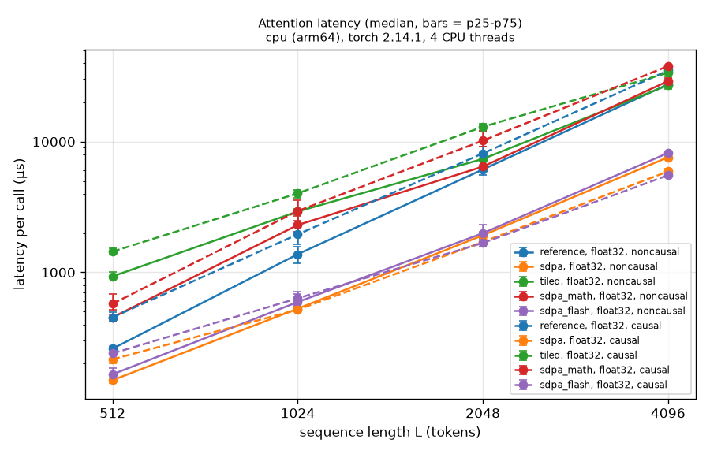
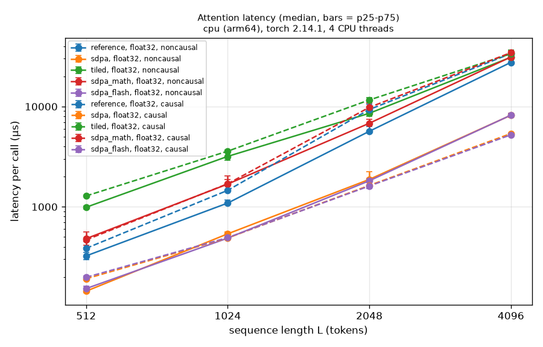
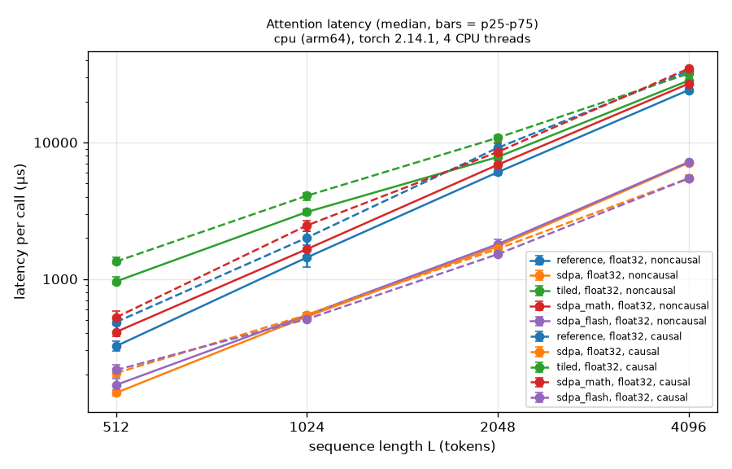
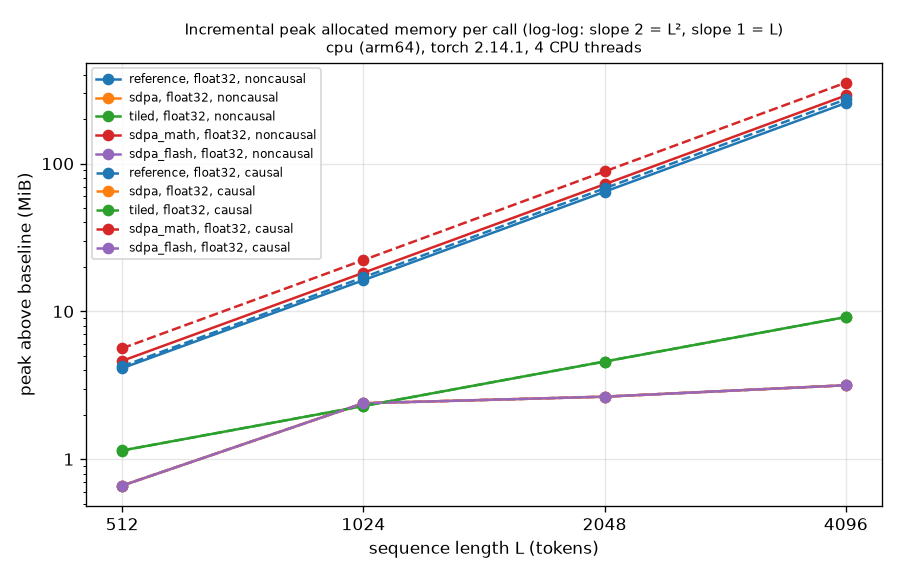
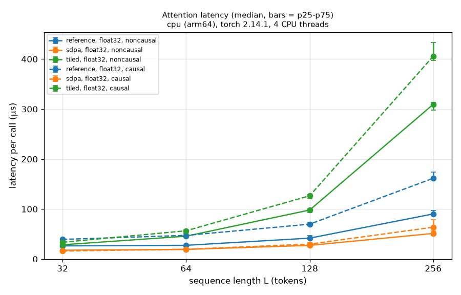
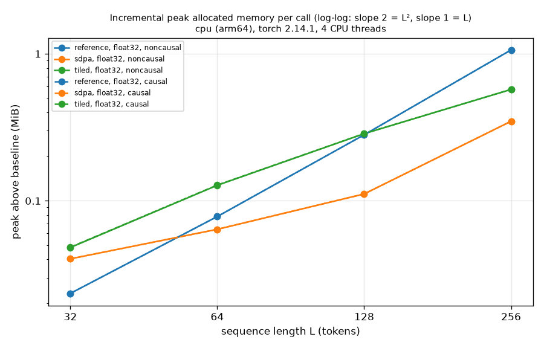
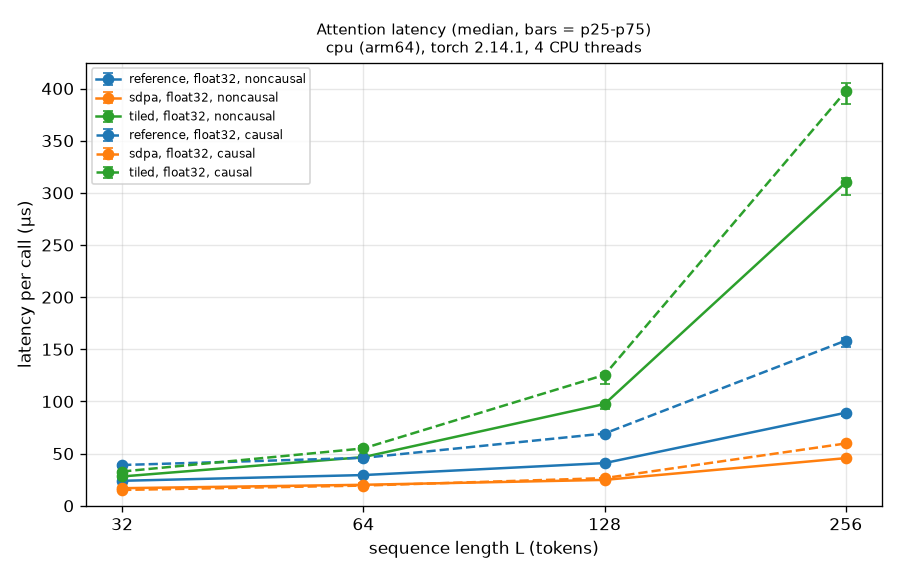
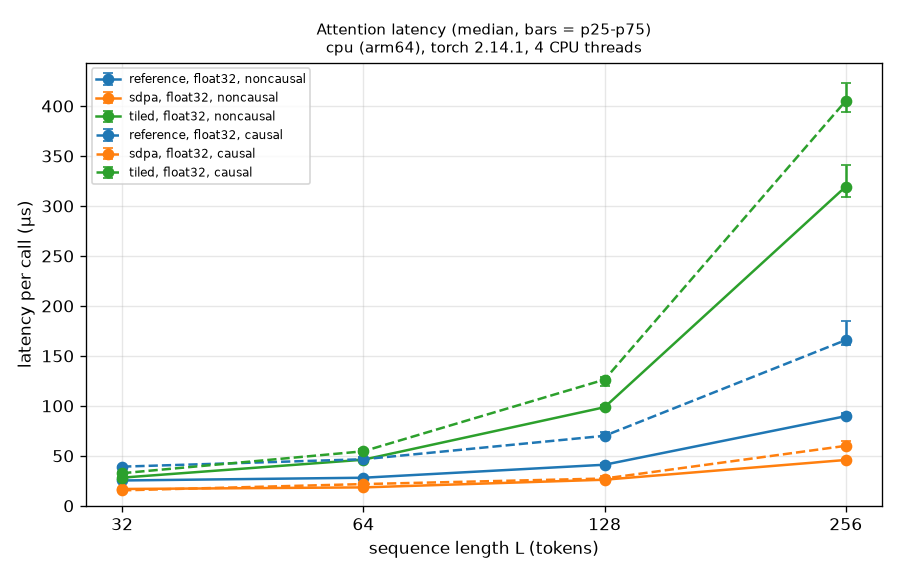
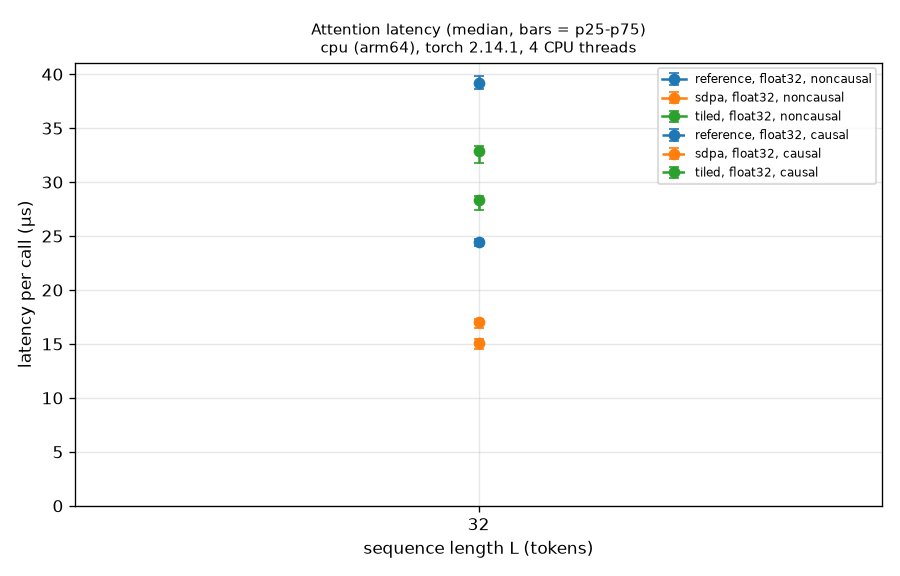
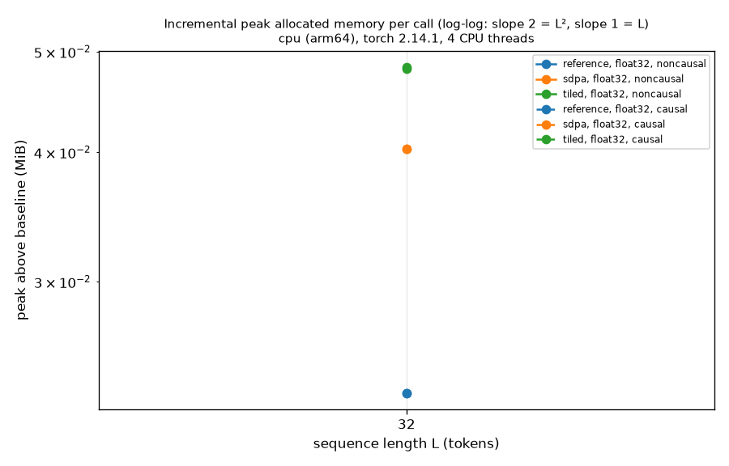

# Attention Lab benchmark report

## `cpu-large-run2.json`

- Environment: cpu (arm64), torch 2.14.1, 4 CPU threads; Python 3.12.13; macOS-27.0.1-arm64-arm-64bit; CUDA runtime None; recorded 2026-10-14T20:45:34+00:00
- Shapes: B=1, H=2, D=32, L in [512, 1024, 2048, 4096]; dtypes ['float32']; seed 0
- Methods: reference, sdpa, tiled, sdpa_math, sdpa_flash, sdpa_efficient; tiled block size 64
- Timing: torch.utils.benchmark.Timer.blocked_autorange(min_run_time=1.0), timer=timeit.default_timer, num_threads=4; sample = mean per-call time of one block; 10 warmup calls per method; unit seconds
- Memory: torch.profiler(profile_memory=True): peak of live CPU-allocator bytes during one call, above the bytes alive before it
- SDPA backend: automatic selection; the kernel that ran is recorded per method as observed_sdpa_ops
- Correctness: each method vs float64 reference; tolerances {'float32': {'atol': 1e-05, 'rtol': 1e-05}}

Reproduce (from the project root, inside the venv):

```bash
python -m attention_lab.benchmark --preset cpu-large --methods reference sdpa tiled sdpa_math sdpa_flash sdpa_efficient --output results/cpu-large-run2.json
```

| L | dtype | mask | method | median µs (IQR) | ref / method | peak MiB | max abs err | correct | SDPA kernel observed |
|---|---|---|---|---|---|---|---|---|---|
| 512 | float32 | noncausal | reference | 260.8 (8.7) | - | 4.12 | 3.2e-07 | yes | - |
| 512 | float32 | noncausal | sdpa | 149.6 (20.6) | 1.74x | 0.66 | 4.2e-07 | yes | _scaled_dot_product_flash_attention_for_cpu |
| 512 | float32 | noncausal | tiled | 931.5 (106.5) | 0.28x | 1.14 | 2.5e-07 | yes | - |
| 512 | float32 | noncausal | sdpa_math | 452.4 (55.0) | 0.58x | 4.63 | 4.1e-07 | yes | _scaled_dot_product_attention_math |
| 512 | float32 | noncausal | sdpa_flash | 166.0 (32.5) | 1.57x | 0.66 | 4.2e-07 | yes | _scaled_dot_product_flash_attention_for_cpu |
| 512 | float32 | noncausal | sdpa_efficient | skipped: RuntimeError: No viable backend for scaled_dot_product_attention was found. This is likely due to turning off both the math kernel and the fused kernels. | | | | | | |
| 512 | float32 | causal | reference | 452.7 (76.6) | - | 4.25 | 4.8e-07 | yes | - |
| 512 | float32 | causal | sdpa | 216.1 (32.6) | 2.09x | 0.66 | 4.8e-07 | yes | _scaled_dot_product_flash_attention_for_cpu |
| 512 | float32 | causal | tiled | 1440.7 (155.9) | 0.31x | 1.15 | 4.9e-07 | yes | - |
| 512 | float32 | causal | sdpa_math | 575.1 (171.1) | 0.79x | 5.63 | 4.7e-07 | yes | _scaled_dot_product_attention_math |
| 512 | float32 | causal | sdpa_flash | 239.7 (54.9) | 1.89x | 0.66 | 4.8e-07 | yes | _scaled_dot_product_flash_attention_for_cpu |
| 512 | float32 | causal | sdpa_efficient | skipped: RuntimeError: No viable backend for scaled_dot_product_attention was found. This is likely due to turning off both the math kernel and the fused kernels. | | | | | | |
| 1024 | float32 | noncausal | reference | 1375.7 (403.3) | - | 16.25 | 3.7e-07 | yes | - |
| 1024 | float32 | noncausal | sdpa | 527.5 (46.5) | 2.61x | 2.39 | 3.3e-07 | yes | _scaled_dot_product_flash_attention_for_cpu |
| 1024 | float32 | noncausal | tiled | 2919.9 (253.8) | 0.47x | 2.29 | 1.8e-07 | yes | - |
| 1024 | float32 | noncausal | sdpa_math | 2300.7 (649.2) | 0.60x | 18.25 | 3.9e-07 | yes | _scaled_dot_product_attention_math |
| 1024 | float32 | noncausal | sdpa_flash | 592.7 (135.8) | 2.32x | 2.39 | 3.3e-07 | yes | _scaled_dot_product_flash_attention_for_cpu |
| 1024 | float32 | noncausal | sdpa_efficient | skipped: RuntimeError: No viable backend for scaled_dot_product_attention was found. This is likely due to turning off both the math kernel and the fused kernels. | | | | | | |
| 1024 | float32 | causal | reference | 1952.7 (658.9) | - | 17.00 | 5.0e-07 | yes | - |
| 1024 | float32 | causal | sdpa | 518.1 (27.0) | 3.77x | 2.39 | 5.1e-07 | yes | _scaled_dot_product_flash_attention_for_cpu |
| 1024 | float32 | causal | tiled | 4020.5 (566.6) | 0.49x | 2.29 | 4.6e-07 | yes | - |
| 1024 | float32 | causal | sdpa_math | 2944.9 (1091.8) | 0.66x | 22.25 | 4.4e-07 | yes | _scaled_dot_product_attention_math |
| 1024 | float32 | causal | sdpa_flash | 633.1 (152.9) | 3.08x | 2.39 | 5.1e-07 | yes | _scaled_dot_product_flash_attention_for_cpu |
| 1024 | float32 | causal | sdpa_efficient | skipped: RuntimeError: No viable backend for scaled_dot_product_attention was found. This is likely due to turning off both the math kernel and the fused kernels. | | | | | | |
| 2048 | float32 | noncausal | reference | 6119.4 (1676.2) | - | 64.50 | 5.7e-07 | yes | - |
| 2048 | float32 | noncausal | sdpa | 1919.6 (202.9) | 3.19x | 2.65 | 4.2e-07 | yes | _scaled_dot_product_flash_attention_for_cpu |
| 2048 | float32 | noncausal | tiled | 7367.2 (954.0) | 0.83x | 4.58 | 1.7e-07 | yes | - |
| 2048 | float32 | noncausal | sdpa_math | 6436.1 (1410.2) | 0.95x | 72.50 | 8.9e-07 | yes | _scaled_dot_product_attention_math |
| 2048 | float32 | noncausal | sdpa_flash | 1991.7 (478.6) | 3.07x | 2.65 | 4.2e-07 | yes | _scaled_dot_product_flash_attention_for_cpu |
| 2048 | float32 | noncausal | sdpa_efficient | skipped: RuntimeError: No viable backend for scaled_dot_product_attention was found. This is likely due to turning off both the math kernel and the fused kernels. | | | | | | |
| 2048 | float32 | causal | reference | 8119.4 (1901.3) | - | 68.00 | 4.5e-07 | yes | - |
| 2048 | float32 | causal | sdpa | 1708.2 (351.5) | 4.75x | 2.65 | 5.9e-07 | yes | _scaled_dot_product_flash_attention_for_cpu |
| 2048 | float32 | causal | tiled | 12970.2 (1613.5) | 0.63x | 4.58 | 5.2e-07 | yes | - |
| 2048 | float32 | causal | sdpa_math | 10168.6 (2983.7) | 0.80x | 88.50 | 5.3e-07 | yes | _scaled_dot_product_attention_math |
| 2048 | float32 | causal | sdpa_flash | 1677.0 (241.6) | 4.84x | 2.65 | 5.9e-07 | yes | _scaled_dot_product_flash_attention_for_cpu |
| 2048 | float32 | causal | sdpa_efficient | skipped: RuntimeError: No viable backend for scaled_dot_product_attention was found. This is likely due to turning off both the math kernel and the fused kernels. | | | | | | |
| 4096 | float32 | noncausal | reference | 27384.2 (3772.0) | - | 257.00 | 4.7e-07 | yes | - |
| 4096 | float32 | noncausal | sdpa | 7587.2 (522.9) | 3.61x | 3.16 | 3.7e-07 | yes | _scaled_dot_product_flash_attention_for_cpu |
| 4096 | float32 | noncausal | tiled | 26980.9 (3491.0) | 1.01x | 9.16 | 1.3e-07 | yes | - |
| 4096 | float32 | noncausal | sdpa_math | 29000.3 (2320.7) | 0.94x | 289.01 | 4.7e-07 | yes | _scaled_dot_product_attention_math |
| 4096 | float32 | noncausal | sdpa_flash | 8184.3 (537.1) | 3.35x | 3.16 | 3.7e-07 | yes | _scaled_dot_product_flash_attention_for_cpu |
| 4096 | float32 | noncausal | sdpa_efficient | skipped: RuntimeError: No viable backend for scaled_dot_product_attention was found. This is likely due to turning off both the math kernel and the fused kernels. | | | | | | |
| 4096 | float32 | causal | reference | 34947.8 (4395.0) | - | 272.00 | 7.4e-07 | yes | - |
| 4096 | float32 | causal | sdpa | 5912.5 (591.5) | 5.91x | 3.16 | 8.3e-07 | yes | _scaled_dot_product_flash_attention_for_cpu |
| 4096 | float32 | causal | tiled | 33587.5 (6697.9) | 1.04x | 9.16 | 7.6e-07 | yes | - |
| 4096 | float32 | causal | sdpa_math | 37789.7 (925.6) | 0.92x | 353.01 | 4.4e-07 | yes | _scaled_dot_product_attention_math |
| 4096 | float32 | causal | sdpa_flash | 5527.0 (503.9) | 6.32x | 3.16 | 8.3e-07 | yes | _scaled_dot_product_flash_attention_for_cpu |
| 4096 | float32 | causal | sdpa_efficient | skipped: RuntimeError: No viable backend for scaled_dot_product_attention was found. This is likely due to turning off both the math kernel and the fused kernels. | | | | | | |




### Observations (computed from this run)

- sdpa vs reference, float32, noncausal: lower median in 4 of 4 configurations; reference/sdpa ratio 1.74x to 3.61x over L = 512, 1024, 2048, 4096.
- tiled vs reference, float32, noncausal: lower median in 1 of 4 configurations; reference/tiled ratio 0.28x to 1.01x over L = 512, 1024, 2048, 4096.
- sdpa_math vs reference, float32, noncausal: lower median in 0 of 4 configurations; reference/sdpa_math ratio 0.58x to 0.95x over L = 512, 1024, 2048, 4096.
- sdpa_flash vs reference, float32, noncausal: lower median in 4 of 4 configurations; reference/sdpa_flash ratio 1.57x to 3.35x over L = 512, 1024, 2048, 4096.
- sdpa vs reference, float32, causal: lower median in 4 of 4 configurations; reference/sdpa ratio 2.09x to 5.91x over L = 512, 1024, 2048, 4096.
- tiled vs reference, float32, causal: lower median in 1 of 4 configurations; reference/tiled ratio 0.31x to 1.04x over L = 512, 1024, 2048, 4096.
- sdpa_math vs reference, float32, causal: lower median in 0 of 4 configurations; reference/sdpa_math ratio 0.66x to 0.92x over L = 512, 1024, 2048, 4096.
- sdpa_flash vs reference, float32, causal: lower median in 4 of 4 configurations; reference/sdpa_flash ratio 1.89x to 6.32x over L = 512, 1024, 2048, 4096.
- sdpa: profiler saw aten::_scaled_dot_product_flash_attention_for_cpu.
- sdpa_math: profiler saw aten::_scaled_dot_product_attention_math.
- sdpa_flash: profiler saw aten::_scaled_dot_product_flash_attention_for_cpu.
- Skipped (reasons in the table): sdpa_efficient at L=512 noncausal; sdpa_efficient at L=512 causal; sdpa_efficient at L=1024 noncausal; sdpa_efficient at L=1024 causal; sdpa_efficient at L=2048 noncausal; sdpa_efficient at L=2048 causal; sdpa_efficient at L=4096 noncausal; sdpa_efficient at L=4096 causal.

Growth across the measured range, compared with linear and quadratic growth in L:

| method | dtype | mask | L range | latency growth | peak-memory growth | L growth | L² growth |
|---|---|---|---|---|---|---|---|
| reference | float32 | noncausal | 512 → 4096 | x105.0 | x62.3 | x8 | x64 |
| sdpa | float32 | noncausal | 512 → 4096 | x50.7 | x4.8 | x8 | x64 |
| tiled | float32 | noncausal | 512 → 4096 | x29.0 | x8.0 | x8 | x64 |
| sdpa_math | float32 | noncausal | 512 → 4096 | x64.1 | x62.5 | x8 | x64 |
| sdpa_flash | float32 | noncausal | 512 → 4096 | x49.3 | x4.8 | x8 | x64 |
| reference | float32 | causal | 512 → 4096 | x77.2 | x64.0 | x8 | x64 |
| sdpa | float32 | causal | 512 → 4096 | x27.4 | x4.8 | x8 | x64 |
| tiled | float32 | causal | 512 → 4096 | x23.3 | x8.0 | x8 | x64 |
| sdpa_math | float32 | causal | 512 → 4096 | x65.7 | x62.7 | x8 | x64 |
| sdpa_flash | float32 | causal | 512 → 4096 | x23.1 | x4.8 | x8 | x64 |

Nominal throughput at L = 4096, noncausal (4·B·H·L²·D FLOPs for the two matmuls ÷ median latency; softmax and masking not counted):

| method | dtype | GFLOP/s |
|---|---|---|
| reference | float32 | 156.8 |
| sdpa | float32 | 566.1 |
| tiled | float32 | 159.2 |
| sdpa_math | float32 | 148.1 |
| sdpa_flash | float32 | 524.8 |

How to read this:
- One run on one machine. Re-run before quoting numbers; compare only rows from the same environment.
- Timings cover one attention call including the identical Python validation in every wrapper;
  input creation, correctness checks, profiling and I/O are excluded. This is not whole-model performance.
- SDPA's backend is chosen automatically; the kernel the profiler saw is listed per row. Forced-backend
  methods (sdpa_math, sdpa_flash, ...) also pay for entering the sdpa_kernel context on every call.
- The score matrix is O(L²), but at small L fixed per-call costs (Python, dispatch, allocation) dominate,
  so latency can grow much more slowly than L².
- The explicit causal reference builds an [L, L] mask on every call. The tiled method loops over key blocks
  in Python, so its per-block overhead is large at small L, and causal does not skip any blocks.
- CPU peak memory comes from torch.profiler allocation events and counts only PyTorch-allocator memory.

## `cpu-large-run3.json`

- Environment: cpu (arm64), torch 2.14.1, 4 CPU threads; Python 3.12.13; macOS-27.0.1-arm64-arm-64bit; CUDA runtime None; recorded 2026-10-14T20:46:24+00:00
- Shapes: B=1, H=2, D=32, L in [512, 1024, 2048, 4096]; dtypes ['float32']; seed 0
- Methods: reference, sdpa, tiled, sdpa_math, sdpa_flash, sdpa_efficient; tiled block size 64
- Timing: torch.utils.benchmark.Timer.blocked_autorange(min_run_time=1.0), timer=timeit.default_timer, num_threads=4; sample = mean per-call time of one block; 10 warmup calls per method; unit seconds
- Memory: torch.profiler(profile_memory=True): peak of live CPU-allocator bytes during one call, above the bytes alive before it
- SDPA backend: automatic selection; the kernel that ran is recorded per method as observed_sdpa_ops
- Correctness: each method vs float64 reference; tolerances {'float32': {'atol': 1e-05, 'rtol': 1e-05}}

Reproduce (from the project root, inside the venv):

```bash
python -m attention_lab.benchmark --preset cpu-large --methods reference sdpa tiled sdpa_math sdpa_flash sdpa_efficient --output results/cpu-large-run3.json
```

| L | dtype | mask | method | median µs (IQR) | ref / method | peak MiB | max abs err | correct | SDPA kernel observed |
|---|---|---|---|---|---|---|---|---|---|
| 512 | float32 | noncausal | reference | 324.2 (52.4) | - | 4.12 | 3.2e-07 | yes | - |
| 512 | float32 | noncausal | sdpa | 144.1 (13.7) | 2.25x | 0.66 | 4.2e-07 | yes | _scaled_dot_product_flash_attention_for_cpu |
| 512 | float32 | noncausal | tiled | 990.5 (68.5) | 0.33x | 1.14 | 2.5e-07 | yes | - |
| 512 | float32 | noncausal | sdpa_math | 481.7 (148.8) | 0.67x | 4.63 | 4.1e-07 | yes | _scaled_dot_product_attention_math |
| 512 | float32 | noncausal | sdpa_flash | 153.1 (12.0) | 2.12x | 0.66 | 4.2e-07 | yes | _scaled_dot_product_flash_attention_for_cpu |
| 512 | float32 | noncausal | sdpa_efficient | skipped: RuntimeError: No viable backend for scaled_dot_product_attention was found. This is likely due to turning off both the math kernel and the fused kernels. | | | | | | |
| 512 | float32 | causal | reference | 385.9 (18.1) | - | 4.25 | 4.8e-07 | yes | - |
| 512 | float32 | causal | sdpa | 191.9 (10.8) | 2.01x | 0.66 | 4.8e-07 | yes | _scaled_dot_product_flash_attention_for_cpu |
| 512 | float32 | causal | tiled | 1284.1 (34.6) | 0.30x | 1.15 | 4.9e-07 | yes | - |
| 512 | float32 | causal | sdpa_math | 467.7 (23.8) | 0.83x | 5.63 | 4.7e-07 | yes | _scaled_dot_product_attention_math |
| 512 | float32 | causal | sdpa_flash | 198.2 (11.4) | 1.95x | 0.66 | 4.8e-07 | yes | _scaled_dot_product_flash_attention_for_cpu |
| 512 | float32 | causal | sdpa_efficient | skipped: RuntimeError: No viable backend for scaled_dot_product_attention was found. This is likely due to turning off both the math kernel and the fused kernels. | | | | | | |
| 1024 | float32 | noncausal | reference | 1090.4 (113.9) | - | 16.25 | 3.7e-07 | yes | - |
| 1024 | float32 | noncausal | sdpa | 537.9 (63.1) | 2.03x | 2.39 | 3.3e-07 | yes | _scaled_dot_product_flash_attention_for_cpu |
| 1024 | float32 | noncausal | tiled | 3184.6 (666.4) | 0.34x | 2.29 | 1.8e-07 | yes | - |
| 1024 | float32 | noncausal | sdpa_math | 1686.5 (554.4) | 0.65x | 18.25 | 3.9e-07 | yes | _scaled_dot_product_attention_math |
| 1024 | float32 | noncausal | sdpa_flash | 487.7 (18.2) | 2.24x | 2.39 | 3.3e-07 | yes | _scaled_dot_product_flash_attention_for_cpu |
| 1024 | float32 | noncausal | sdpa_efficient | skipped: RuntimeError: No viable backend for scaled_dot_product_attention was found. This is likely due to turning off both the math kernel and the fused kernels. | | | | | | |
| 1024 | float32 | causal | reference | 1460.3 (220.6) | - | 17.00 | 5.0e-07 | yes | - |
| 1024 | float32 | causal | sdpa | 489.5 (22.2) | 2.98x | 2.39 | 5.1e-07 | yes | _scaled_dot_product_flash_attention_for_cpu |
| 1024 | float32 | causal | tiled | 3589.6 (206.6) | 0.41x | 2.29 | 4.6e-07 | yes | - |
| 1024 | float32 | causal | sdpa_math | 1698.4 (215.0) | 0.86x | 22.25 | 4.4e-07 | yes | _scaled_dot_product_attention_math |
| 1024 | float32 | causal | sdpa_flash | 493.0 (13.9) | 2.96x | 2.39 | 5.1e-07 | yes | _scaled_dot_product_flash_attention_for_cpu |
| 1024 | float32 | causal | sdpa_efficient | skipped: RuntimeError: No viable backend for scaled_dot_product_attention was found. This is likely due to turning off both the math kernel and the fused kernels. | | | | | | |
| 2048 | float32 | noncausal | reference | 5665.9 (894.5) | - | 64.50 | 5.7e-07 | yes | - |
| 2048 | float32 | noncausal | sdpa | 1876.0 (505.9) | 3.02x | 2.65 | 4.2e-07 | yes | _scaled_dot_product_flash_attention_for_cpu |
| 2048 | float32 | noncausal | tiled | 8564.4 (3285.5) | 0.66x | 4.58 | 1.7e-07 | yes | - |
| 2048 | float32 | noncausal | sdpa_math | 6811.4 (942.7) | 0.83x | 72.50 | 8.9e-07 | yes | _scaled_dot_product_attention_math |
| 2048 | float32 | noncausal | sdpa_flash | 1818.5 (191.1) | 3.12x | 2.65 | 4.2e-07 | yes | _scaled_dot_product_flash_attention_for_cpu |
| 2048 | float32 | noncausal | sdpa_efficient | skipped: RuntimeError: No viable backend for scaled_dot_product_attention was found. This is likely due to turning off both the math kernel and the fused kernels. | | | | | | |
| 2048 | float32 | causal | reference | 9342.3 (1796.5) | - | 68.00 | 4.5e-07 | yes | - |
| 2048 | float32 | causal | sdpa | 1634.5 (259.2) | 5.72x | 2.65 | 5.9e-07 | yes | _scaled_dot_product_flash_attention_for_cpu |
| 2048 | float32 | causal | tiled | 11627.4 (1184.8) | 0.80x | 4.58 | 5.2e-07 | yes | - |
| 2048 | float32 | causal | sdpa_math | 9808.7 (1884.2) | 0.95x | 88.50 | 5.3e-07 | yes | _scaled_dot_product_attention_math |
| 2048 | float32 | causal | sdpa_flash | 1613.0 (232.6) | 5.79x | 2.65 | 5.9e-07 | yes | _scaled_dot_product_flash_attention_for_cpu |
| 2048 | float32 | causal | sdpa_efficient | skipped: RuntimeError: No viable backend for scaled_dot_product_attention was found. This is likely due to turning off both the math kernel and the fused kernels. | | | | | | |
| 4096 | float32 | noncausal | reference | 27577.3 (3578.9) | - | 257.00 | 4.7e-07 | yes | - |
| 4096 | float32 | noncausal | sdpa | 8192.6 (766.1) | 3.37x | 3.16 | 3.7e-07 | yes | _scaled_dot_product_flash_attention_for_cpu |
| 4096 | float32 | noncausal | tiled | 30998.8 (4225.2) | 0.89x | 9.16 | 1.3e-07 | yes | - |
| 4096 | float32 | noncausal | sdpa_math | 31204.5 (2663.1) | 0.88x | 289.01 | 4.7e-07 | yes | _scaled_dot_product_attention_math |
| 4096 | float32 | noncausal | sdpa_flash | 8209.1 (675.6) | 3.36x | 3.16 | 3.7e-07 | yes | _scaled_dot_product_flash_attention_for_cpu |
| 4096 | float32 | noncausal | sdpa_efficient | skipped: RuntimeError: No viable backend for scaled_dot_product_attention was found. This is likely due to turning off both the math kernel and the fused kernels. | | | | | | |
| 4096 | float32 | causal | reference | 33759.5 (1333.3) | - | 272.00 | 7.4e-07 | yes | - |
| 4096 | float32 | causal | sdpa | 5374.6 (205.2) | 6.28x | 3.16 | 8.3e-07 | yes | _scaled_dot_product_flash_attention_for_cpu |
| 4096 | float32 | causal | tiled | 33628.4 (4337.7) | 1.00x | 9.16 | 7.6e-07 | yes | - |
| 4096 | float32 | causal | sdpa_math | 34490.3 (1859.2) | 0.98x | 353.01 | 4.4e-07 | yes | _scaled_dot_product_attention_math |
| 4096 | float32 | causal | sdpa_flash | 5225.9 (186.6) | 6.46x | 3.16 | 8.3e-07 | yes | _scaled_dot_product_flash_attention_for_cpu |
| 4096 | float32 | causal | sdpa_efficient | skipped: RuntimeError: No viable backend for scaled_dot_product_attention was found. This is likely due to turning off both the math kernel and the fused kernels. | | | | | | |




### Observations (computed from this run)

- sdpa vs reference, float32, noncausal: lower median in 4 of 4 configurations; reference/sdpa ratio 2.03x to 3.37x over L = 512, 1024, 2048, 4096.
- tiled vs reference, float32, noncausal: lower median in 0 of 4 configurations; reference/tiled ratio 0.33x to 0.89x over L = 512, 1024, 2048, 4096.
- sdpa_math vs reference, float32, noncausal: lower median in 0 of 4 configurations; reference/sdpa_math ratio 0.65x to 0.88x over L = 512, 1024, 2048, 4096.
- sdpa_flash vs reference, float32, noncausal: lower median in 4 of 4 configurations; reference/sdpa_flash ratio 2.12x to 3.36x over L = 512, 1024, 2048, 4096.
- sdpa vs reference, float32, causal: lower median in 4 of 4 configurations; reference/sdpa ratio 2.01x to 6.28x over L = 512, 1024, 2048, 4096.
- tiled vs reference, float32, causal: lower median in 1 of 4 configurations; reference/tiled ratio 0.30x to 1.00x over L = 512, 1024, 2048, 4096.
- sdpa_math vs reference, float32, causal: lower median in 0 of 4 configurations; reference/sdpa_math ratio 0.83x to 0.98x over L = 512, 1024, 2048, 4096.
- sdpa_flash vs reference, float32, causal: lower median in 4 of 4 configurations; reference/sdpa_flash ratio 1.95x to 6.46x over L = 512, 1024, 2048, 4096.
- sdpa: profiler saw aten::_scaled_dot_product_flash_attention_for_cpu.
- sdpa_math: profiler saw aten::_scaled_dot_product_attention_math.
- sdpa_flash: profiler saw aten::_scaled_dot_product_flash_attention_for_cpu.
- Skipped (reasons in the table): sdpa_efficient at L=512 noncausal; sdpa_efficient at L=512 causal; sdpa_efficient at L=1024 noncausal; sdpa_efficient at L=1024 causal; sdpa_efficient at L=2048 noncausal; sdpa_efficient at L=2048 causal; sdpa_efficient at L=4096 noncausal; sdpa_efficient at L=4096 causal.

Growth across the measured range, compared with linear and quadratic growth in L:

| method | dtype | mask | L range | latency growth | peak-memory growth | L growth | L² growth |
|---|---|---|---|---|---|---|---|
| reference | float32 | noncausal | 512 → 4096 | x85.1 | x62.3 | x8 | x64 |
| sdpa | float32 | noncausal | 512 → 4096 | x56.8 | x4.8 | x8 | x64 |
| tiled | float32 | noncausal | 512 → 4096 | x31.3 | x8.0 | x8 | x64 |
| sdpa_math | float32 | noncausal | 512 → 4096 | x64.8 | x62.5 | x8 | x64 |
| sdpa_flash | float32 | noncausal | 512 → 4096 | x53.6 | x4.8 | x8 | x64 |
| reference | float32 | causal | 512 → 4096 | x87.5 | x64.0 | x8 | x64 |
| sdpa | float32 | causal | 512 → 4096 | x28.0 | x4.8 | x8 | x64 |
| tiled | float32 | causal | 512 → 4096 | x26.2 | x8.0 | x8 | x64 |
| sdpa_math | float32 | causal | 512 → 4096 | x73.8 | x62.7 | x8 | x64 |
| sdpa_flash | float32 | causal | 512 → 4096 | x26.4 | x4.8 | x8 | x64 |

Nominal throughput at L = 4096, noncausal (4·B·H·L²·D FLOPs for the two matmuls ÷ median latency; softmax and masking not counted):

| method | dtype | GFLOP/s |
|---|---|---|
| reference | float32 | 155.7 |
| sdpa | float32 | 524.2 |
| tiled | float32 | 138.6 |
| sdpa_math | float32 | 137.6 |
| sdpa_flash | float32 | 523.2 |

How to read this:
- One run on one machine. Re-run before quoting numbers; compare only rows from the same environment.
- Timings cover one attention call including the identical Python validation in every wrapper;
  input creation, correctness checks, profiling and I/O are excluded. This is not whole-model performance.
- SDPA's backend is chosen automatically; the kernel the profiler saw is listed per row. Forced-backend
  methods (sdpa_math, sdpa_flash, ...) also pay for entering the sdpa_kernel context on every call.
- The score matrix is O(L²), but at small L fixed per-call costs (Python, dispatch, allocation) dominate,
  so latency can grow much more slowly than L².
- The explicit causal reference builds an [L, L] mask on every call. The tiled method loops over key blocks
  in Python, so its per-block overhead is large at small L, and causal does not skip any blocks.
- CPU peak memory comes from torch.profiler allocation events and counts only PyTorch-allocator memory.

## `cpu-large.json`

- Environment: cpu (arm64), torch 2.14.1, 4 CPU threads; Python 3.12.13; macOS-27.0.1-arm64-arm-64bit; CUDA runtime None; recorded 2026-10-14T20:44:45+00:00
- Shapes: B=1, H=2, D=32, L in [512, 1024, 2048, 4096]; dtypes ['float32']; seed 0
- Methods: reference, sdpa, tiled, sdpa_math, sdpa_flash, sdpa_efficient; tiled block size 64
- Timing: torch.utils.benchmark.Timer.blocked_autorange(min_run_time=1.0), timer=timeit.default_timer, num_threads=4; sample = mean per-call time of one block; 10 warmup calls per method; unit seconds
- Memory: torch.profiler(profile_memory=True): peak of live CPU-allocator bytes during one call, above the bytes alive before it
- SDPA backend: automatic selection; the kernel that ran is recorded per method as observed_sdpa_ops
- Correctness: each method vs float64 reference; tolerances {'float32': {'atol': 1e-05, 'rtol': 1e-05}}

Reproduce (from the project root, inside the venv):

```bash
python -m attention_lab.benchmark --preset cpu-large --methods reference sdpa tiled sdpa_math sdpa_flash sdpa_efficient --output results/cpu-large.json
```

| L | dtype | mask | method | median µs (IQR) | ref / method | peak MiB | max abs err | correct | SDPA kernel observed |
|---|---|---|---|---|---|---|---|---|---|
| 512 | float32 | noncausal | reference | 322.6 (57.1) | - | 4.12 | 3.2e-07 | yes | - |
| 512 | float32 | noncausal | sdpa | 146.8 (22.0) | 2.20x | 0.66 | 4.2e-07 | yes | _scaled_dot_product_flash_attention_for_cpu |
| 512 | float32 | noncausal | tiled | 960.6 (119.6) | 0.34x | 1.14 | 2.5e-07 | yes | - |
| 512 | float32 | noncausal | sdpa_math | 409.7 (85.0) | 0.79x | 4.63 | 4.1e-07 | yes | _scaled_dot_product_attention_math |
| 512 | float32 | noncausal | sdpa_flash | 167.7 (32.3) | 1.92x | 0.66 | 4.2e-07 | yes | _scaled_dot_product_flash_attention_for_cpu |
| 512 | float32 | noncausal | sdpa_efficient | skipped: RuntimeError: No viable backend for scaled_dot_product_attention was found. This is likely due to turning off both the math kernel and the fused kernels. | | | | | | |
| 512 | float32 | causal | reference | 483.5 (53.0) | - | 4.25 | 4.8e-07 | yes | - |
| 512 | float32 | causal | sdpa | 204.6 (27.5) | 2.36x | 0.66 | 4.8e-07 | yes | _scaled_dot_product_flash_attention_for_cpu |
| 512 | float32 | causal | tiled | 1343.2 (150.9) | 0.36x | 1.15 | 4.9e-07 | yes | - |
| 512 | float32 | causal | sdpa_math | 524.0 (105.9) | 0.92x | 5.63 | 4.7e-07 | yes | _scaled_dot_product_attention_math |
| 512 | float32 | causal | sdpa_flash | 215.5 (35.4) | 2.24x | 0.66 | 4.8e-07 | yes | _scaled_dot_product_flash_attention_for_cpu |
| 512 | float32 | causal | sdpa_efficient | skipped: RuntimeError: No viable backend for scaled_dot_product_attention was found. This is likely due to turning off both the math kernel and the fused kernels. | | | | | | |
| 1024 | float32 | noncausal | reference | 1439.9 (356.2) | - | 16.25 | 3.7e-07 | yes | - |
| 1024 | float32 | noncausal | sdpa | 531.6 (53.9) | 2.71x | 2.39 | 3.3e-07 | yes | _scaled_dot_product_flash_attention_for_cpu |
| 1024 | float32 | noncausal | tiled | 3098.1 (324.7) | 0.46x | 2.29 | 1.8e-07 | yes | - |
| 1024 | float32 | noncausal | sdpa_math | 1657.3 (451.7) | 0.87x | 18.25 | 3.9e-07 | yes | _scaled_dot_product_attention_math |
| 1024 | float32 | noncausal | sdpa_flash | 545.3 (44.8) | 2.64x | 2.39 | 3.3e-07 | yes | _scaled_dot_product_flash_attention_for_cpu |
| 1024 | float32 | noncausal | sdpa_efficient | skipped: RuntimeError: No viable backend for scaled_dot_product_attention was found. This is likely due to turning off both the math kernel and the fused kernels. | | | | | | |
| 1024 | float32 | causal | reference | 2010.5 (458.8) | - | 17.00 | 5.0e-07 | yes | - |
| 1024 | float32 | causal | sdpa | 546.7 (39.5) | 3.68x | 2.39 | 5.1e-07 | yes | _scaled_dot_product_flash_attention_for_cpu |
| 1024 | float32 | causal | tiled | 4075.5 (501.8) | 0.49x | 2.29 | 4.6e-07 | yes | - |
| 1024 | float32 | causal | sdpa_math | 2469.4 (447.7) | 0.81x | 22.25 | 4.4e-07 | yes | _scaled_dot_product_attention_math |
| 1024 | float32 | causal | sdpa_flash | 509.0 (42.0) | 3.95x | 2.39 | 5.1e-07 | yes | _scaled_dot_product_flash_attention_for_cpu |
| 1024 | float32 | causal | sdpa_efficient | skipped: RuntimeError: No viable backend for scaled_dot_product_attention was found. This is likely due to turning off both the math kernel and the fused kernels. | | | | | | |
| 2048 | float32 | noncausal | reference | 6064.0 (895.6) | - | 64.50 | 5.7e-07 | yes | - |
| 2048 | float32 | noncausal | sdpa | 1741.5 (109.1) | 3.48x | 2.65 | 4.2e-07 | yes | _scaled_dot_product_flash_attention_for_cpu |
| 2048 | float32 | noncausal | tiled | 7835.8 (904.8) | 0.77x | 4.58 | 1.7e-07 | yes | - |
| 2048 | float32 | noncausal | sdpa_math | 6875.4 (1195.1) | 0.88x | 72.50 | 8.9e-07 | yes | _scaled_dot_product_attention_math |
| 2048 | float32 | noncausal | sdpa_flash | 1803.3 (236.1) | 3.36x | 2.65 | 4.2e-07 | yes | _scaled_dot_product_flash_attention_for_cpu |
| 2048 | float32 | noncausal | sdpa_efficient | skipped: RuntimeError: No viable backend for scaled_dot_product_attention was found. This is likely due to turning off both the math kernel and the fused kernels. | | | | | | |
| 2048 | float32 | causal | reference | 9145.0 (2336.2) | - | 68.00 | 4.5e-07 | yes | - |
| 2048 | float32 | causal | sdpa | 1666.4 (243.0) | 5.49x | 2.65 | 5.9e-07 | yes | _scaled_dot_product_flash_attention_for_cpu |
| 2048 | float32 | causal | tiled | 10832.1 (1337.5) | 0.84x | 4.58 | 5.2e-07 | yes | - |
| 2048 | float32 | causal | sdpa_math | 8531.0 (1790.3) | 1.07x | 88.50 | 5.3e-07 | yes | _scaled_dot_product_attention_math |
| 2048 | float32 | causal | sdpa_flash | 1520.4 (69.0) | 6.01x | 2.65 | 5.9e-07 | yes | _scaled_dot_product_flash_attention_for_cpu |
| 2048 | float32 | causal | sdpa_efficient | skipped: RuntimeError: No viable backend for scaled_dot_product_attention was found. This is likely due to turning off both the math kernel and the fused kernels. | | | | | | |
| 4096 | float32 | noncausal | reference | 24229.7 (1672.1) | - | 257.00 | 4.7e-07 | yes | - |
| 4096 | float32 | noncausal | sdpa | 7096.4 (370.3) | 3.41x | 3.16 | 3.7e-07 | yes | _scaled_dot_product_flash_attention_for_cpu |
| 4096 | float32 | noncausal | tiled | 28415.0 (3372.4) | 0.85x | 9.16 | 1.3e-07 | yes | - |
| 4096 | float32 | noncausal | sdpa_math | 26959.2 (1315.9) | 0.90x | 289.01 | 4.7e-07 | yes | _scaled_dot_product_attention_math |
| 4096 | float32 | noncausal | sdpa_flash | 7196.2 (331.3) | 3.37x | 3.16 | 3.7e-07 | yes | _scaled_dot_product_flash_attention_for_cpu |
| 4096 | float32 | noncausal | sdpa_efficient | skipped: RuntimeError: No viable backend for scaled_dot_product_attention was found. This is likely due to turning off both the math kernel and the fused kernels. | | | | | | |
| 4096 | float32 | causal | reference | 33360.1 (1178.4) | - | 272.00 | 7.4e-07 | yes | - |
| 4096 | float32 | causal | sdpa | 5467.0 (535.1) | 6.10x | 3.16 | 8.3e-07 | yes | _scaled_dot_product_flash_attention_for_cpu |
| 4096 | float32 | causal | tiled | 31990.0 (1035.2) | 1.04x | 9.16 | 7.6e-07 | yes | - |
| 4096 | float32 | causal | sdpa_math | 34787.9 (1246.1) | 0.96x | 353.01 | 4.4e-07 | yes | _scaled_dot_product_attention_math |
| 4096 | float32 | causal | sdpa_flash | 5459.3 (359.4) | 6.11x | 3.16 | 8.3e-07 | yes | _scaled_dot_product_flash_attention_for_cpu |
| 4096 | float32 | causal | sdpa_efficient | skipped: RuntimeError: No viable backend for scaled_dot_product_attention was found. This is likely due to turning off both the math kernel and the fused kernels. | | | | | | |





### Observations (computed from this run)

- sdpa vs reference, float32, noncausal: lower median in 4 of 4 configurations; reference/sdpa ratio 2.20x to 3.48x over L = 512, 1024, 2048, 4096.
- tiled vs reference, float32, noncausal: lower median in 0 of 4 configurations; reference/tiled ratio 0.34x to 0.85x over L = 512, 1024, 2048, 4096.
- sdpa_math vs reference, float32, noncausal: lower median in 0 of 4 configurations; reference/sdpa_math ratio 0.79x to 0.90x over L = 512, 1024, 2048, 4096.
- sdpa_flash vs reference, float32, noncausal: lower median in 4 of 4 configurations; reference/sdpa_flash ratio 1.92x to 3.37x over L = 512, 1024, 2048, 4096.
- sdpa vs reference, float32, causal: lower median in 4 of 4 configurations; reference/sdpa ratio 2.36x to 6.10x over L = 512, 1024, 2048, 4096.
- tiled vs reference, float32, causal: lower median in 1 of 4 configurations; reference/tiled ratio 0.36x to 1.04x over L = 512, 1024, 2048, 4096.
- sdpa_math vs reference, float32, causal: lower median in 1 of 4 configurations; reference/sdpa_math ratio 0.81x to 1.07x over L = 512, 1024, 2048, 4096.
- sdpa_flash vs reference, float32, causal: lower median in 4 of 4 configurations; reference/sdpa_flash ratio 2.24x to 6.11x over L = 512, 1024, 2048, 4096.
- sdpa: profiler saw aten::_scaled_dot_product_flash_attention_for_cpu.
- sdpa_math: profiler saw aten::_scaled_dot_product_attention_math.
- sdpa_flash: profiler saw aten::_scaled_dot_product_flash_attention_for_cpu.
- Skipped (reasons in the table): sdpa_efficient at L=512 noncausal; sdpa_efficient at L=512 causal; sdpa_efficient at L=1024 noncausal; sdpa_efficient at L=1024 causal; sdpa_efficient at L=2048 noncausal; sdpa_efficient at L=2048 causal; sdpa_efficient at L=4096 noncausal; sdpa_efficient at L=4096 causal.

Growth across the measured range, compared with linear and quadratic growth in L:

| method | dtype | mask | L range | latency growth | peak-memory growth | L growth | L² growth |
|---|---|---|---|---|---|---|---|
| reference | float32 | noncausal | 512 → 4096 | x75.1 | x62.3 | x8 | x64 |
| sdpa | float32 | noncausal | 512 → 4096 | x48.3 | x4.8 | x8 | x64 |
| tiled | float32 | noncausal | 512 → 4096 | x29.6 | x8.0 | x8 | x64 |
| sdpa_math | float32 | noncausal | 512 → 4096 | x65.8 | x62.5 | x8 | x64 |
| sdpa_flash | float32 | noncausal | 512 → 4096 | x42.9 | x4.8 | x8 | x64 |
| reference | float32 | causal | 512 → 4096 | x69.0 | x64.0 | x8 | x64 |
| sdpa | float32 | causal | 512 → 4096 | x26.7 | x4.8 | x8 | x64 |
| tiled | float32 | causal | 512 → 4096 | x23.8 | x8.0 | x8 | x64 |
| sdpa_math | float32 | causal | 512 → 4096 | x66.4 | x62.7 | x8 | x64 |
| sdpa_flash | float32 | causal | 512 → 4096 | x25.3 | x4.8 | x8 | x64 |

Nominal throughput at L = 4096, noncausal (4·B·H·L²·D FLOPs for the two matmuls ÷ median latency; softmax and masking not counted):

| method | dtype | GFLOP/s |
|---|---|---|
| reference | float32 | 177.3 |
| sdpa | float32 | 605.2 |
| tiled | float32 | 151.2 |
| sdpa_math | float32 | 159.3 |
| sdpa_flash | float32 | 596.8 |

How to read this:
- One run on one machine. Re-run before quoting numbers; compare only rows from the same environment.
- Timings cover one attention call including the identical Python validation in every wrapper;
  input creation, correctness checks, profiling and I/O are excluded. This is not whole-model performance.
- SDPA's backend is chosen automatically; the kernel the profiler saw is listed per row. Forced-backend
  methods (sdpa_math, sdpa_flash, ...) also pay for entering the sdpa_kernel context on every call.
- The score matrix is O(L²), but at small L fixed per-call costs (Python, dispatch, allocation) dominate,
  so latency can grow much more slowly than L².
- The explicit causal reference builds an [L, L] mask on every call. The tiled method loops over key blocks
  in Python, so its per-block overhead is large at small L, and causal does not skip any blocks.
- CPU peak memory comes from torch.profiler allocation events and counts only PyTorch-allocator memory.

## `cpu-sweep-run2.json`

- Environment: cpu (arm64), torch 2.14.1, 4 CPU threads; Python 3.12.13; macOS-27.0.1-arm64-arm-64bit; CUDA runtime None; recorded 2026-10-14T20:44:27+00:00
- Shapes: B=1, H=2, D=32, L in [32, 64, 128, 256]; dtypes ['float32']; seed 0
- Methods: reference, sdpa, tiled; tiled block size 64
- Timing: torch.utils.benchmark.Timer.blocked_autorange(min_run_time=0.2), timer=timeit.default_timer, num_threads=4; sample = mean per-call time of one block; 10 warmup calls per method; unit seconds
- Memory: torch.profiler(profile_memory=True): peak of live CPU-allocator bytes during one call, above the bytes alive before it
- SDPA backend: automatic selection; the kernel that ran is recorded per method as observed_sdpa_ops
- Correctness: each method vs float64 reference; tolerances {'float32': {'atol': 1e-05, 'rtol': 1e-05}}

Reproduce (from the project root, inside the venv):

```bash
python -m attention_lab.benchmark --preset cpu-sweep --output results/cpu-sweep-run2.json
```

| L | dtype | mask | method | median µs (IQR) | ref / method | peak MiB | max abs err | correct | SDPA kernel observed |
|---|---|---|---|---|---|---|---|---|---|
| 32 | float32 | noncausal | reference | 26.4 (2.9) | - | 0.02 | 2.6e-07 | yes | - |
| 32 | float32 | noncausal | sdpa | 17.7 (1.3) | 1.49x | 0.04 | 2.9e-07 | yes | _scaled_dot_product_flash_attention_for_cpu |
| 32 | float32 | noncausal | tiled | 28.5 (2.2) | 0.92x | 0.05 | 2.9e-07 | yes | - |
| 32 | float32 | causal | reference | 39.3 (2.8) | - | 0.02 | 3.6e-07 | yes | - |
| 32 | float32 | causal | sdpa | 16.1 (2.1) | 2.44x | 0.04 | 3.1e-07 | yes | _scaled_dot_product_flash_attention_for_cpu |
| 32 | float32 | causal | tiled | 33.5 (2.0) | 1.17x | 0.05 | 4.6e-07 | yes | - |
| 64 | float32 | noncausal | reference | 27.5 (2.1) | - | 0.08 | 5.4e-07 | yes | - |
| 64 | float32 | noncausal | sdpa | 19.3 (2.9) | 1.42x | 0.06 | 3.4e-07 | yes | _scaled_dot_product_flash_attention_for_cpu |
| 64 | float32 | noncausal | tiled | 45.7 (1.9) | 0.60x | 0.13 | 6.0e-07 | yes | - |
| 64 | float32 | causal | reference | 47.3 (5.3) | - | 0.08 | 5.0e-07 | yes | - |
| 64 | float32 | causal | sdpa | 19.6 (2.6) | 2.42x | 0.06 | 2.5e-07 | yes | _scaled_dot_product_flash_attention_for_cpu |
| 64 | float32 | causal | tiled | 56.5 (4.8) | 0.84x | 0.13 | 3.2e-07 | yes | - |
| 128 | float32 | noncausal | reference | 41.8 (6.8) | - | 0.28 | 3.8e-07 | yes | - |
| 128 | float32 | noncausal | sdpa | 27.3 (5.4) | 1.53x | 0.11 | 3.6e-07 | yes | _scaled_dot_product_flash_attention_for_cpu |
| 128 | float32 | noncausal | tiled | 98.1 (7.2) | 0.43x | 0.29 | 3.7e-07 | yes | - |
| 128 | float32 | causal | reference | 69.8 (7.6) | - | 0.28 | 6.7e-07 | yes | - |
| 128 | float32 | causal | sdpa | 29.8 (6.6) | 2.34x | 0.11 | 4.9e-07 | yes | _scaled_dot_product_flash_attention_for_cpu |
| 128 | float32 | causal | tiled | 126.5 (8.3) | 0.55x | 0.29 | 6.7e-07 | yes | - |
| 256 | float32 | noncausal | reference | 90.2 (8.5) | - | 1.06 | 3.7e-07 | yes | - |
| 256 | float32 | noncausal | sdpa | 51.2 (9.3) | 1.76x | 0.35 | 3.5e-07 | yes | _scaled_dot_product_flash_attention_for_cpu |
| 256 | float32 | noncausal | tiled | 309.4 (15.5) | 0.29x | 0.57 | 1.8e-07 | yes | - |
| 256 | float32 | causal | reference | 161.6 (14.7) | - | 1.06 | 5.3e-07 | yes | - |
| 256 | float32 | causal | sdpa | 63.7 (18.5) | 2.54x | 0.35 | 4.7e-07 | yes | _scaled_dot_product_flash_attention_for_cpu |
| 256 | float32 | causal | tiled | 405.7 (36.1) | 0.40x | 0.57 | 4.7e-07 | yes | - |





### Observations (computed from this run)

- sdpa vs reference, float32, noncausal: lower median in 4 of 4 configurations; reference/sdpa ratio 1.42x to 1.76x over L = 32, 64, 128, 256.
- tiled vs reference, float32, noncausal: lower median in 0 of 4 configurations; reference/tiled ratio 0.29x to 0.92x over L = 32, 64, 128, 256.
- sdpa vs reference, float32, causal: lower median in 4 of 4 configurations; reference/sdpa ratio 2.34x to 2.54x over L = 32, 64, 128, 256.
- tiled vs reference, float32, causal: lower median in 1 of 4 configurations; reference/tiled ratio 0.40x to 1.17x over L = 32, 64, 128, 256.
- sdpa: profiler saw aten::_scaled_dot_product_flash_attention_for_cpu.

Growth across the measured range, compared with linear and quadratic growth in L:

| method | dtype | mask | L range | latency growth | peak-memory growth | L growth | L² growth |
|---|---|---|---|---|---|---|---|
| reference | float32 | noncausal | 32 → 256 | x3.4 | x45.3 | x8 | x64 |
| sdpa | float32 | noncausal | 32 → 256 | x2.9 | x8.6 | x8 | x64 |
| tiled | float32 | noncausal | 32 → 256 | x10.9 | x11.9 | x8 | x64 |
| reference | float32 | causal | 32 → 256 | x4.1 | x45.3 | x8 | x64 |
| sdpa | float32 | causal | 32 → 256 | x4.0 | x8.6 | x8 | x64 |
| tiled | float32 | causal | 32 → 256 | x12.1 | x11.8 | x8 | x64 |

Nominal throughput at L = 256, noncausal (4·B·H·L²·D FLOPs for the two matmuls ÷ median latency; softmax and masking not counted):

| method | dtype | GFLOP/s |
|---|---|---|
| reference | float32 | 185.9 |
| sdpa | float32 | 327.6 |
| tiled | float32 | 54.2 |

How to read this:
- One run on one machine. Re-run before quoting numbers; compare only rows from the same environment.
- Timings cover one attention call including the identical Python validation in every wrapper;
  input creation, correctness checks, profiling and I/O are excluded. This is not whole-model performance.
- SDPA's backend is chosen automatically; the kernel the profiler saw is listed per row. Forced-backend
  methods (sdpa_math, sdpa_flash, ...) also pay for entering the sdpa_kernel context on every call.
- The score matrix is O(L²), but at small L fixed per-call costs (Python, dispatch, allocation) dominate,
  so latency can grow much more slowly than L².
- The explicit causal reference builds an [L, L] mask on every call. The tiled method loops over key blocks
  in Python, so its per-block overhead is large at small L, and causal does not skip any blocks.
- CPU peak memory comes from torch.profiler allocation events and counts only PyTorch-allocator memory.

## `cpu-sweep-run3.json`

- Environment: cpu (arm64), torch 2.14.1, 4 CPU threads; Python 3.12.13; macOS-27.0.1-arm64-arm-64bit; CUDA runtime None; recorded 2026-10-14T20:44:36+00:00
- Shapes: B=1, H=2, D=32, L in [32, 64, 128, 256]; dtypes ['float32']; seed 0
- Methods: reference, sdpa, tiled; tiled block size 64
- Timing: torch.utils.benchmark.Timer.blocked_autorange(min_run_time=0.2), timer=timeit.default_timer, num_threads=4; sample = mean per-call time of one block; 10 warmup calls per method; unit seconds
- Memory: torch.profiler(profile_memory=True): peak of live CPU-allocator bytes during one call, above the bytes alive before it
- SDPA backend: automatic selection; the kernel that ran is recorded per method as observed_sdpa_ops
- Correctness: each method vs float64 reference; tolerances {'float32': {'atol': 1e-05, 'rtol': 1e-05}}

Reproduce (from the project root, inside the venv):

```bash
python -m attention_lab.benchmark --preset cpu-sweep --output results/cpu-sweep-run3.json
```

| L | dtype | mask | method | median µs (IQR) | ref / method | peak MiB | max abs err | correct | SDPA kernel observed |
|---|---|---|---|---|---|---|---|---|---|
| 32 | float32 | noncausal | reference | 24.0 (1.1) | - | 0.02 | 2.6e-07 | yes | - |
| 32 | float32 | noncausal | sdpa | 16.9 (1.1) | 1.42x | 0.04 | 2.9e-07 | yes | _scaled_dot_product_flash_attention_for_cpu |
| 32 | float32 | noncausal | tiled | 28.1 (2.2) | 0.85x | 0.05 | 2.9e-07 | yes | - |
| 32 | float32 | causal | reference | 39.1 (2.5) | - | 0.02 | 3.6e-07 | yes | - |
| 32 | float32 | causal | sdpa | 15.2 (1.2) | 2.57x | 0.04 | 3.1e-07 | yes | _scaled_dot_product_flash_attention_for_cpu |
| 32 | float32 | causal | tiled | 32.9 (2.0) | 1.19x | 0.05 | 4.6e-07 | yes | - |
| 64 | float32 | noncausal | reference | 29.5 (2.7) | - | 0.08 | 5.4e-07 | yes | - |
| 64 | float32 | noncausal | sdpa | 20.1 (2.3) | 1.46x | 0.06 | 3.4e-07 | yes | _scaled_dot_product_flash_attention_for_cpu |
| 64 | float32 | noncausal | tiled | 46.7 (2.7) | 0.63x | 0.13 | 6.0e-07 | yes | - |
| 64 | float32 | causal | reference | 45.9 (3.8) | - | 0.08 | 5.0e-07 | yes | - |
| 64 | float32 | causal | sdpa | 19.4 (2.0) | 2.37x | 0.06 | 2.5e-07 | yes | _scaled_dot_product_flash_attention_for_cpu |
| 64 | float32 | causal | tiled | 55.0 (4.1) | 0.84x | 0.13 | 3.2e-07 | yes | - |
| 128 | float32 | noncausal | reference | 40.9 (1.8) | - | 0.28 | 3.8e-07 | yes | - |
| 128 | float32 | noncausal | sdpa | 24.8 (2.3) | 1.65x | 0.11 | 3.6e-07 | yes | _scaled_dot_product_flash_attention_for_cpu |
| 128 | float32 | noncausal | tiled | 97.6 (6.1) | 0.42x | 0.29 | 3.7e-07 | yes | - |
| 128 | float32 | causal | reference | 69.3 (2.9) | - | 0.28 | 6.7e-07 | yes | - |
| 128 | float32 | causal | sdpa | 26.5 (1.8) | 2.61x | 0.11 | 4.9e-07 | yes | _scaled_dot_product_flash_attention_for_cpu |
| 128 | float32 | causal | tiled | 125.5 (10.4) | 0.55x | 0.29 | 6.7e-07 | yes | - |
| 256 | float32 | noncausal | reference | 89.2 (4.2) | - | 1.06 | 3.7e-07 | yes | - |
| 256 | float32 | noncausal | sdpa | 45.7 (1.0) | 1.95x | 0.35 | 3.5e-07 | yes | _scaled_dot_product_flash_attention_for_cpu |
| 256 | float32 | noncausal | tiled | 310.0 (15.6) | 0.29x | 0.57 | 1.8e-07 | yes | - |
| 256 | float32 | causal | reference | 158.4 (8.0) | - | 1.06 | 5.3e-07 | yes | - |
| 256 | float32 | causal | sdpa | 59.8 (1.3) | 2.65x | 0.35 | 4.7e-07 | yes | _scaled_dot_product_flash_attention_for_cpu |
| 256 | float32 | causal | tiled | 397.4 (20.2) | 0.40x | 0.57 | 4.7e-07 | yes | - |




### Observations (computed from this run)

- sdpa vs reference, float32, noncausal: lower median in 4 of 4 configurations; reference/sdpa ratio 1.42x to 1.95x over L = 32, 64, 128, 256.
- tiled vs reference, float32, noncausal: lower median in 0 of 4 configurations; reference/tiled ratio 0.29x to 0.85x over L = 32, 64, 128, 256.
- sdpa vs reference, float32, causal: lower median in 4 of 4 configurations; reference/sdpa ratio 2.37x to 2.65x over L = 32, 64, 128, 256.
- tiled vs reference, float32, causal: lower median in 1 of 4 configurations; reference/tiled ratio 0.40x to 1.19x over L = 32, 64, 128, 256.
- sdpa: profiler saw aten::_scaled_dot_product_flash_attention_for_cpu.

Growth across the measured range, compared with linear and quadratic growth in L:

| method | dtype | mask | L range | latency growth | peak-memory growth | L growth | L² growth |
|---|---|---|---|---|---|---|---|
| reference | float32 | noncausal | 32 → 256 | x3.7 | x45.3 | x8 | x64 |
| sdpa | float32 | noncausal | 32 → 256 | x2.7 | x8.6 | x8 | x64 |
| tiled | float32 | noncausal | 32 → 256 | x11.0 | x11.9 | x8 | x64 |
| reference | float32 | causal | 32 → 256 | x4.1 | x45.3 | x8 | x64 |
| sdpa | float32 | causal | 32 → 256 | x3.9 | x8.6 | x8 | x64 |
| tiled | float32 | causal | 32 → 256 | x12.1 | x11.8 | x8 | x64 |

Nominal throughput at L = 256, noncausal (4·B·H·L²·D FLOPs for the two matmuls ÷ median latency; softmax and masking not counted):

| method | dtype | GFLOP/s |
|---|---|---|
| reference | float32 | 188.0 |
| sdpa | float32 | 367.2 |
| tiled | float32 | 54.1 |

How to read this:
- One run on one machine. Re-run before quoting numbers; compare only rows from the same environment.
- Timings cover one attention call including the identical Python validation in every wrapper;
  input creation, correctness checks, profiling and I/O are excluded. This is not whole-model performance.
- SDPA's backend is chosen automatically; the kernel the profiler saw is listed per row. Forced-backend
  methods (sdpa_math, sdpa_flash, ...) also pay for entering the sdpa_kernel context on every call.
- The score matrix is O(L²), but at small L fixed per-call costs (Python, dispatch, allocation) dominate,
  so latency can grow much more slowly than L².
- The explicit causal reference builds an [L, L] mask on every call. The tiled method loops over key blocks
  in Python, so its per-block overhead is large at small L, and causal does not skip any blocks.
- CPU peak memory comes from torch.profiler allocation events and counts only PyTorch-allocator memory.

## `cpu-sweep.json`

- Environment: cpu (arm64), torch 2.14.1, 4 CPU threads; Python 3.12.13; macOS-27.0.1-arm64-arm-64bit; CUDA runtime None; recorded 2026-10-14T20:44:19+00:00
- Shapes: B=1, H=2, D=32, L in [32, 64, 128, 256]; dtypes ['float32']; seed 0
- Methods: reference, sdpa, tiled; tiled block size 64
- Timing: torch.utils.benchmark.Timer.blocked_autorange(min_run_time=0.2), timer=timeit.default_timer, num_threads=4; sample = mean per-call time of one block; 10 warmup calls per method; unit seconds
- Memory: torch.profiler(profile_memory=True): peak of live CPU-allocator bytes during one call, above the bytes alive before it
- SDPA backend: automatic selection; the kernel that ran is recorded per method as observed_sdpa_ops
- Correctness: each method vs float64 reference; tolerances {'float32': {'atol': 1e-05, 'rtol': 1e-05}}

Reproduce (from the project root, inside the venv):

```bash
python -m attention_lab.benchmark --preset cpu-sweep --output results/cpu-sweep.json
```

| L | dtype | mask | method | median µs (IQR) | ref / method | peak MiB | max abs err | correct | SDPA kernel observed |
|---|---|---|---|---|---|---|---|---|---|
| 32 | float32 | noncausal | reference | 25.3 (2.3) | - | 0.02 | 2.6e-07 | yes | - |
| 32 | float32 | noncausal | sdpa | 16.8 (1.8) | 1.51x | 0.04 | 2.9e-07 | yes | _scaled_dot_product_flash_attention_for_cpu |
| 32 | float32 | noncausal | tiled | 28.2 (1.6) | 0.90x | 0.05 | 2.9e-07 | yes | - |
| 32 | float32 | causal | reference | 39.2 (1.7) | - | 0.02 | 3.6e-07 | yes | - |
| 32 | float32 | causal | sdpa | 15.4 (1.3) | 2.54x | 0.04 | 3.1e-07 | yes | _scaled_dot_product_flash_attention_for_cpu |
| 32 | float32 | causal | tiled | 32.6 (2.0) | 1.20x | 0.05 | 4.6e-07 | yes | - |
| 64 | float32 | noncausal | reference | 28.1 (2.0) | - | 0.08 | 5.4e-07 | yes | - |
| 64 | float32 | noncausal | sdpa | 18.4 (1.0) | 1.53x | 0.06 | 3.4e-07 | yes | _scaled_dot_product_flash_attention_for_cpu |
| 64 | float32 | noncausal | tiled | 46.1 (2.4) | 0.61x | 0.13 | 6.0e-07 | yes | - |
| 64 | float32 | causal | reference | 46.6 (3.7) | - | 0.08 | 5.0e-07 | yes | - |
| 64 | float32 | causal | sdpa | 21.7 (3.5) | 2.14x | 0.06 | 2.5e-07 | yes | _scaled_dot_product_flash_attention_for_cpu |
| 64 | float32 | causal | tiled | 54.5 (3.4) | 0.85x | 0.13 | 3.2e-07 | yes | - |
| 128 | float32 | noncausal | reference | 41.1 (2.9) | - | 0.28 | 3.8e-07 | yes | - |
| 128 | float32 | noncausal | sdpa | 26.1 (2.7) | 1.57x | 0.11 | 3.6e-07 | yes | _scaled_dot_product_flash_attention_for_cpu |
| 128 | float32 | noncausal | tiled | 98.6 (4.1) | 0.42x | 0.29 | 3.7e-07 | yes | - |
| 128 | float32 | causal | reference | 70.0 (5.6) | - | 0.28 | 6.7e-07 | yes | - |
| 128 | float32 | causal | sdpa | 27.3 (3.1) | 2.57x | 0.11 | 4.9e-07 | yes | _scaled_dot_product_flash_attention_for_cpu |
| 128 | float32 | causal | tiled | 126.3 (8.9) | 0.55x | 0.29 | 6.7e-07 | yes | - |
| 256 | float32 | noncausal | reference | 89.7 (4.1) | - | 1.06 | 3.7e-07 | yes | - |
| 256 | float32 | noncausal | sdpa | 45.9 (1.0) | 1.96x | 0.35 | 3.5e-07 | yes | _scaled_dot_product_flash_attention_for_cpu |
| 256 | float32 | noncausal | tiled | 319.4 (31.6) | 0.28x | 0.57 | 1.8e-07 | yes | - |
| 256 | float32 | causal | reference | 165.9 (24.0) | - | 1.06 | 5.3e-07 | yes | - |
| 256 | float32 | causal | sdpa | 60.0 (5.3) | 2.76x | 0.35 | 4.7e-07 | yes | _scaled_dot_product_flash_attention_for_cpu |
| 256 | float32 | causal | tiled | 405.2 (29.5) | 0.41x | 0.57 | 4.7e-07 | yes | - |




### Observations (computed from this run)

- sdpa vs reference, float32, noncausal: lower median in 4 of 4 configurations; reference/sdpa ratio 1.51x to 1.96x over L = 32, 64, 128, 256.
- tiled vs reference, float32, noncausal: lower median in 0 of 4 configurations; reference/tiled ratio 0.28x to 0.90x over L = 32, 64, 128, 256.
- sdpa vs reference, float32, causal: lower median in 4 of 4 configurations; reference/sdpa ratio 2.14x to 2.76x over L = 32, 64, 128, 256.
- tiled vs reference, float32, causal: lower median in 1 of 4 configurations; reference/tiled ratio 0.41x to 1.20x over L = 32, 64, 128, 256.
- sdpa: profiler saw aten::_scaled_dot_product_flash_attention_for_cpu.

Growth across the measured range, compared with linear and quadratic growth in L:

| method | dtype | mask | L range | latency growth | peak-memory growth | L growth | L² growth |
|---|---|---|---|---|---|---|---|
| reference | float32 | noncausal | 32 → 256 | x3.5 | x45.3 | x8 | x64 |
| sdpa | float32 | noncausal | 32 → 256 | x2.7 | x8.6 | x8 | x64 |
| tiled | float32 | noncausal | 32 → 256 | x11.3 | x11.9 | x8 | x64 |
| reference | float32 | causal | 32 → 256 | x4.2 | x45.3 | x8 | x64 |
| sdpa | float32 | causal | 32 → 256 | x3.9 | x8.6 | x8 | x64 |
| tiled | float32 | causal | 32 → 256 | x12.4 | x11.8 | x8 | x64 |

Nominal throughput at L = 256, noncausal (4·B·H·L²·D FLOPs for the two matmuls ÷ median latency; softmax and masking not counted):

| method | dtype | GFLOP/s |
|---|---|---|
| reference | float32 | 187.0 |
| sdpa | float32 | 365.8 |
| tiled | float32 | 52.5 |

How to read this:
- One run on one machine. Re-run before quoting numbers; compare only rows from the same environment.
- Timings cover one attention call including the identical Python validation in every wrapper;
  input creation, correctness checks, profiling and I/O are excluded. This is not whole-model performance.
- SDPA's backend is chosen automatically; the kernel the profiler saw is listed per row. Forced-backend
  methods (sdpa_math, sdpa_flash, ...) also pay for entering the sdpa_kernel context on every call.
- The score matrix is O(L²), but at small L fixed per-call costs (Python, dispatch, allocation) dominate,
  so latency can grow much more slowly than L².
- The explicit causal reference builds an [L, L] mask on every call. The tiled method loops over key blocks
  in Python, so its per-block overhead is large at small L, and causal does not skip any blocks.
- CPU peak memory comes from torch.profiler allocation events and counts only PyTorch-allocator memory.

## `smoke.json`

- Environment: cpu (arm64), torch 2.14.1, 4 CPU threads; Python 3.12.13; macOS-27.0.1-arm64-arm-64bit; CUDA runtime None; recorded 2026-10-14T20:44:14+00:00
- Shapes: B=1, H=2, D=32, L in [32]; dtypes ['float32']; seed 0
- Methods: reference, sdpa, tiled; tiled block size 64
- Timing: torch.utils.benchmark.Timer.blocked_autorange(min_run_time=0.2), timer=timeit.default_timer, num_threads=4; sample = mean per-call time of one block; 10 warmup calls per method; unit seconds
- Memory: torch.profiler(profile_memory=True): peak of live CPU-allocator bytes during one call, above the bytes alive before it
- SDPA backend: automatic selection; the kernel that ran is recorded per method as observed_sdpa_ops
- Correctness: each method vs float64 reference; tolerances {'float32': {'atol': 1e-05, 'rtol': 1e-05}}

Reproduce (from the project root, inside the venv):

```bash
python -m attention_lab.benchmark --preset smoke --output results/smoke.json
```

| L | dtype | mask | method | median µs (IQR) | ref / method | peak MiB | max abs err | correct | SDPA kernel observed |
|---|---|---|---|---|---|---|---|---|---|
| 32 | float32 | noncausal | reference | 24.4 (0.7) | - | 0.02 | 2.6e-07 | yes | - |
| 32 | float32 | noncausal | sdpa | 17.1 (0.8) | 1.43x | 0.04 | 2.9e-07 | yes | _scaled_dot_product_flash_attention_for_cpu |
| 32 | float32 | noncausal | tiled | 28.4 (1.3) | 0.86x | 0.05 | 2.9e-07 | yes | - |
| 32 | float32 | causal | reference | 39.1 (1.2) | - | 0.02 | 3.6e-07 | yes | - |
| 32 | float32 | causal | sdpa | 15.1 (0.9) | 2.59x | 0.04 | 3.1e-07 | yes | _scaled_dot_product_flash_attention_for_cpu |
| 32 | float32 | causal | tiled | 32.8 (1.6) | 1.19x | 0.05 | 4.6e-07 | yes | - |





### Observations (computed from this run)

- sdpa vs reference, float32, noncausal: lower median in 1 of 1 configurations; reference/sdpa ratio 1.43x to 1.43x over L = 32.
- tiled vs reference, float32, noncausal: lower median in 0 of 1 configurations; reference/tiled ratio 0.86x to 0.86x over L = 32.
- sdpa vs reference, float32, causal: lower median in 1 of 1 configurations; reference/sdpa ratio 2.59x to 2.59x over L = 32.
- tiled vs reference, float32, causal: lower median in 1 of 1 configurations; reference/tiled ratio 1.19x to 1.19x over L = 32.
- sdpa: profiler saw aten::_scaled_dot_product_flash_attention_for_cpu.

Nominal throughput at L = 32, noncausal (4·B·H·L²·D FLOPs for the two matmuls ÷ median latency; softmax and masking not counted):

| method | dtype | GFLOP/s |
|---|---|---|
| reference | float32 | 10.7 |
| sdpa | float32 | 15.4 |
| tiled | float32 | 9.2 |

How to read this:
- One run on one machine. Re-run before quoting numbers; compare only rows from the same environment.
- Timings cover one attention call including the identical Python validation in every wrapper;
  input creation, correctness checks, profiling and I/O are excluded. This is not whole-model performance.
- SDPA's backend is chosen automatically; the kernel the profiler saw is listed per row. Forced-backend
  methods (sdpa_math, sdpa_flash, ...) also pay for entering the sdpa_kernel context on every call.
- The score matrix is O(L²), but at small L fixed per-call costs (Python, dispatch, allocation) dominate,
  so latency can grow much more slowly than L².
- The explicit causal reference builds an [L, L] mask on every call. The tiled method loops over key blocks
  in Python, so its per-block overhead is large at small L, and causal does not skip any blocks.
- CPU peak memory comes from torch.profiler allocation events and counts only PyTorch-allocator memory.
