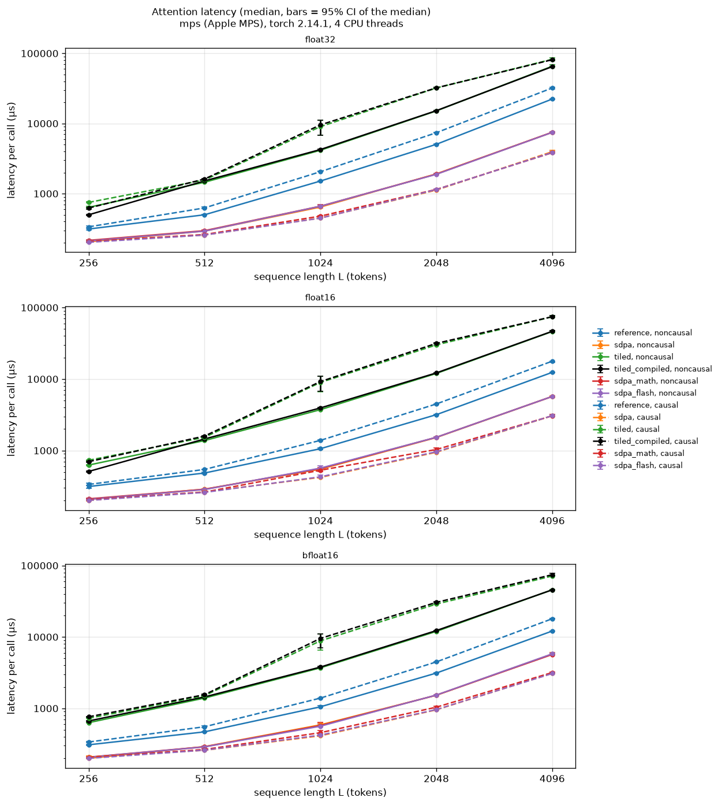

# Attention Lab benchmark report

## `cpu-large-run2.json`

- Environment: cpu (arm64), torch 2.14.1, 4 CPU threads; Python 3.12.13; macOS-27.0.1-arm64-arm-64bit; CUDA runtime None; recorded 2026-10-14T22:22:11+00:00
- Shapes: B=1, H=2, D=32, L in [512, 1024, 2048, 4096]; dtypes ['float32']; seed 0
- Methods: reference, sdpa, tiled, tiled_compiled, sdpa_math, sdpa_flash, sdpa_efficient; tiled block size 64
- Timing: torch.utils.benchmark.Timer.blocked_autorange(min_run_time=0.5 per round), 3 interleaved rounds, timer=timeit.default_timer, num_threads=4; sample = mean per-call time of one block; 10 warmup calls per method; unit seconds
- Memory: torch.profiler(profile_memory=True): peak of live CPU-allocator bytes during one call, above the bytes alive before it
- SDPA backend: automatic selection; the kernel that ran is recorded per method as observed_sdpa_ops
- Correctness: each method vs float64 reference; tolerances {'float32': {'atol': 1e-05, 'rtol': 1e-05}}

Reproduce (from the project root, inside the venv):

```bash
python -m attention_lab.benchmark --preset cpu-large --methods reference sdpa tiled tiled_compiled sdpa_math sdpa_flash sdpa_efficient --output results/cpu-large-run2.json
```

| L | dtype | mask | method | median µs [95% CI] | ref / method [95% CI] | peak MiB | first call ms | max abs err | correct | SDPA kernel observed |
|---|---|---|---|---|---|---|---|---|---|---|
| 512 | float32 | noncausal | reference | 277.0 [274.6, 280.0] | - | 4.12 | 0.5 | 3.2e-07 | yes | - |
| 512 | float32 | noncausal | sdpa | 140.2 [139.9, 140.4] | 1.98x [1.96, 2.00] | 0.66 | 0.2 | 4.2e-07 | yes | _scaled_dot_product_flash_attention_for_cpu |
| 512 | float32 | noncausal | tiled | 902.0 [900.6, 903.2] | 0.31x [0.30, 0.31] | 1.02 | 1.0 | 2.5e-07 | yes | - |
| 512 | float32 | noncausal | tiled_compiled | 928.5 [924.8, 931.9] | 0.30x [0.30, 0.30] | 0.52 | 2207.1 | 2.5e-07 | yes | - |
| 512 | float32 | noncausal | sdpa_math | 375.7 [374.5, 377.1] | 0.74x [0.73, 0.74] | 4.63 | 0.7 | 4.1e-07 | yes | _scaled_dot_product_attention_math |
| 512 | float32 | noncausal | sdpa_flash | 148.9 [147.8, 149.9] | 1.86x [1.84, 1.89] | 0.66 | 0.3 | 4.2e-07 | yes | _scaled_dot_product_flash_attention_for_cpu |
| 512 | float32 | noncausal | sdpa_efficient | skipped: RuntimeError: No viable backend for scaled_dot_product_attention was found. This is likely due to turning off both the math kernel and the fused kernels. | | | | | | | |
| 512 | float32 | causal | reference | 377.1 [377.0, 377.3] | - | 4.25 | 0.6 | 4.8e-07 | yes | - |
| 512 | float32 | causal | sdpa | 191.9 [190.2, 203.8] | 1.96x [1.86, 1.99] | 0.66 | 0.2 | 4.8e-07 | yes | _scaled_dot_product_flash_attention_for_cpu |
| 512 | float32 | causal | tiled | 843.1 [842.6, 843.8] | 0.45x [0.45, 0.45] | 1.02 | 1.0 | 4.9e-07 | yes | - |
| 512 | float32 | causal | tiled_compiled | 980.8 [978.4, 983.8] | 0.38x [0.38, 0.39] | 0.52 | 362.7 | 4.9e-07 | yes | - |
| 512 | float32 | causal | sdpa_math | 461.7 [458.5, 465.3] | 0.82x [0.81, 0.82] | 5.63 | 0.6 | 4.7e-07 | yes | _scaled_dot_product_attention_math |
| 512 | float32 | causal | sdpa_flash | 194.4 [193.9, 195.1] | 1.94x [1.93, 1.95] | 0.66 | 0.2 | 4.8e-07 | yes | _scaled_dot_product_flash_attention_for_cpu |
| 512 | float32 | causal | sdpa_efficient | skipped: RuntimeError: No viable backend for scaled_dot_product_attention was found. This is likely due to turning off both the math kernel and the fused kernels. | | | | | | | |
| 1024 | float32 | noncausal | reference | 1034.7 [1034.2, 1035.2] | - | 16.25 | 1.9 | 3.7e-07 | yes | - |
| 1024 | float32 | noncausal | sdpa | 424.2 [423.8, 424.6] | 2.44x [2.44, 2.44] | 2.39 | 0.7 | 3.3e-07 | yes | _scaled_dot_product_flash_attention_for_cpu |
| 1024 | float32 | noncausal | tiled | 2556.9 [2554.4, 2558.8] | 0.40x [0.40, 0.41] | 2.04 | 2.8 | 1.8e-07 | yes | - |
| 1024 | float32 | noncausal | tiled_compiled | 2387.2 [2385.6, 2390.2] | 0.43x [0.43, 0.43] | 1.04 | 81.7 | 1.8e-07 | yes | - |
| 1024 | float32 | noncausal | sdpa_math | 1370.7 [1368.8, 1372.3] | 0.75x [0.75, 0.76] | 18.25 | 1.6 | 3.9e-07 | yes | _scaled_dot_product_attention_math |
| 1024 | float32 | noncausal | sdpa_flash | 431.8 [431.4, 432.2] | 2.40x [2.39, 2.40] | 2.39 | 0.5 | 3.3e-07 | yes | _scaled_dot_product_flash_attention_for_cpu |
| 1024 | float32 | noncausal | sdpa_efficient | skipped: RuntimeError: No viable backend for scaled_dot_product_attention was found. This is likely due to turning off both the math kernel and the fused kernels. | | | | | | | |
| 1024 | float32 | causal | reference | 1400.7 [1398.9, 1405.8] | - | 17.00 | 1.8 | 5.0e-07 | yes | - |
| 1024 | float32 | causal | sdpa | 465.1 [464.7, 466.0] | 3.01x [3.00, 3.02] | 2.39 | 0.5 | 5.1e-07 | yes | _scaled_dot_product_flash_attention_for_cpu |
| 1024 | float32 | causal | tiled | 2223.6 [2221.7, 2225.9] | 0.63x [0.63, 0.63] | 2.04 | 2.6 | 4.6e-07 | yes | - |
| 1024 | float32 | causal | tiled_compiled | 2373.3 [2371.0, 2375.1] | 0.59x [0.59, 0.59] | 1.84 | 172.1 | 4.6e-07 | yes | - |
| 1024 | float32 | causal | sdpa_math | 1581.0 [1579.7, 1583.1] | 0.89x [0.88, 0.89] | 22.25 | 2.2 | 4.4e-07 | yes | _scaled_dot_product_attention_math |
| 1024 | float32 | causal | sdpa_flash | 467.5 [467.2, 467.7] | 3.00x [2.99, 3.00] | 2.39 | 0.5 | 5.1e-07 | yes | _scaled_dot_product_flash_attention_for_cpu |
| 1024 | float32 | causal | sdpa_efficient | skipped: RuntimeError: No viable backend for scaled_dot_product_attention was found. This is likely due to turning off both the math kernel and the fused kernels. | | | | | | | |
| 2048 | float32 | noncausal | reference | 5135.5 [5059.4, 5195.9] | - | 64.50 | 7.2 | 5.7e-07 | yes | - |
| 2048 | float32 | noncausal | sdpa | 1586.2 [1577.9, 1595.2] | 3.24x [3.19, 3.28] | 2.65 | 2.0 | 4.2e-07 | yes | _scaled_dot_product_flash_attention_for_cpu |
| 2048 | float32 | noncausal | tiled | 7525.6 [7455.0, 7571.0] | 0.68x [0.67, 0.69] | 4.08 | 9.1 | 1.7e-07 | yes | - |
| 2048 | float32 | noncausal | tiled_compiled | 6870.2 [6776.4, 6955.0] | 0.75x [0.73, 0.76] | 2.08 | 7.2 | 1.9e-07 | yes | - |
| 2048 | float32 | noncausal | sdpa_math | 6584.2 [6500.6, 6664.8] | 0.78x [0.77, 0.80] | 72.50 | 7.1 | 8.9e-07 | yes | _scaled_dot_product_attention_math |
| 2048 | float32 | noncausal | sdpa_flash | 1624.0 [1615.9, 1636.0] | 3.16x [3.11, 3.20] | 2.65 | 1.7 | 4.2e-07 | yes | _scaled_dot_product_flash_attention_for_cpu |
| 2048 | float32 | noncausal | sdpa_efficient | skipped: RuntimeError: No viable backend for scaled_dot_product_attention was found. This is likely due to turning off both the math kernel and the fused kernels. | | | | | | | |
| 2048 | float32 | causal | reference | 7772.0 [7634.4, 7853.9] | - | 68.00 | 6.9 | 4.5e-07 | yes | - |
| 2048 | float32 | causal | sdpa | 1455.9 [1448.0, 1466.0] | 5.34x [5.25, 5.40] | 2.65 | 1.7 | 5.9e-07 | yes | _scaled_dot_product_flash_attention_for_cpu |
| 2048 | float32 | causal | tiled | 6025.5 [6004.7, 6075.2] | 1.29x [1.27, 1.30] | 4.08 | 6.8 | 5.2e-07 | yes | - |
| 2048 | float32 | causal | tiled_compiled | 6671.4 [6550.9, 6762.4] | 1.16x [1.14, 1.19] | 3.88 | 8.9 | 5.2e-07 | yes | - |
| 2048 | float32 | causal | sdpa_math | 7986.4 [7906.7, 8174.9] | 0.97x [0.95, 0.99] | 88.50 | 12.2 | 5.3e-07 | yes | _scaled_dot_product_attention_math |
| 2048 | float32 | causal | sdpa_flash | 1478.8 [1471.2, 1486.8] | 5.26x [5.17, 5.31] | 2.65 | 1.7 | 5.9e-07 | yes | _scaled_dot_product_flash_attention_for_cpu |
| 2048 | float32 | causal | sdpa_efficient | skipped: RuntimeError: No viable backend for scaled_dot_product_attention was found. This is likely due to turning off both the math kernel and the fused kernels. | | | | | | | |
| 4096 | float32 | noncausal | reference | 24522.9 [23723.8, 25089.2] | - | 257.00 | 68.0 | 4.7e-07 | yes | - |
| 4096 | float32 | noncausal | sdpa | 6652.3 [6598.7, 6729.3] | 3.69x [3.56, 3.79] | 3.16 | 6.4 | 3.7e-07 | yes | _scaled_dot_product_flash_attention_for_cpu |
| 4096 | float32 | noncausal | tiled | 27546.8 [26895.1, 28069.5] | 0.89x [0.86, 0.92] | 8.16 | 24.3 | 1.3e-07 | yes | - |
| 4096 | float32 | noncausal | tiled_compiled | 27160.4 [26415.2, 27916.3] | 0.90x [0.86, 0.94] | 4.16 | 24.6 | 1.3e-07 | yes | - |
| 4096 | float32 | noncausal | sdpa_math | 27054.2 [24864.9, 30864.5] | 0.91x [0.78, 0.99] | 289.01 | 27.9 | 4.7e-07 | yes | _scaled_dot_product_attention_math |
| 4096 | float32 | noncausal | sdpa_flash | 7209.8 [7117.4, 7459.8] | 3.40x [3.24, 3.47] | 3.16 | 6.9 | 3.7e-07 | yes | _scaled_dot_product_flash_attention_for_cpu |
| 4096 | float32 | noncausal | sdpa_efficient | skipped: RuntimeError: No viable backend for scaled_dot_product_attention was found. This is likely due to turning off both the math kernel and the fused kernels. | | | | | | | |
| 4096 | float32 | causal | reference | 33564.6 [33067.0, 34371.7] | - | 272.00 | 30.2 | 7.4e-07 | yes | - |
| 4096 | float32 | causal | sdpa | 5254.4 [5127.8, 5452.4] | 6.39x [6.15, 6.63] | 3.16 | 5.7 | 8.3e-07 | yes | _scaled_dot_product_flash_attention_for_cpu |
| 4096 | float32 | causal | tiled | 17647.5 [17159.0, 18100.6] | 1.90x [1.85, 1.98] | 8.16 | 19.4 | 7.6e-07 | yes | - |
| 4096 | float32 | causal | tiled_compiled | 20047.8 [19663.0, 20519.0] | 1.67x [1.63, 1.73] | 7.95 | 18.5 | 7.4e-07 | yes | - |
| 4096 | float32 | causal | sdpa_math | 38691.6 [38125.9, 39403.9] | 0.87x [0.85, 0.89] | 353.01 | 41.0 | 4.4e-07 | yes | _scaled_dot_product_attention_math |
| 4096 | float32 | causal | sdpa_flash | 5992.8 [5931.3, 6021.2] | 5.60x [5.52, 5.76] | 3.16 | 5.8 | 8.3e-07 | yes | _scaled_dot_product_flash_attention_for_cpu |
| 4096 | float32 | causal | sdpa_efficient | skipped: RuntimeError: No viable backend for scaled_dot_product_attention was found. This is likely due to turning off both the math kernel and the fused kernels. | | | | | | | |


### Observations (computed from this run)

- sdpa vs reference, float32, noncausal: reference/sdpa ratio 1.98x to 3.69x over L = 512, 1024, 2048, 4096. 95% CI above 1 (faster) at L = 512, 1024, 2048, 4096; below 1 (slower) at L = none.
- tiled vs reference, float32, noncausal: reference/tiled ratio 0.31x to 0.89x over L = 512, 1024, 2048, 4096. 95% CI above 1 (faster) at L = none; below 1 (slower) at L = 512, 1024, 2048, 4096.
- tiled_compiled vs reference, float32, noncausal: reference/tiled_compiled ratio 0.30x to 0.90x over L = 512, 1024, 2048, 4096. 95% CI above 1 (faster) at L = none; below 1 (slower) at L = 512, 1024, 2048, 4096.
- sdpa_math vs reference, float32, noncausal: reference/sdpa_math ratio 0.74x to 0.91x over L = 512, 1024, 2048, 4096. 95% CI above 1 (faster) at L = none; below 1 (slower) at L = 512, 1024, 2048, 4096.
- sdpa_flash vs reference, float32, noncausal: reference/sdpa_flash ratio 1.86x to 3.40x over L = 512, 1024, 2048, 4096. 95% CI above 1 (faster) at L = 512, 1024, 2048, 4096; below 1 (slower) at L = none.
- sdpa vs reference, float32, causal: reference/sdpa ratio 1.96x to 6.39x over L = 512, 1024, 2048, 4096. 95% CI above 1 (faster) at L = 512, 1024, 2048, 4096; below 1 (slower) at L = none.
- tiled vs reference, float32, causal: reference/tiled ratio 0.45x to 1.90x over L = 512, 1024, 2048, 4096. 95% CI above 1 (faster) at L = 2048, 4096; below 1 (slower) at L = 512, 1024.
- tiled_compiled vs reference, float32, causal: reference/tiled_compiled ratio 0.38x to 1.67x over L = 512, 1024, 2048, 4096. 95% CI above 1 (faster) at L = 2048, 4096; below 1 (slower) at L = 512, 1024.
- sdpa_math vs reference, float32, causal: reference/sdpa_math ratio 0.82x to 0.97x over L = 512, 1024, 2048, 4096. 95% CI above 1 (faster) at L = none; below 1 (slower) at L = 512, 1024, 2048, 4096.
- sdpa_flash vs reference, float32, causal: reference/sdpa_flash ratio 1.94x to 5.60x over L = 512, 1024, 2048, 4096. 95% CI above 1 (faster) at L = 512, 1024, 2048, 4096; below 1 (slower) at L = none.
- sdpa: profiler saw aten::_scaled_dot_product_flash_attention_for_cpu.
- sdpa_math: profiler saw aten::_scaled_dot_product_attention_math.
- sdpa_flash: profiler saw aten::_scaled_dot_product_flash_attention_for_cpu.
- Skipped (reasons in the table): sdpa_efficient at L=512 noncausal; sdpa_efficient at L=512 causal; sdpa_efficient at L=1024 noncausal; sdpa_efficient at L=1024 causal; sdpa_efficient at L=2048 noncausal; sdpa_efficient at L=2048 causal; sdpa_efficient at L=4096 noncausal; sdpa_efficient at L=4096 causal.

Growth across the measured range, compared with linear and quadratic growth in L:

| method | dtype | mask | L range | latency growth | peak-memory growth | L growth | L² growth |
|---|---|---|---|---|---|---|---|
| reference | float32 | noncausal | 512 → 4096 | x88.5 | x62.3 | x8 | x64 |
| sdpa | float32 | noncausal | 512 → 4096 | x47.5 | x4.8 | x8 | x64 |
| tiled | float32 | noncausal | 512 → 4096 | x30.5 | x8.0 | x8 | x64 |
| tiled_compiled | float32 | noncausal | 512 → 4096 | x29.3 | x8.0 | x8 | x64 |
| sdpa_math | float32 | noncausal | 512 → 4096 | x72.0 | x62.5 | x8 | x64 |
| sdpa_flash | float32 | noncausal | 512 → 4096 | x48.4 | x4.8 | x8 | x64 |
| reference | float32 | causal | 512 → 4096 | x89.0 | x64.0 | x8 | x64 |
| sdpa | float32 | causal | 512 → 4096 | x27.4 | x4.8 | x8 | x64 |
| tiled | float32 | causal | 512 → 4096 | x20.9 | x8.0 | x8 | x64 |
| tiled_compiled | float32 | causal | 512 → 4096 | x20.4 | x15.3 | x8 | x64 |
| sdpa_math | float32 | causal | 512 → 4096 | x83.8 | x62.7 | x8 | x64 |
| sdpa_flash | float32 | causal | 512 → 4096 | x30.8 | x4.8 | x8 | x64 |

Nominal throughput at L = 4096, noncausal (4·B·H·L²·D FLOPs for the two matmuls ÷ median latency; softmax and masking not counted):

| method | dtype | GFLOP/s |
|---|---|---|
| reference | float32 | 175.1 |
| sdpa | float32 | 645.6 |
| tiled | float32 | 155.9 |
| tiled_compiled | float32 | 158.1 |
| sdpa_math | float32 | 158.8 |
| sdpa_flash | float32 | 595.7 |

How to read this:
- One run on one machine. Re-run before quoting numbers; compare only rows from the same environment.
- Timings cover one attention call including the identical Python validation in every wrapper;
  input creation, correctness checks, profiling and I/O are excluded. This is not whole-model performance.
- SDPA's backend is chosen automatically; the kernel the profiler saw is listed per row. Forced-backend
  methods (sdpa_math, sdpa_flash, ...) also pay for entering the sdpa_kernel context on every call.
- The score matrix is O(L²), but at small L fixed per-call costs (Python, dispatch, allocation) dominate,
  so latency can grow much more slowly than L².
- The explicit causal reference builds an [L, L] mask on every call. The tiled method loops over key blocks
  in Python, so its per-block overhead is large at small L, and causal does not skip any blocks.
- CPU peak memory comes from torch.profiler allocation events and counts only PyTorch-allocator memory.
  MPS has no peak-memory counter, so MPS memory is n/a (not estimated).
- Confidence intervals are percentile bootstraps over timing samples, which assumes independent samples;
  drift and correlation make the real uncertainty larger. "First call" includes torch.compile's compile time.

## `cpu-large-run3.json`

- Environment: cpu (arm64), torch 2.14.1, 4 CPU threads; Python 3.12.13; macOS-27.0.1-arm64-arm-64bit; CUDA runtime None; recorded 2026-10-14T22:23:44+00:00
- Shapes: B=1, H=2, D=32, L in [512, 1024, 2048, 4096]; dtypes ['float32']; seed 0
- Methods: reference, sdpa, tiled, tiled_compiled, sdpa_math, sdpa_flash, sdpa_efficient; tiled block size 64
- Timing: torch.utils.benchmark.Timer.blocked_autorange(min_run_time=0.5 per round), 3 interleaved rounds, timer=timeit.default_timer, num_threads=4; sample = mean per-call time of one block; 10 warmup calls per method; unit seconds
- Memory: torch.profiler(profile_memory=True): peak of live CPU-allocator bytes during one call, above the bytes alive before it
- SDPA backend: automatic selection; the kernel that ran is recorded per method as observed_sdpa_ops
- Correctness: each method vs float64 reference; tolerances {'float32': {'atol': 1e-05, 'rtol': 1e-05}}

Reproduce (from the project root, inside the venv):

```bash
python -m attention_lab.benchmark --preset cpu-large --methods reference sdpa tiled tiled_compiled sdpa_math sdpa_flash sdpa_efficient --output results/cpu-large-run3.json
```

| L | dtype | mask | method | median µs [95% CI] | ref / method [95% CI] | peak MiB | first call ms | max abs err | correct | SDPA kernel observed |
|---|---|---|---|---|---|---|---|---|---|---|
| 512 | float32 | noncausal | reference | 267.5 [266.2, 269.1] | - | 4.12 | 0.5 | 3.2e-07 | yes | - |
| 512 | float32 | noncausal | sdpa | 142.9 [141.5, 144.1] | 1.87x [1.85, 1.89] | 0.66 | 0.2 | 4.2e-07 | yes | _scaled_dot_product_flash_attention_for_cpu |
| 512 | float32 | noncausal | tiled | 913.3 [911.9, 915.3] | 0.29x [0.29, 0.29] | 1.02 | 1.3 | 2.5e-07 | yes | - |
| 512 | float32 | noncausal | tiled_compiled | 927.9 [924.2, 930.9] | 0.29x [0.29, 0.29] | 0.52 | 2190.6 | 2.5e-07 | yes | - |
| 512 | float32 | noncausal | sdpa_math | 380.2 [378.2, 383.5] | 0.70x [0.69, 0.71] | 4.63 | 0.7 | 4.1e-07 | yes | _scaled_dot_product_attention_math |
| 512 | float32 | noncausal | sdpa_flash | 146.3 [146.1, 146.5] | 1.83x [1.82, 1.84] | 0.66 | 0.2 | 4.2e-07 | yes | _scaled_dot_product_flash_attention_for_cpu |
| 512 | float32 | noncausal | sdpa_efficient | skipped: RuntimeError: No viable backend for scaled_dot_product_attention was found. This is likely due to turning off both the math kernel and the fused kernels. | | | | | | | |
| 512 | float32 | causal | reference | 383.9 [382.7, 385.3] | - | 4.25 | 0.6 | 4.8e-07 | yes | - |
| 512 | float32 | causal | sdpa | 191.2 [190.0, 192.4] | 2.01x [1.99, 2.02] | 0.66 | 0.2 | 4.8e-07 | yes | _scaled_dot_product_flash_attention_for_cpu |
| 512 | float32 | causal | tiled | 862.5 [861.2, 864.1] | 0.45x [0.44, 0.45] | 1.02 | 1.2 | 4.9e-07 | yes | - |
| 512 | float32 | causal | tiled_compiled | 985.8 [983.3, 987.8] | 0.39x [0.39, 0.39] | 0.52 | 352.3 | 4.9e-07 | yes | - |
| 512 | float32 | causal | sdpa_math | 465.8 [463.7, 468.6] | 0.82x [0.82, 0.83] | 5.63 | 0.7 | 4.7e-07 | yes | _scaled_dot_product_attention_math |
| 512 | float32 | causal | sdpa_flash | 202.0 [200.0, 204.2] | 1.90x [1.88, 1.92] | 0.66 | 0.2 | 4.8e-07 | yes | _scaled_dot_product_flash_attention_for_cpu |
| 512 | float32 | causal | sdpa_efficient | skipped: RuntimeError: No viable backend for scaled_dot_product_attention was found. This is likely due to turning off both the math kernel and the fused kernels. | | | | | | | |
| 1024 | float32 | noncausal | reference | 1237.2 [1202.9, 1276.9] | - | 16.25 | 2.5 | 3.7e-07 | yes | - |
| 1024 | float32 | noncausal | sdpa | 454.6 [452.1, 456.9] | 2.72x [2.64, 2.81] | 2.39 | 0.7 | 3.3e-07 | yes | _scaled_dot_product_flash_attention_for_cpu |
| 1024 | float32 | noncausal | tiled | 2767.9 [2740.9, 2802.8] | 0.45x [0.43, 0.46] | 2.04 | 3.4 | 1.8e-07 | yes | - |
| 1024 | float32 | noncausal | tiled_compiled | 2653.7 [2619.7, 2688.0] | 0.47x [0.45, 0.48] | 1.04 | 88.6 | 1.8e-07 | yes | - |
| 1024 | float32 | noncausal | sdpa_math | 1727.9 [1672.1, 1774.6] | 0.72x [0.69, 0.75] | 18.25 | 2.2 | 3.9e-07 | yes | _scaled_dot_product_attention_math |
| 1024 | float32 | noncausal | sdpa_flash | 466.1 [461.7, 471.9] | 2.65x [2.57, 2.74] | 2.39 | 0.6 | 3.3e-07 | yes | _scaled_dot_product_flash_attention_for_cpu |
| 1024 | float32 | noncausal | sdpa_efficient | skipped: RuntimeError: No viable backend for scaled_dot_product_attention was found. This is likely due to turning off both the math kernel and the fused kernels. | | | | | | | |
| 1024 | float32 | causal | reference | 1759.9 [1705.8, 1811.4] | - | 17.00 | 2.2 | 5.0e-07 | yes | - |
| 1024 | float32 | causal | sdpa | 471.1 [470.0, 472.1] | 3.74x [3.62, 3.85] | 2.39 | 0.6 | 5.1e-07 | yes | _scaled_dot_product_flash_attention_for_cpu |
| 1024 | float32 | causal | tiled | 2292.2 [2280.0, 2314.6] | 0.77x [0.74, 0.79] | 2.04 | 4.0 | 4.6e-07 | yes | - |
| 1024 | float32 | causal | tiled_compiled | 2538.5 [2513.5, 2561.5] | 0.69x [0.67, 0.72] | 1.84 | 193.9 | 4.6e-07 | yes | - |
| 1024 | float32 | causal | sdpa_math | 2059.4 [1991.2, 2096.6] | 0.85x [0.82, 0.90] | 22.25 | 2.1 | 4.4e-07 | yes | _scaled_dot_product_attention_math |
| 1024 | float32 | causal | sdpa_flash | 477.2 [476.1, 478.3] | 3.69x [3.57, 3.80] | 2.39 | 0.6 | 5.1e-07 | yes | _scaled_dot_product_flash_attention_for_cpu |
| 1024 | float32 | causal | sdpa_efficient | skipped: RuntimeError: No viable backend for scaled_dot_product_attention was found. This is likely due to turning off both the math kernel and the fused kernels. | | | | | | | |
| 2048 | float32 | noncausal | reference | 5335.5 [5219.8, 5503.8] | - | 64.50 | 7.2 | 5.7e-07 | yes | - |
| 2048 | float32 | noncausal | sdpa | 1747.8 [1735.0, 1762.2] | 3.05x [2.98, 3.14] | 2.65 | 1.6 | 4.2e-07 | yes | _scaled_dot_product_flash_attention_for_cpu |
| 2048 | float32 | noncausal | tiled | 7307.6 [7281.0, 7383.3] | 0.73x [0.71, 0.75] | 4.08 | 7.9 | 1.7e-07 | yes | - |
| 2048 | float32 | noncausal | tiled_compiled | 6506.9 [6495.0, 6520.2] | 0.82x [0.80, 0.84] | 2.08 | 7.1 | 1.9e-07 | yes | - |
| 2048 | float32 | noncausal | sdpa_math | 6159.0 [6126.8, 6188.5] | 0.87x [0.85, 0.89] | 72.50 | 6.4 | 8.9e-07 | yes | _scaled_dot_product_attention_math |
| 2048 | float32 | noncausal | sdpa_flash | 1723.1 [1718.8, 1727.0] | 3.10x [3.03, 3.18] | 2.65 | 1.6 | 4.2e-07 | yes | _scaled_dot_product_flash_attention_for_cpu |
| 2048 | float32 | noncausal | sdpa_efficient | skipped: RuntimeError: No viable backend for scaled_dot_product_attention was found. This is likely due to turning off both the math kernel and the fused kernels. | | | | | | | |
| 2048 | float32 | causal | reference | 7740.1 [7646.3, 7875.9] | - | 68.00 | 8.9 | 4.5e-07 | yes | - |
| 2048 | float32 | causal | sdpa | 1469.1 [1457.3, 1482.8] | 5.27x [5.19, 5.38] | 2.65 | 1.8 | 5.9e-07 | yes | _scaled_dot_product_flash_attention_for_cpu |
| 2048 | float32 | causal | tiled | 6289.3 [6198.5, 6433.9] | 1.23x [1.20, 1.26] | 4.08 | 7.8 | 5.2e-07 | yes | - |
| 2048 | float32 | causal | tiled_compiled | 6435.6 [6417.9, 6493.5] | 1.20x [1.19, 1.22] | 3.88 | 8.0 | 5.2e-07 | yes | - |
| 2048 | float32 | causal | sdpa_math | 8142.1 [8057.5, 8213.0] | 0.95x [0.94, 0.97] | 88.50 | 13.7 | 5.3e-07 | yes | _scaled_dot_product_attention_math |
| 2048 | float32 | causal | sdpa_flash | 1440.0 [1436.8, 1443.5] | 5.38x [5.31, 5.47] | 2.65 | 1.7 | 5.9e-07 | yes | _scaled_dot_product_flash_attention_for_cpu |
| 2048 | float32 | causal | sdpa_efficient | skipped: RuntimeError: No viable backend for scaled_dot_product_attention was found. This is likely due to turning off both the math kernel and the fused kernels. | | | | | | | |
| 4096 | float32 | noncausal | reference | 22601.3 [22440.0, 22858.5] | - | 257.00 | 53.3 | 4.7e-07 | yes | - |
| 4096 | float32 | noncausal | sdpa | 7045.7 [7008.5, 7073.4] | 3.21x [3.18, 3.25] | 3.16 | 6.6 | 3.7e-07 | yes | _scaled_dot_product_flash_attention_for_cpu |
| 4096 | float32 | noncausal | tiled | 22599.0 [22329.1, 23854.5] | 1.00x [0.95, 1.01] | 8.16 | 24.6 | 1.3e-07 | yes | - |
| 4096 | float32 | noncausal | tiled_compiled | 20145.9 [19920.3, 20524.2] | 1.12x [1.10, 1.14] | 4.16 | 20.6 | 1.3e-07 | yes | - |
| 4096 | float32 | noncausal | sdpa_math | 24393.0 [24196.9, 24844.1] | 0.93x [0.91, 0.94] | 289.01 | 25.2 | 4.7e-07 | yes | _scaled_dot_product_attention_math |
| 4096 | float32 | noncausal | sdpa_flash | 7136.3 [7095.2, 7199.8] | 3.17x [3.13, 3.21] | 3.16 | 6.9 | 3.7e-07 | yes | _scaled_dot_product_flash_attention_for_cpu |
| 4096 | float32 | noncausal | sdpa_efficient | skipped: RuntimeError: No viable backend for scaled_dot_product_attention was found. This is likely due to turning off both the math kernel and the fused kernels. | | | | | | | |
| 4096 | float32 | causal | reference | 28390.5 [28084.8, 30012.3] | - | 272.00 | 29.9 | 7.4e-07 | yes | - |
| 4096 | float32 | causal | sdpa | 5296.9 [5260.2, 5374.9] | 5.36x [5.27, 5.66] | 3.16 | 5.3 | 8.3e-07 | yes | _scaled_dot_product_flash_attention_for_cpu |
| 4096 | float32 | causal | tiled | 16302.3 [16226.4, 16385.5] | 1.74x [1.72, 1.84] | 8.16 | 19.3 | 7.6e-07 | yes | - |
| 4096 | float32 | causal | tiled_compiled | 17192.0 [17121.8, 17341.4] | 1.65x [1.63, 1.74] | 7.95 | 18.6 | 7.4e-07 | yes | - |
| 4096 | float32 | causal | sdpa_math | 32094.1 [31827.7, 32704.5] | 0.88x [0.87, 0.93] | 353.01 | 32.2 | 4.4e-07 | yes | _scaled_dot_product_attention_math |
| 4096 | float32 | causal | sdpa_flash | 5282.5 [5220.6, 5341.9] | 5.37x [5.29, 5.69] | 3.16 | 5.1 | 8.3e-07 | yes | _scaled_dot_product_flash_attention_for_cpu |
| 4096 | float32 | causal | sdpa_efficient | skipped: RuntimeError: No viable backend for scaled_dot_product_attention was found. This is likely due to turning off both the math kernel and the fused kernels. | | | | | | | |


### Observations (computed from this run)

- sdpa vs reference, float32, noncausal: reference/sdpa ratio 1.87x to 3.21x over L = 512, 1024, 2048, 4096. 95% CI above 1 (faster) at L = 512, 1024, 2048, 4096; below 1 (slower) at L = none.
- tiled vs reference, float32, noncausal: reference/tiled ratio 0.29x to 1.00x over L = 512, 1024, 2048, 4096. 95% CI above 1 (faster) at L = none; below 1 (slower) at L = 512, 1024, 2048.
- tiled_compiled vs reference, float32, noncausal: reference/tiled_compiled ratio 0.29x to 1.12x over L = 512, 1024, 2048, 4096. 95% CI above 1 (faster) at L = 4096; below 1 (slower) at L = 512, 1024, 2048.
- sdpa_math vs reference, float32, noncausal: reference/sdpa_math ratio 0.70x to 0.93x over L = 512, 1024, 2048, 4096. 95% CI above 1 (faster) at L = none; below 1 (slower) at L = 512, 1024, 2048, 4096.
- sdpa_flash vs reference, float32, noncausal: reference/sdpa_flash ratio 1.83x to 3.17x over L = 512, 1024, 2048, 4096. 95% CI above 1 (faster) at L = 512, 1024, 2048, 4096; below 1 (slower) at L = none.
- sdpa vs reference, float32, causal: reference/sdpa ratio 2.01x to 5.36x over L = 512, 1024, 2048, 4096. 95% CI above 1 (faster) at L = 512, 1024, 2048, 4096; below 1 (slower) at L = none.
- tiled vs reference, float32, causal: reference/tiled ratio 0.45x to 1.74x over L = 512, 1024, 2048, 4096. 95% CI above 1 (faster) at L = 2048, 4096; below 1 (slower) at L = 512, 1024.
- tiled_compiled vs reference, float32, causal: reference/tiled_compiled ratio 0.39x to 1.65x over L = 512, 1024, 2048, 4096. 95% CI above 1 (faster) at L = 2048, 4096; below 1 (slower) at L = 512, 1024.
- sdpa_math vs reference, float32, causal: reference/sdpa_math ratio 0.82x to 0.95x over L = 512, 1024, 2048, 4096. 95% CI above 1 (faster) at L = none; below 1 (slower) at L = 512, 1024, 2048, 4096.
- sdpa_flash vs reference, float32, causal: reference/sdpa_flash ratio 1.90x to 5.38x over L = 512, 1024, 2048, 4096. 95% CI above 1 (faster) at L = 512, 1024, 2048, 4096; below 1 (slower) at L = none.
- sdpa: profiler saw aten::_scaled_dot_product_flash_attention_for_cpu.
- sdpa_math: profiler saw aten::_scaled_dot_product_attention_math.
- sdpa_flash: profiler saw aten::_scaled_dot_product_flash_attention_for_cpu.
- Skipped (reasons in the table): sdpa_efficient at L=512 noncausal; sdpa_efficient at L=512 causal; sdpa_efficient at L=1024 noncausal; sdpa_efficient at L=1024 causal; sdpa_efficient at L=2048 noncausal; sdpa_efficient at L=2048 causal; sdpa_efficient at L=4096 noncausal; sdpa_efficient at L=4096 causal.

Growth across the measured range, compared with linear and quadratic growth in L:

| method | dtype | mask | L range | latency growth | peak-memory growth | L growth | L² growth |
|---|---|---|---|---|---|---|---|
| reference | float32 | noncausal | 512 → 4096 | x84.5 | x62.3 | x8 | x64 |
| sdpa | float32 | noncausal | 512 → 4096 | x49.3 | x4.8 | x8 | x64 |
| tiled | float32 | noncausal | 512 → 4096 | x24.7 | x8.0 | x8 | x64 |
| tiled_compiled | float32 | noncausal | 512 → 4096 | x21.7 | x8.0 | x8 | x64 |
| sdpa_math | float32 | noncausal | 512 → 4096 | x64.2 | x62.5 | x8 | x64 |
| sdpa_flash | float32 | noncausal | 512 → 4096 | x48.8 | x4.8 | x8 | x64 |
| reference | float32 | causal | 512 → 4096 | x74.0 | x64.0 | x8 | x64 |
| sdpa | float32 | causal | 512 → 4096 | x27.7 | x4.8 | x8 | x64 |
| tiled | float32 | causal | 512 → 4096 | x18.9 | x8.0 | x8 | x64 |
| tiled_compiled | float32 | causal | 512 → 4096 | x17.4 | x15.3 | x8 | x64 |
| sdpa_math | float32 | causal | 512 → 4096 | x68.9 | x62.7 | x8 | x64 |
| sdpa_flash | float32 | causal | 512 → 4096 | x26.2 | x4.8 | x8 | x64 |

Nominal throughput at L = 4096, noncausal (4·B·H·L²·D FLOPs for the two matmuls ÷ median latency; softmax and masking not counted):

| method | dtype | GFLOP/s |
|---|---|---|
| reference | float32 | 190.0 |
| sdpa | float32 | 609.6 |
| tiled | float32 | 190.1 |
| tiled_compiled | float32 | 213.2 |
| sdpa_math | float32 | 176.1 |
| sdpa_flash | float32 | 601.9 |

How to read this:
- One run on one machine. Re-run before quoting numbers; compare only rows from the same environment.
- Timings cover one attention call including the identical Python validation in every wrapper;
  input creation, correctness checks, profiling and I/O are excluded. This is not whole-model performance.
- SDPA's backend is chosen automatically; the kernel the profiler saw is listed per row. Forced-backend
  methods (sdpa_math, sdpa_flash, ...) also pay for entering the sdpa_kernel context on every call.
- The score matrix is O(L²), but at small L fixed per-call costs (Python, dispatch, allocation) dominate,
  so latency can grow much more slowly than L².
- The explicit causal reference builds an [L, L] mask on every call. The tiled method loops over key blocks
  in Python, so its per-block overhead is large at small L, and causal does not skip any blocks.
- CPU peak memory comes from torch.profiler allocation events and counts only PyTorch-allocator memory.
  MPS has no peak-memory counter, so MPS memory is n/a (not estimated).
- Confidence intervals are percentile bootstraps over timing samples, which assumes independent samples;
  drift and correlation make the real uncertainty larger. "First call" includes torch.compile's compile time.

## `cpu-large.json`

- Environment: cpu (arm64), torch 2.14.1, 4 CPU threads; Python 3.12.13; macOS-27.0.1-arm64-arm-64bit; CUDA runtime None; recorded 2026-10-14T22:20:34+00:00
- Shapes: B=1, H=2, D=32, L in [512, 1024, 2048, 4096]; dtypes ['float32']; seed 0
- Methods: reference, sdpa, tiled, tiled_compiled, sdpa_math, sdpa_flash, sdpa_efficient; tiled block size 64
- Timing: torch.utils.benchmark.Timer.blocked_autorange(min_run_time=0.5 per round), 3 interleaved rounds, timer=timeit.default_timer, num_threads=4; sample = mean per-call time of one block; 10 warmup calls per method; unit seconds
- Memory: torch.profiler(profile_memory=True): peak of live CPU-allocator bytes during one call, above the bytes alive before it
- SDPA backend: automatic selection; the kernel that ran is recorded per method as observed_sdpa_ops
- Correctness: each method vs float64 reference; tolerances {'float32': {'atol': 1e-05, 'rtol': 1e-05}}

Reproduce (from the project root, inside the venv):

```bash
python -m attention_lab.benchmark --preset cpu-large --methods reference sdpa tiled tiled_compiled sdpa_math sdpa_flash sdpa_efficient --output results/cpu-large.json
```

| L | dtype | mask | method | median µs [95% CI] | ref / method [95% CI] | peak MiB | first call ms | max abs err | correct | SDPA kernel observed |
|---|---|---|---|---|---|---|---|---|---|---|
| 512 | float32 | noncausal | reference | 266.6 [265.4, 267.8] | - | 4.12 | 0.5 | 3.2e-07 | yes | - |
| 512 | float32 | noncausal | sdpa | 139.2 [139.0, 139.4] | 1.92x [1.91, 1.93] | 0.66 | 0.2 | 4.2e-07 | yes | _scaled_dot_product_flash_attention_for_cpu |
| 512 | float32 | noncausal | tiled | 904.0 [902.7, 905.3] | 0.29x [0.29, 0.30] | 1.02 | 1.6 | 2.5e-07 | yes | - |
| 512 | float32 | noncausal | tiled_compiled | 918.2 [914.2, 922.1] | 0.29x [0.29, 0.29] | 0.52 | 2947.8 | 2.5e-07 | yes | - |
| 512 | float32 | noncausal | sdpa_math | 373.3 [372.6, 374.4] | 0.71x [0.71, 0.72] | 4.63 | 1.7 | 4.1e-07 | yes | _scaled_dot_product_attention_math |
| 512 | float32 | noncausal | sdpa_flash | 145.8 [145.6, 146.0] | 1.83x [1.82, 1.84] | 0.66 | 0.3 | 4.2e-07 | yes | _scaled_dot_product_flash_attention_for_cpu |
| 512 | float32 | noncausal | sdpa_efficient | skipped: RuntimeError: No viable backend for scaled_dot_product_attention was found. This is likely due to turning off both the math kernel and the fused kernels. | | | | | | | |
| 512 | float32 | causal | reference | 379.0 [378.6, 379.3] | - | 4.25 | 0.7 | 4.8e-07 | yes | - |
| 512 | float32 | causal | sdpa | 190.6 [189.4, 191.9] | 1.99x [1.98, 2.00] | 0.66 | 0.2 | 4.8e-07 | yes | _scaled_dot_product_flash_attention_for_cpu |
| 512 | float32 | causal | tiled | 862.0 [859.8, 865.3] | 0.44x [0.44, 0.44] | 1.02 | 1.2 | 4.9e-07 | yes | - |
| 512 | float32 | causal | tiled_compiled | 1005.4 [999.6, 1012.8] | 0.38x [0.37, 0.38] | 0.52 | 2230.3 | 4.9e-07 | yes | - |
| 512 | float32 | causal | sdpa_math | 455.1 [454.5, 456.1] | 0.83x [0.83, 0.83] | 5.63 | 1.0 | 4.7e-07 | yes | _scaled_dot_product_attention_math |
| 512 | float32 | causal | sdpa_flash | 196.6 [195.9, 197.8] | 1.93x [1.91, 1.93] | 0.66 | 0.3 | 4.8e-07 | yes | _scaled_dot_product_flash_attention_for_cpu |
| 512 | float32 | causal | sdpa_efficient | skipped: RuntimeError: No viable backend for scaled_dot_product_attention was found. This is likely due to turning off both the math kernel and the fused kernels. | | | | | | | |
| 1024 | float32 | noncausal | reference | 1052.5 [1051.4, 1054.3] | - | 16.25 | 2.5 | 3.7e-07 | yes | - |
| 1024 | float32 | noncausal | sdpa | 434.0 [432.8, 435.8] | 2.42x [2.41, 2.43] | 2.39 | 0.9 | 3.3e-07 | yes | _scaled_dot_product_flash_attention_for_cpu |
| 1024 | float32 | noncausal | tiled | 2613.8 [2606.9, 2622.6] | 0.40x [0.40, 0.40] | 2.04 | 3.1 | 1.8e-07 | yes | - |
| 1024 | float32 | noncausal | tiled_compiled | 2438.5 [2427.5, 2446.7] | 0.43x [0.43, 0.43] | 1.04 | 757.4 | 1.8e-07 | yes | - |
| 1024 | float32 | noncausal | sdpa_math | 1456.2 [1444.1, 1466.7] | 0.72x [0.72, 0.73] | 18.25 | 2.7 | 3.9e-07 | yes | _scaled_dot_product_attention_math |
| 1024 | float32 | noncausal | sdpa_flash | 429.7 [429.2, 430.4] | 2.45x [2.44, 2.45] | 2.39 | 0.5 | 3.3e-07 | yes | _scaled_dot_product_flash_attention_for_cpu |
| 1024 | float32 | noncausal | sdpa_efficient | skipped: RuntimeError: No viable backend for scaled_dot_product_attention was found. This is likely due to turning off both the math kernel and the fused kernels. | | | | | | | |
| 1024 | float32 | causal | reference | 1469.9 [1450.3, 1489.8] | - | 17.00 | 1.8 | 5.0e-07 | yes | - |
| 1024 | float32 | causal | sdpa | 593.0 [591.6, 594.4] | 2.48x [2.44, 2.51] | 2.39 | 0.5 | 5.1e-07 | yes | _scaled_dot_product_flash_attention_for_cpu |
| 1024 | float32 | causal | tiled | 2264.3 [2259.1, 2271.7] | 0.65x [0.64, 0.66] | 2.04 | 2.8 | 4.6e-07 | yes | - |
| 1024 | float32 | causal | tiled_compiled | 2422.7 [2418.1, 2427.7] | 0.61x [0.60, 0.62] | 1.84 | 906.6 | 4.6e-07 | yes | - |
| 1024 | float32 | causal | sdpa_math | 1669.6 [1649.0, 1696.3] | 0.88x [0.86, 0.90] | 22.25 | 2.9 | 4.4e-07 | yes | _scaled_dot_product_attention_math |
| 1024 | float32 | causal | sdpa_flash | 480.1 [478.1, 482.3] | 3.06x [3.02, 3.10] | 2.39 | 0.5 | 5.1e-07 | yes | _scaled_dot_product_flash_attention_for_cpu |
| 1024 | float32 | causal | sdpa_efficient | skipped: RuntimeError: No viable backend for scaled_dot_product_attention was found. This is likely due to turning off both the math kernel and the fused kernels. | | | | | | | |
| 2048 | float32 | noncausal | reference | 6108.4 [5799.4, 6297.0] | - | 64.50 | 8.9 | 5.7e-07 | yes | - |
| 2048 | float32 | noncausal | sdpa | 2012.2 [1952.4, 2072.0] | 3.04x [2.85, 3.18] | 2.65 | 2.2 | 4.2e-07 | yes | _scaled_dot_product_flash_attention_for_cpu |
| 2048 | float32 | noncausal | tiled | 9183.5 [9116.9, 9242.1] | 0.67x [0.63, 0.69] | 4.08 | 9.8 | 1.7e-07 | yes | - |
| 2048 | float32 | noncausal | tiled_compiled | 8751.3 [8686.3, 8835.5] | 0.70x [0.66, 0.72] | 2.08 | 11.7 | 1.9e-07 | yes | - |
| 2048 | float32 | noncausal | sdpa_math | 7926.3 [7806.8, 8075.8] | 0.77x [0.73, 0.80] | 72.50 | 11.1 | 8.9e-07 | yes | _scaled_dot_product_attention_math |
| 2048 | float32 | noncausal | sdpa_flash | 2190.3 [2186.6, 2195.2] | 2.79x [2.64, 2.88] | 2.65 | 2.4 | 4.2e-07 | yes | _scaled_dot_product_flash_attention_for_cpu |
| 2048 | float32 | noncausal | sdpa_efficient | skipped: RuntimeError: No viable backend for scaled_dot_product_attention was found. This is likely due to turning off both the math kernel and the fused kernels. | | | | | | | |
| 2048 | float32 | causal | reference | 7022.9 [6969.9, 7070.9] | - | 68.00 | 7.0 | 4.5e-07 | yes | - |
| 2048 | float32 | causal | sdpa | 1467.6 [1458.0, 1474.5] | 4.79x [4.75, 4.83] | 2.65 | 1.5 | 5.9e-07 | yes | _scaled_dot_product_flash_attention_for_cpu |
| 2048 | float32 | causal | tiled | 6206.8 [6116.3, 6279.4] | 1.13x [1.12, 1.15] | 4.08 | 6.5 | 5.2e-07 | yes | - |
| 2048 | float32 | causal | tiled_compiled | 6387.2 [6335.7, 6454.0] | 1.10x [1.08, 1.11] | 3.88 | 7.0 | 5.2e-07 | yes | - |
| 2048 | float32 | causal | sdpa_math | 7458.3 [7403.9, 7530.2] | 0.94x [0.93, 0.95] | 88.50 | 7.7 | 5.3e-07 | yes | _scaled_dot_product_attention_math |
| 2048 | float32 | causal | sdpa_flash | 1442.7 [1439.8, 1445.3] | 4.87x [4.83, 4.90] | 2.65 | 1.5 | 5.9e-07 | yes | _scaled_dot_product_flash_attention_for_cpu |
| 2048 | float32 | causal | sdpa_efficient | skipped: RuntimeError: No viable backend for scaled_dot_product_attention was found. This is likely due to turning off both the math kernel and the fused kernels. | | | | | | | |
| 4096 | float32 | noncausal | reference | 21453.7 [21341.2, 21611.7] | - | 257.00 | 66.7 | 4.7e-07 | yes | - |
| 4096 | float32 | noncausal | sdpa | 6354.0 [6233.8, 6455.6] | 3.38x [3.32, 3.44] | 3.16 | 6.9 | 3.7e-07 | yes | _scaled_dot_product_flash_attention_for_cpu |
| 4096 | float32 | noncausal | tiled | 23125.7 [22164.3, 23820.5] | 0.93x [0.88, 0.97] | 8.16 | 21.4 | 1.3e-07 | yes | - |
| 4096 | float32 | noncausal | tiled_compiled | 20491.0 [20140.6, 21447.0] | 1.05x [1.00, 1.07] | 4.16 | 20.6 | 1.3e-07 | yes | - |
| 4096 | float32 | noncausal | sdpa_math | 24683.4 [24433.5, 25392.0] | 0.87x [0.84, 0.88] | 289.01 | 30.8 | 4.7e-07 | yes | _scaled_dot_product_attention_math |
| 4096 | float32 | noncausal | sdpa_flash | 6339.7 [6281.8, 6459.3] | 3.38x [3.32, 3.42] | 3.16 | 10.2 | 3.7e-07 | yes | _scaled_dot_product_flash_attention_for_cpu |
| 4096 | float32 | noncausal | sdpa_efficient | skipped: RuntimeError: No viable backend for scaled_dot_product_attention was found. This is likely due to turning off both the math kernel and the fused kernels. | | | | | | | |
| 4096 | float32 | causal | reference | 27832.7 [27647.3, 28700.8] | - | 272.00 | 28.8 | 7.4e-07 | yes | - |
| 4096 | float32 | causal | sdpa | 4929.2 [4911.8, 4951.5] | 5.65x [5.60, 5.83] | 3.16 | 5.2 | 8.3e-07 | yes | _scaled_dot_product_flash_attention_for_cpu |
| 4096 | float32 | causal | tiled | 15826.3 [15772.2, 15891.3] | 1.76x [1.74, 1.81] | 8.16 | 17.6 | 7.6e-07 | yes | - |
| 4096 | float32 | causal | tiled_compiled | 16510.8 [16355.8, 16570.5] | 1.69x [1.67, 1.74] | 7.95 | 18.1 | 7.4e-07 | yes | - |
| 4096 | float32 | causal | sdpa_math | 29981.0 [29535.1, 30469.2] | 0.93x [0.91, 0.96] | 353.01 | 47.7 | 4.4e-07 | yes | _scaled_dot_product_attention_math |
| 4096 | float32 | causal | sdpa_flash | 4907.7 [4894.9, 4925.6] | 5.67x [5.63, 5.85] | 3.16 | 5.1 | 8.3e-07 | yes | _scaled_dot_product_flash_attention_for_cpu |
| 4096 | float32 | causal | sdpa_efficient | skipped: RuntimeError: No viable backend for scaled_dot_product_attention was found. This is likely due to turning off both the math kernel and the fused kernels. | | | | | | | |


### Observations (computed from this run)

- sdpa vs reference, float32, noncausal: reference/sdpa ratio 1.92x to 3.38x over L = 512, 1024, 2048, 4096. 95% CI above 1 (faster) at L = 512, 1024, 2048, 4096; below 1 (slower) at L = none.
- tiled vs reference, float32, noncausal: reference/tiled ratio 0.29x to 0.93x over L = 512, 1024, 2048, 4096. 95% CI above 1 (faster) at L = none; below 1 (slower) at L = 512, 1024, 2048, 4096.
- tiled_compiled vs reference, float32, noncausal: reference/tiled_compiled ratio 0.29x to 1.05x over L = 512, 1024, 2048, 4096. 95% CI above 1 (faster) at L = none; below 1 (slower) at L = 512, 1024, 2048.
- sdpa_math vs reference, float32, noncausal: reference/sdpa_math ratio 0.71x to 0.87x over L = 512, 1024, 2048, 4096. 95% CI above 1 (faster) at L = none; below 1 (slower) at L = 512, 1024, 2048, 4096.
- sdpa_flash vs reference, float32, noncausal: reference/sdpa_flash ratio 1.83x to 3.38x over L = 512, 1024, 2048, 4096. 95% CI above 1 (faster) at L = 512, 1024, 2048, 4096; below 1 (slower) at L = none.
- sdpa vs reference, float32, causal: reference/sdpa ratio 1.99x to 5.65x over L = 512, 1024, 2048, 4096. 95% CI above 1 (faster) at L = 512, 1024, 2048, 4096; below 1 (slower) at L = none.
- tiled vs reference, float32, causal: reference/tiled ratio 0.44x to 1.76x over L = 512, 1024, 2048, 4096. 95% CI above 1 (faster) at L = 2048, 4096; below 1 (slower) at L = 512, 1024.
- tiled_compiled vs reference, float32, causal: reference/tiled_compiled ratio 0.38x to 1.69x over L = 512, 1024, 2048, 4096. 95% CI above 1 (faster) at L = 2048, 4096; below 1 (slower) at L = 512, 1024.
- sdpa_math vs reference, float32, causal: reference/sdpa_math ratio 0.83x to 0.94x over L = 512, 1024, 2048, 4096. 95% CI above 1 (faster) at L = none; below 1 (slower) at L = 512, 1024, 2048, 4096.
- sdpa_flash vs reference, float32, causal: reference/sdpa_flash ratio 1.93x to 5.67x over L = 512, 1024, 2048, 4096. 95% CI above 1 (faster) at L = 512, 1024, 2048, 4096; below 1 (slower) at L = none.
- sdpa: profiler saw aten::_scaled_dot_product_flash_attention_for_cpu.
- sdpa_math: profiler saw aten::_scaled_dot_product_attention_math.
- sdpa_flash: profiler saw aten::_scaled_dot_product_flash_attention_for_cpu.
- Skipped (reasons in the table): sdpa_efficient at L=512 noncausal; sdpa_efficient at L=512 causal; sdpa_efficient at L=1024 noncausal; sdpa_efficient at L=1024 causal; sdpa_efficient at L=2048 noncausal; sdpa_efficient at L=2048 causal; sdpa_efficient at L=4096 noncausal; sdpa_efficient at L=4096 causal.

Growth across the measured range, compared with linear and quadratic growth in L:

| method | dtype | mask | L range | latency growth | peak-memory growth | L growth | L² growth |
|---|---|---|---|---|---|---|---|
| reference | float32 | noncausal | 512 → 4096 | x80.5 | x62.3 | x8 | x64 |
| sdpa | float32 | noncausal | 512 → 4096 | x45.7 | x4.8 | x8 | x64 |
| tiled | float32 | noncausal | 512 → 4096 | x25.6 | x8.0 | x8 | x64 |
| tiled_compiled | float32 | noncausal | 512 → 4096 | x22.3 | x8.0 | x8 | x64 |
| sdpa_math | float32 | noncausal | 512 → 4096 | x66.1 | x62.5 | x8 | x64 |
| sdpa_flash | float32 | noncausal | 512 → 4096 | x43.5 | x4.8 | x8 | x64 |
| reference | float32 | causal | 512 → 4096 | x73.4 | x64.0 | x8 | x64 |
| sdpa | float32 | causal | 512 → 4096 | x25.9 | x4.8 | x8 | x64 |
| tiled | float32 | causal | 512 → 4096 | x18.4 | x8.0 | x8 | x64 |
| tiled_compiled | float32 | causal | 512 → 4096 | x16.4 | x15.3 | x8 | x64 |
| sdpa_math | float32 | causal | 512 → 4096 | x65.9 | x62.7 | x8 | x64 |
| sdpa_flash | float32 | causal | 512 → 4096 | x25.0 | x4.8 | x8 | x64 |

Nominal throughput at L = 4096, noncausal (4·B·H·L²·D FLOPs for the two matmuls ÷ median latency; softmax and masking not counted):

| method | dtype | GFLOP/s |
|---|---|---|
| reference | float32 | 200.2 |
| sdpa | float32 | 675.9 |
| tiled | float32 | 185.7 |
| tiled_compiled | float32 | 209.6 |
| sdpa_math | float32 | 174.0 |
| sdpa_flash | float32 | 677.5 |

How to read this:
- One run on one machine. Re-run before quoting numbers; compare only rows from the same environment.
- Timings cover one attention call including the identical Python validation in every wrapper;
  input creation, correctness checks, profiling and I/O are excluded. This is not whole-model performance.
- SDPA's backend is chosen automatically; the kernel the profiler saw is listed per row. Forced-backend
  methods (sdpa_math, sdpa_flash, ...) also pay for entering the sdpa_kernel context on every call.
- The score matrix is O(L²), but at small L fixed per-call costs (Python, dispatch, allocation) dominate,
  so latency can grow much more slowly than L².
- The explicit causal reference builds an [L, L] mask on every call. The tiled method loops over key blocks
  in Python, so its per-block overhead is large at small L, and causal does not skip any blocks.
- CPU peak memory comes from torch.profiler allocation events and counts only PyTorch-allocator memory.
  MPS has no peak-memory counter, so MPS memory is n/a (not estimated).
- Confidence intervals are percentile bootstraps over timing samples, which assumes independent samples;
  drift and correlation make the real uncertainty larger. "First call" includes torch.compile's compile time.

## `cpu-sweep-run2.json`

- Environment: cpu (arm64), torch 2.14.1, 4 CPU threads; Python 3.12.13; macOS-27.0.1-arm64-arm-64bit; CUDA runtime None; recorded 2026-10-14T22:20:09+00:00
- Shapes: B=1, H=2, D=32, L in [32, 64, 128, 256]; dtypes ['float32']; seed 0
- Methods: reference, sdpa, tiled; tiled block size 64
- Timing: torch.utils.benchmark.Timer.blocked_autorange(min_run_time=0.1 per round), 3 interleaved rounds, timer=timeit.default_timer, num_threads=4; sample = mean per-call time of one block; 10 warmup calls per method; unit seconds
- Memory: torch.profiler(profile_memory=True): peak of live CPU-allocator bytes during one call, above the bytes alive before it
- SDPA backend: automatic selection; the kernel that ran is recorded per method as observed_sdpa_ops
- Correctness: each method vs float64 reference; tolerances {'float32': {'atol': 1e-05, 'rtol': 1e-05}}

Reproduce (from the project root, inside the venv):

```bash
python -m attention_lab.benchmark --preset cpu-sweep --output results/cpu-sweep-run2.json
```

| L | dtype | mask | method | median µs [95% CI] | ref / method [95% CI] | peak MiB | first call ms | max abs err | correct | SDPA kernel observed |
|---|---|---|---|---|---|---|---|---|---|---|
| 32 | float32 | noncausal | reference | 24.6 [24.5, 24.7] | - | 0.02 | 0.1 | 2.6e-07 | yes | - |
| 32 | float32 | noncausal | sdpa | 17.4 [17.3, 17.4] | 1.42x [1.41, 1.42] | 0.04 | 0.1 | 2.9e-07 | yes | _scaled_dot_product_flash_attention_for_cpu |
| 32 | float32 | noncausal | tiled | 27.8 [27.7, 27.9] | 0.89x [0.88, 0.89] | 0.05 | 0.1 | 2.9e-07 | yes | - |
| 32 | float32 | causal | reference | 39.4 [39.3, 39.5] | - | 0.02 | 0.1 | 3.6e-07 | yes | - |
| 32 | float32 | causal | sdpa | 15.3 [15.2, 15.4] | 2.57x [2.55, 2.59] | 0.04 | 0.0 | 3.1e-07 | yes | _scaled_dot_product_flash_attention_for_cpu |
| 32 | float32 | causal | tiled | 52.2 [52.1, 52.4] | 0.76x [0.75, 0.76] | 0.05 | 0.2 | 4.6e-07 | yes | - |
| 64 | float32 | noncausal | reference | 28.2 [28.1, 28.3] | - | 0.08 | 0.1 | 5.4e-07 | yes | - |
| 64 | float32 | noncausal | sdpa | 18.8 [18.7, 18.9] | 1.50x [1.49, 1.51] | 0.06 | 0.0 | 3.4e-07 | yes | _scaled_dot_product_flash_attention_for_cpu |
| 64 | float32 | noncausal | tiled | 43.2 [43.1, 43.3] | 0.65x [0.65, 0.65] | 0.13 | 0.1 | 6.0e-07 | yes | - |
| 64 | float32 | causal | reference | 47.6 [47.4, 48.0] | - | 0.08 | 0.1 | 5.0e-07 | yes | - |
| 64 | float32 | causal | sdpa | 19.2 [19.0, 19.4] | 2.47x [2.45, 2.51] | 0.06 | 0.0 | 2.5e-07 | yes | _scaled_dot_product_flash_attention_for_cpu |
| 64 | float32 | causal | tiled | 69.7 [69.5, 70.0] | 0.68x [0.68, 0.69] | 0.13 | 0.1 | 3.2e-07 | yes | - |
| 128 | float32 | noncausal | reference | 45.0 [44.1, 45.8] | - | 0.28 | 0.1 | 3.8e-07 | yes | - |
| 128 | float32 | noncausal | sdpa | 25.8 [25.5, 26.1] | 1.75x [1.70, 1.78] | 0.11 | 0.0 | 3.6e-07 | yes | _scaled_dot_product_flash_attention_for_cpu |
| 128 | float32 | noncausal | tiled | 100.8 [99.8, 102.0] | 0.45x [0.44, 0.45] | 0.25 | 0.2 | 3.7e-07 | yes | - |
| 128 | float32 | causal | reference | 74.3 [72.7, 76.3] | - | 0.28 | 0.1 | 6.7e-07 | yes | - |
| 128 | float32 | causal | sdpa | 44.7 [43.7, 46.7] | 1.66x [1.58, 1.72] | 0.11 | 0.1 | 4.9e-07 | yes | _scaled_dot_product_flash_attention_for_cpu |
| 128 | float32 | causal | tiled | 164.3 [157.0, 180.5] | 0.45x [0.41, 0.48] | 0.26 | 0.3 | 6.7e-07 | yes | - |
| 256 | float32 | noncausal | reference | 90.6 [89.8, 91.5] | - | 1.06 | 0.2 | 3.7e-07 | yes | - |
| 256 | float32 | noncausal | sdpa | 45.8 [45.6, 45.9] | 1.98x [1.96, 2.00] | 0.35 | 0.1 | 3.5e-07 | yes | _scaled_dot_product_flash_attention_for_cpu |
| 256 | float32 | noncausal | tiled | 316.3 [312.1, 323.5] | 0.29x [0.28, 0.29] | 0.51 | 0.6 | 1.8e-07 | yes | - |
| 256 | float32 | causal | reference | 163.3 [162.7, 163.9] | - | 1.06 | 0.2 | 5.3e-07 | yes | - |
| 256 | float32 | causal | sdpa | 60.2 [60.1, 60.3] | 2.71x [2.70, 2.72] | 0.35 | 0.1 | 4.7e-07 | yes | _scaled_dot_product_flash_attention_for_cpu |
| 256 | float32 | causal | tiled | 325.2 [324.4, 326.3] | 0.50x [0.50, 0.50] | 0.51 | 0.5 | 4.7e-07 | yes | - |


### Observations (computed from this run)

- sdpa vs reference, float32, noncausal: reference/sdpa ratio 1.42x to 1.98x over L = 32, 64, 128, 256. 95% CI above 1 (faster) at L = 32, 64, 128, 256; below 1 (slower) at L = none.
- tiled vs reference, float32, noncausal: reference/tiled ratio 0.29x to 0.89x over L = 32, 64, 128, 256. 95% CI above 1 (faster) at L = none; below 1 (slower) at L = 32, 64, 128, 256.
- sdpa vs reference, float32, causal: reference/sdpa ratio 1.66x to 2.71x over L = 32, 64, 128, 256. 95% CI above 1 (faster) at L = 32, 64, 128, 256; below 1 (slower) at L = none.
- tiled vs reference, float32, causal: reference/tiled ratio 0.45x to 0.76x over L = 32, 64, 128, 256. 95% CI above 1 (faster) at L = none; below 1 (slower) at L = 32, 64, 128, 256.
- sdpa: profiler saw aten::_scaled_dot_product_flash_attention_for_cpu.

Growth across the measured range, compared with linear and quadratic growth in L:

| method | dtype | mask | L range | latency growth | peak-memory growth | L growth | L² growth |
|---|---|---|---|---|---|---|---|
| reference | float32 | noncausal | 32 → 256 | x3.7 | x45.3 | x8 | x64 |
| sdpa | float32 | noncausal | 32 → 256 | x2.6 | x8.6 | x8 | x64 |
| tiled | float32 | noncausal | 32 → 256 | x11.4 | x10.6 | x8 | x64 |
| reference | float32 | causal | 32 → 256 | x4.1 | x45.3 | x8 | x64 |
| sdpa | float32 | causal | 32 → 256 | x3.9 | x8.6 | x8 | x64 |
| tiled | float32 | causal | 32 → 256 | x6.2 | x10.5 | x8 | x64 |

Nominal throughput at L = 256, noncausal (4·B·H·L²·D FLOPs for the two matmuls ÷ median latency; softmax and masking not counted):

| method | dtype | GFLOP/s |
|---|---|---|
| reference | float32 | 185.2 |
| sdpa | float32 | 366.4 |
| tiled | float32 | 53.0 |

How to read this:
- One run on one machine. Re-run before quoting numbers; compare only rows from the same environment.
- Timings cover one attention call including the identical Python validation in every wrapper;
  input creation, correctness checks, profiling and I/O are excluded. This is not whole-model performance.
- SDPA's backend is chosen automatically; the kernel the profiler saw is listed per row. Forced-backend
  methods (sdpa_math, sdpa_flash, ...) also pay for entering the sdpa_kernel context on every call.
- The score matrix is O(L²), but at small L fixed per-call costs (Python, dispatch, allocation) dominate,
  so latency can grow much more slowly than L².
- The explicit causal reference builds an [L, L] mask on every call. The tiled method loops over key blocks
  in Python, so its per-block overhead is large at small L, and causal does not skip any blocks.
- CPU peak memory comes from torch.profiler allocation events and counts only PyTorch-allocator memory.
  MPS has no peak-memory counter, so MPS memory is n/a (not estimated).
- Confidence intervals are percentile bootstraps over timing samples, which assumes independent samples;
  drift and correlation make the real uncertainty larger. "First call" includes torch.compile's compile time.

## `cpu-sweep-run3.json`

- Environment: cpu (arm64), torch 2.14.1, 4 CPU threads; Python 3.12.13; macOS-27.0.1-arm64-arm-64bit; CUDA runtime None; recorded 2026-10-14T22:20:22+00:00
- Shapes: B=1, H=2, D=32, L in [32, 64, 128, 256]; dtypes ['float32']; seed 0
- Methods: reference, sdpa, tiled; tiled block size 64
- Timing: torch.utils.benchmark.Timer.blocked_autorange(min_run_time=0.1 per round), 3 interleaved rounds, timer=timeit.default_timer, num_threads=4; sample = mean per-call time of one block; 10 warmup calls per method; unit seconds
- Memory: torch.profiler(profile_memory=True): peak of live CPU-allocator bytes during one call, above the bytes alive before it
- SDPA backend: automatic selection; the kernel that ran is recorded per method as observed_sdpa_ops
- Correctness: each method vs float64 reference; tolerances {'float32': {'atol': 1e-05, 'rtol': 1e-05}}

Reproduce (from the project root, inside the venv):

```bash
python -m attention_lab.benchmark --preset cpu-sweep --output results/cpu-sweep-run3.json
```

| L | dtype | mask | method | median µs [95% CI] | ref / method [95% CI] | peak MiB | first call ms | max abs err | correct | SDPA kernel observed |
|---|---|---|---|---|---|---|---|---|---|---|
| 32 | float32 | noncausal | reference | 24.5 [24.4, 24.6] | - | 0.02 | 0.1 | 2.6e-07 | yes | - |
| 32 | float32 | noncausal | sdpa | 17.3 [17.2, 17.4] | 1.42x [1.41, 1.42] | 0.04 | 0.1 | 2.9e-07 | yes | _scaled_dot_product_flash_attention_for_cpu |
| 32 | float32 | noncausal | tiled | 27.3 [27.3, 27.4] | 0.90x [0.89, 0.90] | 0.05 | 0.2 | 2.9e-07 | yes | - |
| 32 | float32 | causal | reference | 39.1 [39.1, 39.3] | - | 0.02 | 0.1 | 3.6e-07 | yes | - |
| 32 | float32 | causal | sdpa | 15.4 [15.3, 15.5] | 2.54x [2.52, 2.56] | 0.04 | 0.0 | 3.1e-07 | yes | _scaled_dot_product_flash_attention_for_cpu |
| 32 | float32 | causal | tiled | 52.3 [52.1, 52.5] | 0.75x [0.74, 0.75] | 0.05 | 0.1 | 4.6e-07 | yes | - |
| 64 | float32 | noncausal | reference | 28.3 [28.2, 28.4] | - | 0.08 | 0.0 | 5.4e-07 | yes | - |
| 64 | float32 | noncausal | sdpa | 18.7 [18.6, 18.8] | 1.51x [1.50, 1.52] | 0.06 | 0.0 | 3.4e-07 | yes | _scaled_dot_product_flash_attention_for_cpu |
| 64 | float32 | noncausal | tiled | 42.6 [42.5, 42.7] | 0.66x [0.66, 0.67] | 0.13 | 0.1 | 6.0e-07 | yes | - |
| 64 | float32 | causal | reference | 46.4 [46.3, 46.7] | - | 0.08 | 0.1 | 5.0e-07 | yes | - |
| 64 | float32 | causal | sdpa | 19.4 [19.2, 19.5] | 2.40x [2.38, 2.42] | 0.06 | 0.0 | 2.5e-07 | yes | _scaled_dot_product_flash_attention_for_cpu |
| 64 | float32 | causal | tiled | 69.6 [69.4, 69.8] | 0.67x [0.66, 0.67] | 0.13 | 0.1 | 3.2e-07 | yes | - |
| 128 | float32 | noncausal | reference | 42.8 [42.7, 42.8] | - | 0.28 | 0.1 | 3.8e-07 | yes | - |
| 128 | float32 | noncausal | sdpa | 24.9 [24.7, 25.1] | 1.72x [1.70, 1.74] | 0.11 | 0.0 | 3.6e-07 | yes | _scaled_dot_product_flash_attention_for_cpu |
| 128 | float32 | noncausal | tiled | 97.9 [97.6, 98.2] | 0.44x [0.44, 0.44] | 0.25 | 0.2 | 3.7e-07 | yes | - |
| 128 | float32 | causal | reference | 71.7 [71.5, 72.0] | - | 0.28 | 0.1 | 6.7e-07 | yes | - |
| 128 | float32 | causal | sdpa | 27.1 [26.9, 27.2] | 2.65x [2.64, 2.67] | 0.11 | 0.0 | 4.9e-07 | yes | _scaled_dot_product_flash_attention_for_cpu |
| 128 | float32 | causal | tiled | 144.7 [143.3, 146.0] | 0.50x [0.49, 0.50] | 0.26 | 0.2 | 6.7e-07 | yes | - |
| 256 | float32 | noncausal | reference | 90.4 [90.0, 90.9] | - | 1.06 | 0.2 | 3.7e-07 | yes | - |
| 256 | float32 | noncausal | sdpa | 46.0 [45.9, 46.1] | 1.97x [1.96, 1.98] | 0.35 | 0.1 | 3.5e-07 | yes | _scaled_dot_product_flash_attention_for_cpu |
| 256 | float32 | noncausal | tiled | 309.9 [308.8, 311.3] | 0.29x [0.29, 0.29] | 0.51 | 0.5 | 1.8e-07 | yes | - |
| 256 | float32 | causal | reference | 163.3 [162.1, 164.0] | - | 1.06 | 0.2 | 5.3e-07 | yes | - |
| 256 | float32 | causal | sdpa | 60.0 [59.9, 60.2] | 2.72x [2.70, 2.73] | 0.35 | 0.1 | 4.7e-07 | yes | _scaled_dot_product_flash_attention_for_cpu |
| 256 | float32 | causal | tiled | 329.1 [328.4, 330.1] | 0.50x [0.49, 0.50] | 0.51 | 0.5 | 4.7e-07 | yes | - |


### Observations (computed from this run)

- sdpa vs reference, float32, noncausal: reference/sdpa ratio 1.42x to 1.97x over L = 32, 64, 128, 256. 95% CI above 1 (faster) at L = 32, 64, 128, 256; below 1 (slower) at L = none.
- tiled vs reference, float32, noncausal: reference/tiled ratio 0.29x to 0.90x over L = 32, 64, 128, 256. 95% CI above 1 (faster) at L = none; below 1 (slower) at L = 32, 64, 128, 256.
- sdpa vs reference, float32, causal: reference/sdpa ratio 2.40x to 2.72x over L = 32, 64, 128, 256. 95% CI above 1 (faster) at L = 32, 64, 128, 256; below 1 (slower) at L = none.
- tiled vs reference, float32, causal: reference/tiled ratio 0.50x to 0.75x over L = 32, 64, 128, 256. 95% CI above 1 (faster) at L = none; below 1 (slower) at L = 32, 64, 128, 256.
- sdpa: profiler saw aten::_scaled_dot_product_flash_attention_for_cpu.

Growth across the measured range, compared with linear and quadratic growth in L:

| method | dtype | mask | L range | latency growth | peak-memory growth | L growth | L² growth |
|---|---|---|---|---|---|---|---|
| reference | float32 | noncausal | 32 → 256 | x3.7 | x45.3 | x8 | x64 |
| sdpa | float32 | noncausal | 32 → 256 | x2.7 | x8.6 | x8 | x64 |
| tiled | float32 | noncausal | 32 → 256 | x11.4 | x10.6 | x8 | x64 |
| reference | float32 | causal | 32 → 256 | x4.2 | x45.3 | x8 | x64 |
| sdpa | float32 | causal | 32 → 256 | x3.9 | x8.6 | x8 | x64 |
| tiled | float32 | causal | 32 → 256 | x6.3 | x10.5 | x8 | x64 |

Nominal throughput at L = 256, noncausal (4·B·H·L²·D FLOPs for the two matmuls ÷ median latency; softmax and masking not counted):

| method | dtype | GFLOP/s |
|---|---|---|
| reference | float32 | 185.5 |
| sdpa | float32 | 364.7 |
| tiled | float32 | 54.1 |

How to read this:
- One run on one machine. Re-run before quoting numbers; compare only rows from the same environment.
- Timings cover one attention call including the identical Python validation in every wrapper;
  input creation, correctness checks, profiling and I/O are excluded. This is not whole-model performance.
- SDPA's backend is chosen automatically; the kernel the profiler saw is listed per row. Forced-backend
  methods (sdpa_math, sdpa_flash, ...) also pay for entering the sdpa_kernel context on every call.
- The score matrix is O(L²), but at small L fixed per-call costs (Python, dispatch, allocation) dominate,
  so latency can grow much more slowly than L².
- The explicit causal reference builds an [L, L] mask on every call. The tiled method loops over key blocks
  in Python, so its per-block overhead is large at small L, and causal does not skip any blocks.
- CPU peak memory comes from torch.profiler allocation events and counts only PyTorch-allocator memory.
  MPS has no peak-memory counter, so MPS memory is n/a (not estimated).
- Confidence intervals are percentile bootstraps over timing samples, which assumes independent samples;
  drift and correlation make the real uncertainty larger. "First call" includes torch.compile's compile time.

## `cpu-sweep.json`

- Environment: cpu (arm64), torch 2.14.1, 4 CPU threads; Python 3.12.13; macOS-27.0.1-arm64-arm-64bit; CUDA runtime None; recorded 2026-10-14T22:19:56+00:00
- Shapes: B=1, H=2, D=32, L in [32, 64, 128, 256]; dtypes ['float32']; seed 0
- Methods: reference, sdpa, tiled; tiled block size 64
- Timing: torch.utils.benchmark.Timer.blocked_autorange(min_run_time=0.1 per round), 3 interleaved rounds, timer=timeit.default_timer, num_threads=4; sample = mean per-call time of one block; 10 warmup calls per method; unit seconds
- Memory: torch.profiler(profile_memory=True): peak of live CPU-allocator bytes during one call, above the bytes alive before it
- SDPA backend: automatic selection; the kernel that ran is recorded per method as observed_sdpa_ops
- Correctness: each method vs float64 reference; tolerances {'float32': {'atol': 1e-05, 'rtol': 1e-05}}

Reproduce (from the project root, inside the venv):

```bash
python -m attention_lab.benchmark --preset cpu-sweep --output results/cpu-sweep.json
```

| L | dtype | mask | method | median µs [95% CI] | ref / method [95% CI] | peak MiB | first call ms | max abs err | correct | SDPA kernel observed |
|---|---|---|---|---|---|---|---|---|---|---|
| 32 | float32 | noncausal | reference | 25.2 [24.9, 25.3] | - | 0.02 | 0.1 | 2.6e-07 | yes | - |
| 32 | float32 | noncausal | sdpa | 18.0 [17.8, 18.2] | 1.40x [1.38, 1.41] | 0.04 | 0.1 | 2.9e-07 | yes | _scaled_dot_product_flash_attention_for_cpu |
| 32 | float32 | noncausal | tiled | 28.3 [28.1, 28.5] | 0.89x [0.88, 0.90] | 0.05 | 0.4 | 2.9e-07 | yes | - |
| 32 | float32 | causal | reference | 40.0 [39.7, 40.4] | - | 0.02 | 0.1 | 3.6e-07 | yes | - |
| 32 | float32 | causal | sdpa | 16.2 [15.8, 16.6] | 2.47x [2.42, 2.53] | 0.04 | 0.0 | 3.1e-07 | yes | _scaled_dot_product_flash_attention_for_cpu |
| 32 | float32 | causal | tiled | 51.4 [51.1, 51.6] | 0.78x [0.77, 0.79] | 0.05 | 0.2 | 4.6e-07 | yes | - |
| 64 | float32 | noncausal | reference | 31.5 [30.5, 32.7] | - | 0.08 | 0.1 | 5.4e-07 | yes | - |
| 64 | float32 | noncausal | sdpa | 22.9 [21.0, 23.6] | 1.38x [1.33, 1.50] | 0.06 | 0.1 | 3.4e-07 | yes | _scaled_dot_product_flash_attention_for_cpu |
| 64 | float32 | noncausal | tiled | 43.9 [43.4, 44.4] | 0.72x [0.69, 0.75] | 0.13 | 0.2 | 6.0e-07 | yes | - |
| 64 | float32 | causal | reference | 48.6 [48.2, 49.0] | - | 0.08 | 0.1 | 5.0e-07 | yes | - |
| 64 | float32 | causal | sdpa | 20.4 [19.8, 21.1] | 2.39x [2.29, 2.46] | 0.06 | 0.0 | 2.5e-07 | yes | _scaled_dot_product_flash_attention_for_cpu |
| 64 | float32 | causal | tiled | 75.5 [74.5, 77.1] | 0.64x [0.63, 0.65] | 0.13 | 0.2 | 3.2e-07 | yes | - |
| 128 | float32 | noncausal | reference | 43.3 [43.2, 43.5] | - | 0.28 | 0.1 | 3.8e-07 | yes | - |
| 128 | float32 | noncausal | sdpa | 35.2 [34.1, 36.3] | 1.23x [1.19, 1.27] | 0.11 | 0.0 | 3.6e-07 | yes | _scaled_dot_product_flash_attention_for_cpu |
| 128 | float32 | noncausal | tiled | 105.4 [104.3, 106.8] | 0.41x [0.40, 0.41] | 0.25 | 0.2 | 3.7e-07 | yes | - |
| 128 | float32 | causal | reference | 74.9 [73.9, 76.9] | - | 0.28 | 0.1 | 6.7e-07 | yes | - |
| 128 | float32 | causal | sdpa | 30.4 [29.2, 31.7] | 2.47x [2.34, 2.60] | 0.11 | 0.1 | 4.9e-07 | yes | _scaled_dot_product_flash_attention_for_cpu |
| 128 | float32 | causal | tiled | 150.0 [148.9, 151.9] | 0.50x [0.49, 0.51] | 0.26 | 0.3 | 6.7e-07 | yes | - |
| 256 | float32 | noncausal | reference | 92.8 [91.7, 94.4] | - | 1.06 | 0.2 | 3.7e-07 | yes | - |
| 256 | float32 | noncausal | sdpa | 46.8 [46.6, 47.2] | 1.98x [1.95, 2.02] | 0.35 | 0.4 | 3.5e-07 | yes | _scaled_dot_product_flash_attention_for_cpu |
| 256 | float32 | noncausal | tiled | 316.2 [314.8, 319.1] | 0.29x [0.29, 0.30] | 0.51 | 0.5 | 1.8e-07 | yes | - |
| 256 | float32 | causal | reference | 178.0 [176.1, 183.8] | - | 1.06 | 0.2 | 5.3e-07 | yes | - |
| 256 | float32 | causal | sdpa | 64.5 [63.4, 65.4] | 2.76x [2.70, 2.85] | 0.35 | 0.1 | 4.7e-07 | yes | _scaled_dot_product_flash_attention_for_cpu |
| 256 | float32 | causal | tiled | 333.8 [331.9, 335.5] | 0.53x [0.52, 0.55] | 0.51 | 0.6 | 4.7e-07 | yes | - |


### Observations (computed from this run)

- sdpa vs reference, float32, noncausal: reference/sdpa ratio 1.23x to 1.98x over L = 32, 64, 128, 256. 95% CI above 1 (faster) at L = 32, 64, 128, 256; below 1 (slower) at L = none.
- tiled vs reference, float32, noncausal: reference/tiled ratio 0.29x to 0.89x over L = 32, 64, 128, 256. 95% CI above 1 (faster) at L = none; below 1 (slower) at L = 32, 64, 128, 256.
- sdpa vs reference, float32, causal: reference/sdpa ratio 2.39x to 2.76x over L = 32, 64, 128, 256. 95% CI above 1 (faster) at L = 32, 64, 128, 256; below 1 (slower) at L = none.
- tiled vs reference, float32, causal: reference/tiled ratio 0.50x to 0.78x over L = 32, 64, 128, 256. 95% CI above 1 (faster) at L = none; below 1 (slower) at L = 32, 64, 128, 256.
- sdpa: profiler saw aten::_scaled_dot_product_flash_attention_for_cpu.

Growth across the measured range, compared with linear and quadratic growth in L:

| method | dtype | mask | L range | latency growth | peak-memory growth | L growth | L² growth |
|---|---|---|---|---|---|---|---|
| reference | float32 | noncausal | 32 → 256 | x3.7 | x45.3 | x8 | x64 |
| sdpa | float32 | noncausal | 32 → 256 | x2.6 | x8.6 | x8 | x64 |
| tiled | float32 | noncausal | 32 → 256 | x11.2 | x10.6 | x8 | x64 |
| reference | float32 | causal | 32 → 256 | x4.4 | x45.3 | x8 | x64 |
| sdpa | float32 | causal | 32 → 256 | x4.0 | x8.6 | x8 | x64 |
| tiled | float32 | causal | 32 → 256 | x6.5 | x10.5 | x8 | x64 |

Nominal throughput at L = 256, noncausal (4·B·H·L²·D FLOPs for the two matmuls ÷ median latency; softmax and masking not counted):

| method | dtype | GFLOP/s |
|---|---|---|
| reference | float32 | 180.9 |
| sdpa | float32 | 358.9 |
| tiled | float32 | 53.1 |

How to read this:
- One run on one machine. Re-run before quoting numbers; compare only rows from the same environment.
- Timings cover one attention call including the identical Python validation in every wrapper;
  input creation, correctness checks, profiling and I/O are excluded. This is not whole-model performance.
- SDPA's backend is chosen automatically; the kernel the profiler saw is listed per row. Forced-backend
  methods (sdpa_math, sdpa_flash, ...) also pay for entering the sdpa_kernel context on every call.
- The score matrix is O(L²), but at small L fixed per-call costs (Python, dispatch, allocation) dominate,
  so latency can grow much more slowly than L².
- The explicit causal reference builds an [L, L] mask on every call. The tiled method loops over key blocks
  in Python, so its per-block overhead is large at small L, and causal does not skip any blocks.
- CPU peak memory comes from torch.profiler allocation events and counts only PyTorch-allocator memory.
  MPS has no peak-memory counter, so MPS memory is n/a (not estimated).
- Confidence intervals are percentile bootstraps over timing samples, which assumes independent samples;
  drift and correlation make the real uncertainty larger. "First call" includes torch.compile's compile time.

## `mps-sweep.json`

- Environment: mps (Apple MPS), torch 2.14.1, 4 CPU threads; Python 3.12.13; macOS-27.0.1-arm64-arm-64bit; CUDA runtime None; recorded 2026-10-14T22:25:17+00:00
- Shapes: B=1, H=4, D=64, L in [256, 512, 1024, 2048, 4096]; dtypes ['float32', 'float16', 'bfloat16']; seed 0
- Methods: reference, sdpa, tiled, tiled_compiled, sdpa_math, sdpa_flash; tiled block size 64
- Timing: torch.mps.Event pairs around 1 call, 60 samples over 3 interleaved rounds; 10 warmup calls per method; unit seconds
- Memory: unavailable: MPS exposes no peak-memory counter
- SDPA backend: automatic selection; the kernel that ran is recorded per method as observed_sdpa_ops
- Correctness: each method vs float64 reference; tolerances {'float32': {'atol': 1e-05, 'rtol': 1e-05}, 'float16': {'atol': 0.01, 'rtol': 0.01}, 'bfloat16': {'atol': 0.05, 'rtol': 0.05}}

Reproduce (from the project root, inside the venv):

```bash
python -m attention_lab.benchmark --preset mps-sweep --methods reference sdpa tiled tiled_compiled sdpa_math sdpa_flash --output results/mps-sweep.json
```

| L | dtype | mask | method | median µs [95% CI] | ref / method [95% CI] | peak MiB | first call ms | max abs err | correct | SDPA kernel observed |
|---|---|---|---|---|---|---|---|---|---|---|
| 256 | float32 | noncausal | reference | 312.8 [303.2, 317.7] | - | n/a | 62.1 | 1.9e-06 | yes | - |
| 256 | float32 | noncausal | sdpa | 205.6 [202.6, 212.0] | 1.52x [1.46, 1.56] | n/a | 1.8 | 1.8e-06 | yes | _scaled_dot_product_attention_math_for_mps |
| 256 | float32 | noncausal | tiled | 637.7 [623.3, 655.5] | 0.49x [0.47, 0.51] | n/a | 8.3 | 1.8e-06 | yes | - |
| 256 | float32 | noncausal | tiled_compiled | 498.5 [489.8, 506.3] | 0.63x [0.61, 0.64] | n/a | 1662.2 | 1.8e-06 | yes | - |
| 256 | float32 | noncausal | sdpa_math | 215.4 [211.6, 220.0] | 1.45x [1.40, 1.49] | n/a | 1.5 | 1.8e-06 | yes | _scaled_dot_product_attention_math_for_mps |
| 256 | float32 | noncausal | sdpa_flash | 211.2 [207.3, 215.0] | 1.48x [1.43, 1.52] | n/a | 0.9 | 1.8e-06 | yes | _scaled_dot_product_attention_math_for_mps |
| 256 | float32 | causal | reference | 335.9 [326.3, 345.7] | - | n/a | 1.3 | 2.2e-06 | yes | - |
| 256 | float32 | causal | sdpa | 207.7 [204.7, 210.7] | 1.62x [1.56, 1.67] | n/a | 2.0 | 1.9e-06 | yes | _scaled_dot_product_attention_math_for_mps |
| 256 | float32 | causal | tiled | 749.3 [736.2, 766.8] | 0.45x [0.43, 0.46] | n/a | 7.1 | 1.9e-06 | yes | - |
| 256 | float32 | causal | tiled_compiled | 622.2 [601.1, 630.6] | 0.54x [0.52, 0.57] | n/a | 373.1 | 2.0e-06 | yes | - |
| 256 | float32 | causal | sdpa_math | 208.0 [203.1, 211.4] | 1.62x [1.56, 1.68] | n/a | 1.4 | 1.9e-06 | yes | _scaled_dot_product_attention_math_for_mps |
| 256 | float32 | causal | sdpa_flash | 202.1 [198.3, 206.6] | 1.66x [1.59, 1.72] | n/a | 0.8 | 1.9e-06 | yes | _scaled_dot_product_attention_math_for_mps |
| 256 | float16 | noncausal | reference | 313.8 [298.3, 323.1] | - | n/a | 7.7 | 1.3e-03 | yes | - |
| 256 | float16 | noncausal | sdpa | 207.3 [203.9, 209.4] | 1.51x [1.44, 1.57] | n/a | 0.9 | 2.3e-04 | yes | _scaled_dot_product_attention_math_for_mps |
| 256 | float16 | noncausal | tiled | 626.1 [616.2, 637.2] | 0.50x [0.48, 0.52] | n/a | 3.7 | 1.3e-03 | yes | - |
| 256 | float16 | noncausal | tiled_compiled | 509.9 [497.3, 520.5] | 0.62x [0.58, 0.64] | n/a | 64.4 | 1.3e-03 | yes | - |
| 256 | float16 | noncausal | sdpa_math | 211.3 [206.6, 216.2] | 1.49x [1.40, 1.54] | n/a | 1.0 | 2.3e-04 | yes | _scaled_dot_product_attention_math_for_mps |
| 256 | float16 | noncausal | sdpa_flash | 207.9 [201.2, 212.4] | 1.51x [1.43, 1.57] | n/a | 0.9 | 2.3e-04 | yes | _scaled_dot_product_attention_math_for_mps |
| 256 | float16 | causal | reference | 335.6 [324.1, 349.6] | - | n/a | 1.0 | 2.1e-03 | yes | - |
| 256 | float16 | causal | sdpa | 201.5 [198.1, 207.7] | 1.67x [1.59, 1.73] | n/a | 1.2 | 8.2e-04 | yes | _scaled_dot_product_attention_math_for_mps |
| 256 | float16 | causal | tiled | 731.3 [718.1, 744.3] | 0.46x [0.44, 0.48] | n/a | 7.3 | 2.1e-03 | yes | - |
| 256 | float16 | causal | tiled_compiled | 699.0 [687.3, 708.2] | 0.48x [0.46, 0.50] | n/a | 166.8 | 2.1e-03 | yes | - |
| 256 | float16 | causal | sdpa_math | 205.8 [202.0, 210.9] | 1.63x [1.56, 1.70] | n/a | 1.6 | 8.2e-04 | yes | _scaled_dot_product_attention_math_for_mps |
| 256 | float16 | causal | sdpa_flash | 200.7 [199.2, 206.7] | 1.67x [1.60, 1.74] | n/a | 0.7 | 8.2e-04 | yes | _scaled_dot_product_attention_math_for_mps |
| 256 | bfloat16 | noncausal | reference | 308.9 [299.9, 316.6] | - | n/a | 8.1 | 5.7e-03 | yes | - |
| 256 | bfloat16 | noncausal | sdpa | 199.6 [197.5, 204.9] | 1.55x [1.48, 1.59] | n/a | 0.8 | 1.9e-03 | yes | _scaled_dot_product_attention_math_for_mps |
| 256 | bfloat16 | noncausal | tiled | 630.5 [622.6, 642.0] | 0.49x [0.47, 0.50] | n/a | 4.3 | 9.6e-03 | yes | - |
| 256 | bfloat16 | noncausal | tiled_compiled | 665.8 [652.9, 674.5] | 0.46x [0.45, 0.48] | n/a | 2.8 | 9.6e-03 | yes | - |
| 256 | bfloat16 | noncausal | sdpa_math | 207.8 [204.6, 212.3] | 1.49x [1.43, 1.53] | n/a | 1.7 | 1.9e-03 | yes | _scaled_dot_product_attention_math_for_mps |
| 256 | bfloat16 | noncausal | sdpa_flash | 206.9 [203.2, 212.0] | 1.49x [1.43, 1.54] | n/a | 0.9 | 1.9e-03 | yes | _scaled_dot_product_attention_math_for_mps |
| 256 | bfloat16 | causal | reference | 338.0 [330.0, 346.2] | - | n/a | 0.8 | 8.2e-03 | yes | - |
| 256 | bfloat16 | causal | sdpa | 207.9 [198.0, 214.4] | 1.63x [1.56, 1.71] | n/a | 1.1 | 7.6e-03 | yes | _scaled_dot_product_attention_math_for_mps |
| 256 | bfloat16 | causal | tiled | 726.3 [721.8, 735.9] | 0.47x [0.45, 0.48] | n/a | 7.1 | 1.6e-02 | yes | - |
| 256 | bfloat16 | causal | tiled_compiled | 762.0 [749.0, 768.6] | 0.44x [0.43, 0.46] | n/a | 3.5 | 1.6e-02 | yes | - |
| 256 | bfloat16 | causal | sdpa_math | 205.5 [200.7, 208.4] | 1.65x [1.60, 1.69] | n/a | 2.2 | 7.6e-03 | yes | _scaled_dot_product_attention_math_for_mps |
| 256 | bfloat16 | causal | sdpa_flash | 199.5 [197.1, 205.2] | 1.69x [1.64, 1.74] | n/a | 0.8 | 7.6e-03 | yes | _scaled_dot_product_attention_math_for_mps |
| 512 | float32 | noncausal | reference | 499.2 [492.6, 508.1] | - | n/a | 6.4 | 5.2e-07 | yes | - |
| 512 | float32 | noncausal | sdpa | 292.6 [288.2, 302.3] | 1.71x [1.65, 1.74] | n/a | 2.0 | 5.2e-07 | yes | _scaled_dot_product_attention_math_for_mps |
| 512 | float32 | noncausal | tiled | 1452.3 [1430.4, 1470.0] | 0.34x [0.34, 0.35] | n/a | 5.9 | 5.5e-07 | yes | - |
| 512 | float32 | noncausal | tiled_compiled | 1517.3 [1500.5, 1554.3] | 0.33x [0.32, 0.34] | n/a | 4.4 | 5.5e-07 | yes | - |
| 512 | float32 | noncausal | sdpa_math | 296.4 [294.3, 304.7] | 1.68x [1.63, 1.72] | n/a | 1.3 | 5.2e-07 | yes | _scaled_dot_product_attention_math_for_mps |
| 512 | float32 | noncausal | sdpa_flash | 291.8 [287.5, 293.9] | 1.71x [1.68, 1.75] | n/a | 0.5 | 5.2e-07 | yes | _scaled_dot_product_attention_math_for_mps |
| 512 | float32 | causal | reference | 625.3 [614.6, 648.0] | - | n/a | 1.9 | 7.5e-07 | yes | - |
| 512 | float32 | causal | sdpa | 257.2 [252.7, 261.6] | 2.43x [2.37, 2.52] | n/a | 2.4 | 8.7e-07 | yes | _scaled_dot_product_attention_math_for_mps |
| 512 | float32 | causal | tiled | 1566.2 [1546.5, 1601.8] | 0.40x [0.39, 0.41] | n/a | 8.1 | 7.2e-07 | yes | - |
| 512 | float32 | causal | tiled_compiled | 1615.1 [1595.7, 1640.2] | 0.39x [0.38, 0.40] | n/a | 3.1 | 7.2e-07 | yes | - |
| 512 | float32 | causal | sdpa_math | 261.1 [256.0, 266.1] | 2.39x [2.33, 2.48] | n/a | 1.5 | 8.7e-07 | yes | _scaled_dot_product_attention_math_for_mps |
| 512 | float32 | causal | sdpa_flash | 256.5 [253.9, 259.7] | 2.44x [2.39, 2.52] | n/a | 0.7 | 8.7e-07 | yes | _scaled_dot_product_attention_math_for_mps |
| 512 | float16 | noncausal | reference | 484.9 [475.3, 501.5] | - | n/a | 6.2 | 5.0e-04 | yes | - |
| 512 | float16 | noncausal | sdpa | 288.4 [283.3, 293.0] | 1.68x [1.64, 1.74] | n/a | 1.1 | 1.2e-04 | yes | _scaled_dot_product_attention_math_for_mps |
| 512 | float16 | noncausal | tiled | 1378.6 [1354.0, 1395.4] | 0.35x [0.34, 0.36] | n/a | 4.0 | 5.6e-04 | yes | - |
| 512 | float16 | noncausal | tiled_compiled | 1450.3 [1426.4, 1464.1] | 0.33x [0.33, 0.35] | n/a | 3.4 | 5.6e-04 | yes | - |
| 512 | float16 | noncausal | sdpa_math | 287.2 [282.9, 293.5] | 1.69x [1.64, 1.75] | n/a | 1.8 | 1.2e-04 | yes | _scaled_dot_product_attention_math_for_mps |
| 512 | float16 | noncausal | sdpa_flash | 284.5 [280.1, 288.5] | 1.70x [1.67, 1.77] | n/a | 0.6 | 1.2e-04 | yes | _scaled_dot_product_attention_math_for_mps |
| 512 | float16 | causal | reference | 544.4 [540.7, 550.9] | - | n/a | 1.2 | 1.3e-03 | yes | - |
| 512 | float16 | causal | sdpa | 263.9 [256.1, 270.0] | 2.06x [2.01, 2.13] | n/a | 1.6 | 6.9e-04 | yes | _scaled_dot_product_attention_math_for_mps |
| 512 | float16 | causal | tiled | 1530.4 [1505.0, 1558.7] | 0.36x [0.35, 0.36] | n/a | 5.6 | 1.5e-03 | yes | - |
| 512 | float16 | causal | tiled_compiled | 1593.9 [1555.7, 1605.5] | 0.34x [0.34, 0.35] | n/a | 4.8 | 1.5e-03 | yes | - |
| 512 | float16 | causal | sdpa_math | 262.0 [256.2, 268.7] | 2.08x [2.02, 2.13] | n/a | 1.7 | 6.9e-04 | yes | _scaled_dot_product_attention_math_for_mps |
| 512 | float16 | causal | sdpa_flash | 259.8 [253.6, 266.0] | 2.10x [2.04, 2.15] | n/a | 0.8 | 6.9e-04 | yes | _scaled_dot_product_attention_math_for_mps |
| 512 | bfloat16 | noncausal | reference | 468.9 [465.7, 474.6] | - | n/a | 6.4 | 3.9e-03 | yes | - |
| 512 | bfloat16 | noncausal | sdpa | 291.6 [287.7, 295.7] | 1.61x [1.58, 1.64] | n/a | 1.9 | 9.8e-04 | yes | _scaled_dot_product_attention_math_for_mps |
| 512 | bfloat16 | noncausal | tiled | 1394.2 [1372.7, 1407.7] | 0.34x [0.33, 0.34] | n/a | 4.6 | 6.1e-03 | yes | - |
| 512 | bfloat16 | noncausal | tiled_compiled | 1445.8 [1430.1, 1468.1] | 0.32x [0.32, 0.33] | n/a | 5.4 | 6.1e-03 | yes | - |
| 512 | bfloat16 | noncausal | sdpa_math | 290.3 [283.9, 298.0] | 1.62x [1.57, 1.66] | n/a | 1.4 | 9.8e-04 | yes | _scaled_dot_product_attention_math_for_mps |
| 512 | bfloat16 | noncausal | sdpa_flash | 288.5 [285.5, 294.1] | 1.63x [1.59, 1.66] | n/a | 0.5 | 9.8e-04 | yes | _scaled_dot_product_attention_math_for_mps |
| 512 | bfloat16 | causal | reference | 552.9 [536.3, 568.8] | - | n/a | 1.9 | 1.2e-02 | yes | - |
| 512 | bfloat16 | causal | sdpa | 259.0 [255.4, 265.9] | 2.14x [2.06, 2.20] | n/a | 1.7 | 7.5e-03 | yes | _scaled_dot_product_attention_math_for_mps |
| 512 | bfloat16 | causal | tiled | 1509.5 [1495.0, 1564.1] | 0.37x [0.35, 0.38] | n/a | 7.3 | 1.8e-02 | yes | - |
| 512 | bfloat16 | causal | tiled_compiled | 1553.4 [1525.1, 1576.6] | 0.36x [0.34, 0.37] | n/a | 3.8 | 1.8e-02 | yes | - |
| 512 | bfloat16 | causal | sdpa_math | 265.8 [259.3, 273.8] | 2.08x [2.01, 2.15] | n/a | 3.4 | 7.5e-03 | yes | _scaled_dot_product_attention_math_for_mps |
| 512 | bfloat16 | causal | sdpa_flash | 259.9 [253.5, 264.2] | 2.13x [2.06, 2.19] | n/a | 1.4 | 7.5e-03 | yes | _scaled_dot_product_attention_math_for_mps |
| 1024 | float32 | noncausal | reference | 1510.7 [1498.9, 1528.1] | - | n/a | 73.2 | 5.6e-07 | yes | - |
| 1024 | float32 | noncausal | sdpa | 643.6 [621.3, 684.0] | 2.35x [2.20, 2.43] | n/a | 5.7 | 4.3e-07 | yes | _scaled_dot_product_attention_math_for_mps |
| 1024 | float32 | noncausal | tiled | 4154.9 [4131.6, 4191.2] | 0.36x [0.36, 0.37] | n/a | 7.2 | 4.1e-07 | yes | - |
| 1024 | float32 | noncausal | tiled_compiled | 4251.2 [4225.3, 4294.1] | 0.36x [0.35, 0.36] | n/a | 7.9 | 4.1e-07 | yes | - |
| 1024 | float32 | noncausal | sdpa_math | 662.2 [637.4, 700.0] | 2.28x [2.15, 2.39] | n/a | 4.0 | 4.3e-07 | yes | _scaled_dot_product_attention_math_for_mps |
| 1024 | float32 | noncausal | sdpa_flash | 661.2 [638.2, 689.6] | 2.28x [2.19, 2.37] | n/a | 1.2 | 4.3e-07 | yes | _scaled_dot_product_attention_math_for_mps |
| 1024 | float32 | causal | reference | 2053.9 [2043.5, 2085.6] | - | n/a | 2.8 | 6.7e-07 | yes | - |
| 1024 | float32 | causal | sdpa | 449.1 [445.2, 459.3] | 4.57x [4.46, 4.64] | n/a | 2.4 | 7.2e-07 | yes | _scaled_dot_product_attention_math_for_mps |
| 1024 | float32 | causal | tiled | 9015.1 [6787.0, 11069.3] | 0.23x [0.19, 0.30] | n/a | 15.4 | 5.2e-07 | yes | - |
| 1024 | float32 | causal | tiled_compiled | 9550.4 [6837.4, 11063.5] | 0.22x [0.19, 0.30] | n/a | 17.0 | 5.2e-07 | yes | - |
| 1024 | float32 | causal | sdpa_math | 477.6 [460.2, 489.8] | 4.30x [4.19, 4.46] | n/a | 3.7 | 7.2e-07 | yes | _scaled_dot_product_attention_math_for_mps |
| 1024 | float32 | causal | sdpa_flash | 447.1 [443.4, 454.1] | 4.59x [4.52, 4.67] | n/a | 1.1 | 7.2e-07 | yes | _scaled_dot_product_attention_math_for_mps |
| 1024 | float16 | noncausal | reference | 1061.0 [1037.7, 1096.1] | - | n/a | 5.7 | 6.9e-04 | yes | - |
| 1024 | float16 | noncausal | sdpa | 548.8 [536.0, 568.2] | 1.93x [1.85, 2.01] | n/a | 1.9 | 1.2e-04 | yes | _scaled_dot_product_attention_math_for_mps |
| 1024 | float16 | noncausal | tiled | 3732.2 [3704.4, 3756.7] | 0.28x [0.28, 0.29] | n/a | 6.2 | 7.8e-04 | yes | - |
| 1024 | float16 | noncausal | tiled_compiled | 3944.3 [3926.7, 4023.9] | 0.27x [0.26, 0.28] | n/a | 7.7 | 7.8e-04 | yes | - |
| 1024 | float16 | noncausal | sdpa_math | 560.3 [554.0, 574.6] | 1.89x [1.82, 1.96] | n/a | 4.6 | 1.2e-04 | yes | _scaled_dot_product_attention_math_for_mps |
| 1024 | float16 | noncausal | sdpa_flash | 567.9 [548.7, 607.2] | 1.87x [1.73, 1.97] | n/a | 1.6 | 1.2e-04 | yes | _scaled_dot_product_attention_math_for_mps |
| 1024 | float16 | causal | reference | 1387.5 [1365.2, 1408.1] | - | n/a | 2.1 | 1.3e-03 | yes | - |
| 1024 | float16 | causal | sdpa | 421.9 [412.2, 424.9] | 3.29x [3.23, 3.38] | n/a | 2.4 | 9.6e-04 | yes | _scaled_dot_product_attention_math_for_mps |
| 1024 | float16 | causal | tiled | 8965.6 [6576.2, 10909.4] | 0.15x [0.13, 0.21] | n/a | 14.3 | 1.7e-03 | yes | - |
| 1024 | float16 | causal | tiled_compiled | 9225.1 [6726.1, 11010.4] | 0.15x [0.13, 0.21] | n/a | 18.3 | 1.7e-03 | yes | - |
| 1024 | float16 | causal | sdpa_math | 530.4 [504.6, 556.7] | 2.62x [2.48, 2.75] | n/a | 5.1 | 9.6e-04 | yes | _scaled_dot_product_attention_math_for_mps |
| 1024 | float16 | causal | sdpa_flash | 429.2 [420.8, 451.0] | 3.23x [3.07, 3.31] | n/a | 1.5 | 9.6e-04 | yes | _scaled_dot_product_attention_math_for_mps |
| 1024 | bfloat16 | noncausal | reference | 1051.9 [1029.5, 1093.8] | - | n/a | 5.6 | 3.5e-03 | yes | - |
| 1024 | bfloat16 | noncausal | sdpa | 588.1 [555.6, 627.4] | 1.79x [1.65, 1.92] | n/a | 2.8 | 9.6e-04 | yes | _scaled_dot_product_attention_math_for_mps |
| 1024 | bfloat16 | noncausal | tiled | 3694.6 [3674.5, 3757.1] | 0.28x [0.28, 0.30] | n/a | 8.4 | 7.5e-03 | yes | - |
| 1024 | bfloat16 | noncausal | tiled_compiled | 3784.2 [3759.4, 3861.5] | 0.28x [0.27, 0.29] | n/a | 8.2 | 7.5e-03 | yes | - |
| 1024 | bfloat16 | noncausal | sdpa_math | 573.9 [555.5, 635.3] | 1.83x [1.64, 1.95] | n/a | 12.1 | 9.6e-04 | yes | _scaled_dot_product_attention_math_for_mps |
| 1024 | bfloat16 | noncausal | sdpa_flash | 563.1 [548.5, 606.4] | 1.87x [1.75, 1.96] | n/a | 1.2 | 9.6e-04 | yes | _scaled_dot_product_attention_math_for_mps |
| 1024 | bfloat16 | causal | reference | 1392.6 [1377.4, 1403.1] | - | n/a | 2.2 | 1.3e-02 | yes | - |
| 1024 | bfloat16 | causal | sdpa | 413.3 [409.5, 424.0] | 3.37x [3.27, 3.41] | n/a | 1.8 | 5.7e-03 | yes | _scaled_dot_product_attention_math_for_mps |
| 1024 | bfloat16 | causal | tiled | 8820.3 [6587.8, 10934.2] | 0.16x [0.13, 0.21] | n/a | 14.0 | 1.0e-02 | yes | - |
| 1024 | bfloat16 | causal | tiled_compiled | 9542.6 [7069.1, 11063.4] | 0.15x [0.13, 0.20] | n/a | 17.0 | 1.0e-02 | yes | - |
| 1024 | bfloat16 | causal | sdpa_math | 456.6 [434.0, 495.2] | 3.05x [2.76, 3.21] | n/a | 3.5 | 5.7e-03 | yes | _scaled_dot_product_attention_math_for_mps |
| 1024 | bfloat16 | causal | sdpa_flash | 422.1 [416.4, 431.7] | 3.30x [3.21, 3.35] | n/a | 0.9 | 5.7e-03 | yes | _scaled_dot_product_attention_math_for_mps |
| 2048 | float32 | noncausal | reference | 5047.2 [5028.8, 5091.9] | - | n/a | 15.6 | 4.0e-07 | yes | - |
| 2048 | float32 | noncausal | sdpa | 1913.1 [1878.8, 1918.8] | 2.64x [2.62, 2.70] | n/a | 6.9 | 3.8e-07 | yes | _scaled_dot_product_attention_math_for_mps |
| 2048 | float32 | noncausal | tiled | 15110.0 [14974.5, 15176.8] | 0.33x [0.33, 0.34] | n/a | 19.5 | 1.8e-07 | yes | - |
| 2048 | float32 | noncausal | tiled_compiled | 15233.8 [15108.8, 15362.0] | 0.33x [0.33, 0.34] | n/a | 29.2 | 1.8e-07 | yes | - |
| 2048 | float32 | noncausal | sdpa_math | 1896.4 [1868.2, 1941.2] | 2.66x [2.60, 2.71] | n/a | 15.0 | 3.8e-07 | yes | _scaled_dot_product_attention_math_for_mps |
| 2048 | float32 | noncausal | sdpa_flash | 1884.4 [1868.8, 1933.8] | 2.68x [2.61, 2.72] | n/a | 4.1 | 3.8e-07 | yes | _scaled_dot_product_attention_math_for_mps |
| 2048 | float32 | causal | reference | 7384.6 [7299.8, 7426.0] | - | n/a | 8.1 | 7.3e-07 | yes | - |
| 2048 | float32 | causal | sdpa | 1122.4 [1115.4, 1132.3] | 6.58x [6.48, 6.62] | n/a | 8.8 | 9.1e-07 | yes | _scaled_dot_product_attention_math_for_mps |
| 2048 | float32 | causal | tiled | 32090.3 [31369.3, 32895.8] | 0.23x [0.22, 0.24] | n/a | 37.4 | 6.4e-07 | yes | - |
| 2048 | float32 | causal | tiled_compiled | 32231.3 [31927.9, 32784.8] | 0.23x [0.23, 0.23] | n/a | 47.1 | 6.4e-07 | yes | - |
| 2048 | float32 | causal | sdpa_math | 1148.7 [1131.9, 1174.8] | 6.43x [6.26, 6.51] | n/a | 16.2 | 9.1e-07 | yes | _scaled_dot_product_attention_math_for_mps |
| 2048 | float32 | causal | sdpa_flash | 1141.1 [1131.6, 1155.2] | 6.47x [6.35, 6.53] | n/a | 2.6 | 9.1e-07 | yes | _scaled_dot_product_attention_math_for_mps |
| 2048 | float16 | noncausal | reference | 3173.8 [3140.5, 3209.1] | - | n/a | 7.1 | 5.6e-04 | yes | - |
| 2048 | float16 | noncausal | sdpa | 1520.8 [1517.6, 1531.6] | 2.09x [2.06, 2.11] | n/a | 5.1 | 8.0e-05 | yes | _scaled_dot_product_attention_math_for_mps |
| 2048 | float16 | noncausal | tiled | 11979.0 [11882.0, 12102.2] | 0.26x [0.26, 0.27] | n/a | 15.2 | 7.1e-04 | yes | - |
| 2048 | float16 | noncausal | tiled_compiled | 12179.5 [12096.0, 12240.5] | 0.26x [0.26, 0.26] | n/a | 21.9 | 7.1e-04 | yes | - |
| 2048 | float16 | noncausal | sdpa_math | 1532.6 [1523.5, 1543.3] | 2.07x [2.04, 2.10] | n/a | 10.8 | 8.0e-05 | yes | _scaled_dot_product_attention_math_for_mps |
| 2048 | float16 | noncausal | sdpa_flash | 1532.6 [1523.5, 1558.8] | 2.07x [2.03, 2.10] | n/a | 3.6 | 8.0e-05 | yes | _scaled_dot_product_attention_math_for_mps |
| 2048 | float16 | causal | reference | 4481.7 [4443.2, 4525.5] | - | n/a | 5.4 | 9.8e-04 | yes | - |
| 2048 | float16 | causal | sdpa | 946.1 [936.9, 954.2] | 4.74x [4.68, 4.80] | n/a | 5.8 | 5.3e-04 | yes | _scaled_dot_product_attention_math_for_mps |
| 2048 | float16 | causal | tiled | 30016.4 [29504.4, 30932.2] | 0.15x [0.15, 0.15] | n/a | 36.0 | 2.3e-03 | yes | - |
| 2048 | float16 | causal | tiled_compiled | 31528.6 [30972.4, 32491.8] | 0.14x [0.14, 0.14] | n/a | 41.7 | 2.3e-03 | yes | - |
| 2048 | float16 | causal | sdpa_math | 1034.8 [989.8, 1092.6] | 4.33x [4.10, 4.52] | n/a | 12.7 | 5.3e-04 | yes | _scaled_dot_product_attention_math_for_mps |
| 2048 | float16 | causal | sdpa_flash | 961.8 [952.3, 970.7] | 4.66x [4.60, 4.72] | n/a | 2.6 | 5.3e-04 | yes | _scaled_dot_product_attention_math_for_mps |
| 2048 | bfloat16 | noncausal | reference | 3120.3 [3095.5, 3153.8] | - | n/a | 7.1 | 5.5e-03 | yes | - |
| 2048 | bfloat16 | noncausal | sdpa | 1525.2 [1513.9, 1535.7] | 2.05x [2.02, 2.07] | n/a | 4.7 | 4.9e-04 | yes | _scaled_dot_product_attention_math_for_mps |
| 2048 | bfloat16 | noncausal | tiled | 11965.6 [11910.0, 12030.4] | 0.26x [0.26, 0.26] | n/a | 14.7 | 9.4e-03 | yes | - |
| 2048 | bfloat16 | noncausal | tiled_compiled | 12280.1 [12164.8, 12317.8] | 0.25x [0.25, 0.26] | n/a | 21.6 | 9.4e-03 | yes | - |
| 2048 | bfloat16 | noncausal | sdpa_math | 1532.5 [1523.8, 1543.3] | 2.04x [2.01, 2.06] | n/a | 10.9 | 4.9e-04 | yes | _scaled_dot_product_attention_math_for_mps |
| 2048 | bfloat16 | noncausal | sdpa_flash | 1536.2 [1531.1, 1545.1] | 2.03x [2.01, 2.05] | n/a | 2.9 | 4.9e-04 | yes | _scaled_dot_product_attention_math_for_mps |
| 2048 | bfloat16 | causal | reference | 4470.9 [4407.6, 4509.9] | - | n/a | 5.0 | 1.1e-02 | yes | - |
| 2048 | bfloat16 | causal | sdpa | 954.1 [945.1, 965.5] | 4.69x [4.60, 4.74] | n/a | 5.6 | 6.9e-03 | yes | _scaled_dot_product_attention_math_for_mps |
| 2048 | bfloat16 | causal | tiled | 28886.9 [28618.9, 29249.5] | 0.15x [0.15, 0.16] | n/a | 35.2 | 1.2e-02 | yes | - |
| 2048 | bfloat16 | causal | tiled_compiled | 30491.0 [29901.6, 31456.1] | 0.15x [0.14, 0.15] | n/a | 41.3 | 1.2e-02 | yes | - |
| 2048 | bfloat16 | causal | sdpa_math | 1039.2 [983.2, 1082.2] | 4.30x [4.13, 4.55] | n/a | 10.2 | 6.9e-03 | yes | _scaled_dot_product_attention_math_for_mps |
| 2048 | bfloat16 | causal | sdpa_flash | 961.8 [950.8, 969.7] | 4.65x [4.57, 4.72] | n/a | 2.5 | 6.9e-03 | yes | _scaled_dot_product_attention_math_for_mps |
| 4096 | float32 | noncausal | reference | 22320.0 [22129.1, 22442.8] | - | n/a | 25.4 | 3.4e-07 | yes | - |
| 4096 | float32 | noncausal | sdpa | 7477.7 [7429.1, 7541.2] | 2.98x [2.95, 3.02] | n/a | 28.0 | 3.7e-07 | yes | _scaled_dot_product_attention_math_for_mps |
| 4096 | float32 | noncausal | tiled | 65521.6 [64973.0, 69229.6] | 0.34x [0.32, 0.34] | n/a | 88.5 | 1.2e-07 | yes | - |
| 4096 | float32 | noncausal | tiled_compiled | 64650.1 [64443.4, 65178.3] | 0.35x [0.34, 0.35] | n/a | 136.9 | 1.2e-07 | yes | - |
| 4096 | float32 | noncausal | sdpa_math | 7507.1 [7444.5, 7574.4] | 2.97x [2.94, 3.00] | n/a | 68.7 | 3.7e-07 | yes | _scaled_dot_product_attention_math_for_mps |
| 4096 | float32 | noncausal | sdpa_flash | 7466.5 [7390.4, 7555.1] | 2.99x [2.94, 3.03] | n/a | 15.3 | 3.7e-07 | yes | _scaled_dot_product_attention_math_for_mps |
| 4096 | float32 | causal | reference | 32109.1 [31015.1, 32628.7] | - | n/a | 33.2 | 5.7e-07 | yes | - |
| 4096 | float32 | causal | sdpa | 3959.5 [3898.9, 4117.0] | 8.11x [7.73, 8.33] | n/a | 34.4 | 6.3e-07 | yes | _scaled_dot_product_attention_math_for_mps |
| 4096 | float32 | causal | tiled | 82260.7 [80684.0, 87237.6] | 0.39x [0.37, 0.40] | n/a | 95.6 | 6.3e-07 | yes | - |
| 4096 | float32 | causal | tiled_compiled | 81161.2 [79105.6, 81976.2] | 0.40x [0.38, 0.41] | n/a | 122.8 | 6.3e-07 | yes | - |
| 4096 | float32 | causal | sdpa_math | 3829.9 [3781.3, 3961.1] | 8.38x [8.03, 8.58] | n/a | 43.5 | 6.3e-07 | yes | _scaled_dot_product_attention_math_for_mps |
| 4096 | float32 | causal | sdpa_flash | 3857.7 [3823.8, 3971.1] | 8.32x [7.99, 8.48] | n/a | 8.3 | 6.3e-07 | yes | _scaled_dot_product_attention_math_for_mps |
| 4096 | float16 | noncausal | reference | 12412.0 [12329.3, 12483.3] | - | n/a | 15.6 | 2.1e-04 | yes | - |
| 4096 | float16 | noncausal | sdpa | 5699.6 [5492.9, 5817.7] | 2.18x [2.13, 2.26] | n/a | 15.3 | 5.7e-05 | yes | _scaled_dot_product_attention_math_for_mps |
| 4096 | float16 | noncausal | tiled | 46235.6 [45460.1, 47444.5] | 0.27x [0.26, 0.27] | n/a | 53.5 | 6.5e-04 | yes | - |
| 4096 | float16 | noncausal | tiled_compiled | 46554.9 [45651.6, 47965.1] | 0.27x [0.26, 0.27] | n/a | 86.0 | 6.5e-04 | yes | - |
| 4096 | float16 | noncausal | sdpa_math | 5717.1 [5634.1, 5756.0] | 2.17x [2.15, 2.21] | n/a | 46.1 | 5.7e-05 | yes | _scaled_dot_product_attention_math_for_mps |
| 4096 | float16 | noncausal | sdpa_flash | 5707.7 [5613.8, 5764.4] | 2.17x [2.15, 2.21] | n/a | 11.3 | 5.7e-05 | yes | _scaled_dot_product_attention_math_for_mps |
| 4096 | float16 | causal | reference | 17780.7 [17257.9, 17929.3] | - | n/a | 24.5 | 1.3e-03 | yes | - |
| 4096 | float16 | causal | sdpa | 3068.6 [3025.2, 3156.3] | 5.79x [5.59, 5.88] | n/a | 21.8 | 7.9e-04 | yes | _scaled_dot_product_attention_math_for_mps |
| 4096 | float16 | causal | tiled | 74319.9 [73268.2, 75662.7] | 0.24x [0.23, 0.24] | n/a | 94.1 | 1.3e-03 | yes | - |
| 4096 | float16 | causal | tiled_compiled | 74492.1 [73502.9, 77598.4] | 0.24x [0.23, 0.24] | n/a | 125.7 | 1.3e-03 | yes | - |
| 4096 | float16 | causal | sdpa_math | 3061.5 [3012.9, 3192.8] | 5.81x [5.54, 5.91] | n/a | 35.1 | 7.9e-04 | yes | _scaled_dot_product_attention_math_for_mps |
| 4096 | float16 | causal | sdpa_flash | 3074.5 [2985.5, 3125.5] | 5.78x [5.63, 5.96] | n/a | 6.3 | 7.9e-04 | yes | _scaled_dot_product_attention_math_for_mps |
| 4096 | bfloat16 | noncausal | reference | 12102.1 [12062.8, 12165.0] | - | n/a | 25.2 | 1.8e-03 | yes | - |
| 4096 | bfloat16 | noncausal | sdpa | 5764.6 [5610.7, 6018.0] | 2.10x [2.01, 2.16] | n/a | 18.4 | 4.0e-04 | yes | _scaled_dot_product_attention_math_for_mps |
| 4096 | bfloat16 | noncausal | tiled | 45734.2 [45628.2, 45925.1] | 0.26x [0.26, 0.27] | n/a | 56.0 | 4.1e-03 | yes | - |
| 4096 | bfloat16 | noncausal | tiled_compiled | 45709.0 [45644.8, 45832.3] | 0.26x [0.26, 0.27] | n/a | 106.4 | 4.1e-03 | yes | - |
| 4096 | bfloat16 | noncausal | sdpa_math | 5683.8 [5620.8, 5848.6] | 2.13x [2.08, 2.16] | n/a | 45.7 | 4.0e-04 | yes | _scaled_dot_product_attention_math_for_mps |
| 4096 | bfloat16 | noncausal | sdpa_flash | 5800.7 [5707.8, 5946.5] | 2.09x [2.04, 2.12] | n/a | 11.2 | 4.0e-04 | yes | _scaled_dot_product_attention_math_for_mps |
| 4096 | bfloat16 | causal | reference | 17992.7 [17908.0, 18076.7] | - | n/a | 18.2 | 1.1e-02 | yes | - |
| 4096 | bfloat16 | causal | sdpa | 3102.0 [3063.0, 3214.5] | 5.80x [5.59, 5.89] | n/a | 20.6 | 7.4e-03 | yes | _scaled_dot_product_attention_math_for_mps |
| 4096 | bfloat16 | causal | tiled | 71369.2 [70417.9, 73132.3] | 0.25x [0.25, 0.26] | n/a | 84.9 | 1.3e-02 | yes | - |
| 4096 | bfloat16 | causal | tiled_compiled | 74379.1 [72861.3, 77761.4] | 0.24x [0.23, 0.25] | n/a | 113.7 | 1.3e-02 | yes | - |
| 4096 | bfloat16 | causal | sdpa_math | 3175.9 [3071.8, 3210.1] | 5.67x [5.59, 5.86] | n/a | 34.1 | 7.4e-03 | yes | _scaled_dot_product_attention_math_for_mps |
| 4096 | bfloat16 | causal | sdpa_flash | 3077.5 [3042.9, 3152.6] | 5.85x [5.70, 5.92] | n/a | 6.3 | 7.4e-03 | yes | _scaled_dot_product_attention_math_for_mps |



### Observations (computed from this run)

- sdpa vs reference, float32, noncausal: reference/sdpa ratio 1.52x to 2.98x over L = 256, 512, 1024, 2048, 4096. 95% CI above 1 (faster) at L = 256, 512, 1024, 2048, 4096; below 1 (slower) at L = none.
- tiled vs reference, float32, noncausal: reference/tiled ratio 0.33x to 0.49x over L = 256, 512, 1024, 2048, 4096. 95% CI above 1 (faster) at L = none; below 1 (slower) at L = 256, 512, 1024, 2048, 4096.
- tiled_compiled vs reference, float32, noncausal: reference/tiled_compiled ratio 0.33x to 0.63x over L = 256, 512, 1024, 2048, 4096. 95% CI above 1 (faster) at L = none; below 1 (slower) at L = 256, 512, 1024, 2048, 4096.
- sdpa_math vs reference, float32, noncausal: reference/sdpa_math ratio 1.45x to 2.97x over L = 256, 512, 1024, 2048, 4096. 95% CI above 1 (faster) at L = 256, 512, 1024, 2048, 4096; below 1 (slower) at L = none.
- sdpa_flash vs reference, float32, noncausal: reference/sdpa_flash ratio 1.48x to 2.99x over L = 256, 512, 1024, 2048, 4096. 95% CI above 1 (faster) at L = 256, 512, 1024, 2048, 4096; below 1 (slower) at L = none.
- sdpa vs reference, float32, causal: reference/sdpa ratio 1.62x to 8.11x over L = 256, 512, 1024, 2048, 4096. 95% CI above 1 (faster) at L = 256, 512, 1024, 2048, 4096; below 1 (slower) at L = none.
- tiled vs reference, float32, causal: reference/tiled ratio 0.23x to 0.45x over L = 256, 512, 1024, 2048, 4096. 95% CI above 1 (faster) at L = none; below 1 (slower) at L = 256, 512, 1024, 2048, 4096.
- tiled_compiled vs reference, float32, causal: reference/tiled_compiled ratio 0.22x to 0.54x over L = 256, 512, 1024, 2048, 4096. 95% CI above 1 (faster) at L = none; below 1 (slower) at L = 256, 512, 1024, 2048, 4096.
- sdpa_math vs reference, float32, causal: reference/sdpa_math ratio 1.62x to 8.38x over L = 256, 512, 1024, 2048, 4096. 95% CI above 1 (faster) at L = 256, 512, 1024, 2048, 4096; below 1 (slower) at L = none.
- sdpa_flash vs reference, float32, causal: reference/sdpa_flash ratio 1.66x to 8.32x over L = 256, 512, 1024, 2048, 4096. 95% CI above 1 (faster) at L = 256, 512, 1024, 2048, 4096; below 1 (slower) at L = none.
- sdpa vs reference, float16, noncausal: reference/sdpa ratio 1.51x to 2.18x over L = 256, 512, 1024, 2048, 4096. 95% CI above 1 (faster) at L = 256, 512, 1024, 2048, 4096; below 1 (slower) at L = none.
- tiled vs reference, float16, noncausal: reference/tiled ratio 0.26x to 0.50x over L = 256, 512, 1024, 2048, 4096. 95% CI above 1 (faster) at L = none; below 1 (slower) at L = 256, 512, 1024, 2048, 4096.
- tiled_compiled vs reference, float16, noncausal: reference/tiled_compiled ratio 0.26x to 0.62x over L = 256, 512, 1024, 2048, 4096. 95% CI above 1 (faster) at L = none; below 1 (slower) at L = 256, 512, 1024, 2048, 4096.
- sdpa_math vs reference, float16, noncausal: reference/sdpa_math ratio 1.49x to 2.17x over L = 256, 512, 1024, 2048, 4096. 95% CI above 1 (faster) at L = 256, 512, 1024, 2048, 4096; below 1 (slower) at L = none.
- sdpa_flash vs reference, float16, noncausal: reference/sdpa_flash ratio 1.51x to 2.17x over L = 256, 512, 1024, 2048, 4096. 95% CI above 1 (faster) at L = 256, 512, 1024, 2048, 4096; below 1 (slower) at L = none.
- sdpa vs reference, float16, causal: reference/sdpa ratio 1.67x to 5.79x over L = 256, 512, 1024, 2048, 4096. 95% CI above 1 (faster) at L = 256, 512, 1024, 2048, 4096; below 1 (slower) at L = none.
- tiled vs reference, float16, causal: reference/tiled ratio 0.15x to 0.46x over L = 256, 512, 1024, 2048, 4096. 95% CI above 1 (faster) at L = none; below 1 (slower) at L = 256, 512, 1024, 2048, 4096.
- tiled_compiled vs reference, float16, causal: reference/tiled_compiled ratio 0.14x to 0.48x over L = 256, 512, 1024, 2048, 4096. 95% CI above 1 (faster) at L = none; below 1 (slower) at L = 256, 512, 1024, 2048, 4096.
- sdpa_math vs reference, float16, causal: reference/sdpa_math ratio 1.63x to 5.81x over L = 256, 512, 1024, 2048, 4096. 95% CI above 1 (faster) at L = 256, 512, 1024, 2048, 4096; below 1 (slower) at L = none.
- sdpa_flash vs reference, float16, causal: reference/sdpa_flash ratio 1.67x to 5.78x over L = 256, 512, 1024, 2048, 4096. 95% CI above 1 (faster) at L = 256, 512, 1024, 2048, 4096; below 1 (slower) at L = none.
- sdpa vs reference, bfloat16, noncausal: reference/sdpa ratio 1.55x to 2.10x over L = 256, 512, 1024, 2048, 4096. 95% CI above 1 (faster) at L = 256, 512, 1024, 2048, 4096; below 1 (slower) at L = none.
- tiled vs reference, bfloat16, noncausal: reference/tiled ratio 0.26x to 0.49x over L = 256, 512, 1024, 2048, 4096. 95% CI above 1 (faster) at L = none; below 1 (slower) at L = 256, 512, 1024, 2048, 4096.
- tiled_compiled vs reference, bfloat16, noncausal: reference/tiled_compiled ratio 0.25x to 0.46x over L = 256, 512, 1024, 2048, 4096. 95% CI above 1 (faster) at L = none; below 1 (slower) at L = 256, 512, 1024, 2048, 4096.
- sdpa_math vs reference, bfloat16, noncausal: reference/sdpa_math ratio 1.49x to 2.13x over L = 256, 512, 1024, 2048, 4096. 95% CI above 1 (faster) at L = 256, 512, 1024, 2048, 4096; below 1 (slower) at L = none.
- sdpa_flash vs reference, bfloat16, noncausal: reference/sdpa_flash ratio 1.49x to 2.09x over L = 256, 512, 1024, 2048, 4096. 95% CI above 1 (faster) at L = 256, 512, 1024, 2048, 4096; below 1 (slower) at L = none.
- sdpa vs reference, bfloat16, causal: reference/sdpa ratio 1.63x to 5.80x over L = 256, 512, 1024, 2048, 4096. 95% CI above 1 (faster) at L = 256, 512, 1024, 2048, 4096; below 1 (slower) at L = none.
- tiled vs reference, bfloat16, causal: reference/tiled ratio 0.15x to 0.47x over L = 256, 512, 1024, 2048, 4096. 95% CI above 1 (faster) at L = none; below 1 (slower) at L = 256, 512, 1024, 2048, 4096.
- tiled_compiled vs reference, bfloat16, causal: reference/tiled_compiled ratio 0.15x to 0.44x over L = 256, 512, 1024, 2048, 4096. 95% CI above 1 (faster) at L = none; below 1 (slower) at L = 256, 512, 1024, 2048, 4096.
- sdpa_math vs reference, bfloat16, causal: reference/sdpa_math ratio 1.65x to 5.67x over L = 256, 512, 1024, 2048, 4096. 95% CI above 1 (faster) at L = 256, 512, 1024, 2048, 4096; below 1 (slower) at L = none.
- sdpa_flash vs reference, bfloat16, causal: reference/sdpa_flash ratio 1.69x to 5.85x over L = 256, 512, 1024, 2048, 4096. 95% CI above 1 (faster) at L = 256, 512, 1024, 2048, 4096; below 1 (slower) at L = none.
- sdpa: profiler saw aten::_scaled_dot_product_attention_math_for_mps.
- sdpa_math: profiler saw aten::_scaled_dot_product_attention_math_for_mps.
- sdpa_flash: profiler saw aten::_scaled_dot_product_attention_math_for_mps.

Growth across the measured range, compared with linear and quadratic growth in L:

| method | dtype | mask | L range | latency growth | peak-memory growth | L growth | L² growth |
|---|---|---|---|---|---|---|---|
| reference | float32 | noncausal | 256 → 4096 | x71.4 | n/a | x16 | x256 |
| sdpa | float32 | noncausal | 256 → 4096 | x36.4 | n/a | x16 | x256 |
| tiled | float32 | noncausal | 256 → 4096 | x102.8 | n/a | x16 | x256 |
| tiled_compiled | float32 | noncausal | 256 → 4096 | x129.7 | n/a | x16 | x256 |
| sdpa_math | float32 | noncausal | 256 → 4096 | x34.8 | n/a | x16 | x256 |
| sdpa_flash | float32 | noncausal | 256 → 4096 | x35.3 | n/a | x16 | x256 |
| reference | float32 | causal | 256 → 4096 | x95.6 | n/a | x16 | x256 |
| sdpa | float32 | causal | 256 → 4096 | x19.1 | n/a | x16 | x256 |
| tiled | float32 | causal | 256 → 4096 | x109.8 | n/a | x16 | x256 |
| tiled_compiled | float32 | causal | 256 → 4096 | x130.4 | n/a | x16 | x256 |
| sdpa_math | float32 | causal | 256 → 4096 | x18.4 | n/a | x16 | x256 |
| sdpa_flash | float32 | causal | 256 → 4096 | x19.1 | n/a | x16 | x256 |
| reference | float16 | noncausal | 256 → 4096 | x39.6 | n/a | x16 | x256 |
| sdpa | float16 | noncausal | 256 → 4096 | x27.5 | n/a | x16 | x256 |
| tiled | float16 | noncausal | 256 → 4096 | x73.8 | n/a | x16 | x256 |
| tiled_compiled | float16 | noncausal | 256 → 4096 | x91.3 | n/a | x16 | x256 |
| sdpa_math | float16 | noncausal | 256 → 4096 | x27.1 | n/a | x16 | x256 |
| sdpa_flash | float16 | noncausal | 256 → 4096 | x27.5 | n/a | x16 | x256 |
| reference | float16 | causal | 256 → 4096 | x53.0 | n/a | x16 | x256 |
| sdpa | float16 | causal | 256 → 4096 | x15.2 | n/a | x16 | x256 |
| tiled | float16 | causal | 256 → 4096 | x101.6 | n/a | x16 | x256 |
| tiled_compiled | float16 | causal | 256 → 4096 | x106.6 | n/a | x16 | x256 |
| sdpa_math | float16 | causal | 256 → 4096 | x14.9 | n/a | x16 | x256 |
| sdpa_flash | float16 | causal | 256 → 4096 | x15.3 | n/a | x16 | x256 |
| reference | bfloat16 | noncausal | 256 → 4096 | x39.2 | n/a | x16 | x256 |
| sdpa | bfloat16 | noncausal | 256 → 4096 | x28.9 | n/a | x16 | x256 |
| tiled | bfloat16 | noncausal | 256 → 4096 | x72.5 | n/a | x16 | x256 |
| tiled_compiled | bfloat16 | noncausal | 256 → 4096 | x68.7 | n/a | x16 | x256 |
| sdpa_math | bfloat16 | noncausal | 256 → 4096 | x27.4 | n/a | x16 | x256 |
| sdpa_flash | bfloat16 | noncausal | 256 → 4096 | x28.0 | n/a | x16 | x256 |
| reference | bfloat16 | causal | 256 → 4096 | x53.2 | n/a | x16 | x256 |
| sdpa | bfloat16 | causal | 256 → 4096 | x14.9 | n/a | x16 | x256 |
| tiled | bfloat16 | causal | 256 → 4096 | x98.3 | n/a | x16 | x256 |
| tiled_compiled | bfloat16 | causal | 256 → 4096 | x97.6 | n/a | x16 | x256 |
| sdpa_math | bfloat16 | causal | 256 → 4096 | x15.5 | n/a | x16 | x256 |
| sdpa_flash | bfloat16 | causal | 256 → 4096 | x15.4 | n/a | x16 | x256 |

Nominal throughput at L = 4096, noncausal (4·B·H·L²·D FLOPs for the two matmuls ÷ median latency; softmax and masking not counted):

| method | dtype | GFLOP/s |
|---|---|---|
| reference | float32 | 769.7 |
| sdpa | float32 | 2297.5 |
| tiled | float32 | 262.2 |
| tiled_compiled | float32 | 265.7 |
| sdpa_math | float32 | 2288.5 |
| sdpa_flash | float32 | 2300.9 |
| reference | float16 | 1384.1 |
| sdpa | float16 | 3014.2 |
| tiled | float16 | 371.6 |
| tiled_compiled | float16 | 369.0 |
| sdpa_math | float16 | 3005.0 |
| sdpa_flash | float16 | 3010.0 |
| reference | bfloat16 | 1419.6 |
| sdpa | bfloat16 | 2980.2 |
| tiled | bfloat16 | 375.6 |
| tiled_compiled | bfloat16 | 375.9 |
| sdpa_math | bfloat16 | 3022.6 |
| sdpa_flash | bfloat16 | 2961.7 |

How to read this:
- One run on one machine. Re-run before quoting numbers; compare only rows from the same environment.
- Timings cover one attention call including the identical Python validation in every wrapper;
  input creation, correctness checks, profiling and I/O are excluded. This is not whole-model performance.
- SDPA's backend is chosen automatically; the kernel the profiler saw is listed per row. Forced-backend
  methods (sdpa_math, sdpa_flash, ...) also pay for entering the sdpa_kernel context on every call.
- The score matrix is O(L²), but at small L fixed per-call costs (Python, dispatch, allocation) dominate,
  so latency can grow much more slowly than L².
- The explicit causal reference builds an [L, L] mask on every call. The tiled method loops over key blocks
  in Python, so its per-block overhead is large at small L, and causal does not skip any blocks.
- CPU peak memory comes from torch.profiler allocation events and counts only PyTorch-allocator memory.
  MPS has no peak-memory counter, so MPS memory is n/a (not estimated).
- Confidence intervals are percentile bootstraps over timing samples, which assumes independent samples;
  drift and correlation make the real uncertainty larger. "First call" includes torch.compile's compile time.

## `smoke.json`

- Environment: cpu (arm64), torch 2.14.1, 4 CPU threads; Python 3.12.13; macOS-27.0.1-arm64-arm-64bit; CUDA runtime None; recorded 2026-10-14T22:19:51+00:00
- Shapes: B=1, H=2, D=32, L in [32]; dtypes ['float32']; seed 0
- Methods: reference, sdpa, tiled; tiled block size 64
- Timing: torch.utils.benchmark.Timer.blocked_autorange(min_run_time=0.1 per round), 3 interleaved rounds, timer=timeit.default_timer, num_threads=4; sample = mean per-call time of one block; 10 warmup calls per method; unit seconds
- Memory: torch.profiler(profile_memory=True): peak of live CPU-allocator bytes during one call, above the bytes alive before it
- SDPA backend: automatic selection; the kernel that ran is recorded per method as observed_sdpa_ops
- Correctness: each method vs float64 reference; tolerances {'float32': {'atol': 1e-05, 'rtol': 1e-05}}

Reproduce (from the project root, inside the venv):

```bash
python -m attention_lab.benchmark --preset smoke --output results/smoke.json
```

| L | dtype | mask | method | median µs [95% CI] | ref / method [95% CI] | peak MiB | first call ms | max abs err | correct | SDPA kernel observed |
|---|---|---|---|---|---|---|---|---|---|---|
| 32 | float32 | noncausal | reference | 24.8 [24.7, 25.0] | - | 0.02 | 0.1 | 2.6e-07 | yes | - |
| 32 | float32 | noncausal | sdpa | 17.6 [17.5, 17.8] | 1.41x [1.40, 1.42] | 0.04 | 0.1 | 2.9e-07 | yes | _scaled_dot_product_flash_attention_for_cpu |
| 32 | float32 | noncausal | tiled | 28.2 [28.1, 28.4] | 0.88x [0.87, 0.89] | 0.05 | 0.1 | 2.9e-07 | yes | - |
| 32 | float32 | causal | reference | 39.6 [39.5, 39.7] | - | 0.02 | 0.1 | 3.6e-07 | yes | - |
| 32 | float32 | causal | sdpa | 15.5 [15.3, 15.6] | 2.56x [2.53, 2.59] | 0.04 | 0.0 | 3.1e-07 | yes | _scaled_dot_product_flash_attention_for_cpu |
| 32 | float32 | causal | tiled | 52.0 [51.9, 52.2] | 0.76x [0.76, 0.76] | 0.05 | 0.1 | 4.6e-07 | yes | - |


### Observations (computed from this run)

- sdpa vs reference, float32, noncausal: reference/sdpa ratio 1.41x to 1.41x over L = 32. 95% CI above 1 (faster) at L = 32; below 1 (slower) at L = none.
- tiled vs reference, float32, noncausal: reference/tiled ratio 0.88x to 0.88x over L = 32. 95% CI above 1 (faster) at L = none; below 1 (slower) at L = 32.
- sdpa vs reference, float32, causal: reference/sdpa ratio 2.56x to 2.56x over L = 32. 95% CI above 1 (faster) at L = 32; below 1 (slower) at L = none.
- tiled vs reference, float32, causal: reference/tiled ratio 0.76x to 0.76x over L = 32. 95% CI above 1 (faster) at L = none; below 1 (slower) at L = 32.
- sdpa: profiler saw aten::_scaled_dot_product_flash_attention_for_cpu.

Nominal throughput at L = 32, noncausal (4·B·H·L²·D FLOPs for the two matmuls ÷ median latency; softmax and masking not counted):

| method | dtype | GFLOP/s |
|---|---|---|
| reference | float32 | 10.6 |
| sdpa | float32 | 14.9 |
| tiled | float32 | 9.3 |

How to read this:
- One run on one machine. Re-run before quoting numbers; compare only rows from the same environment.
- Timings cover one attention call including the identical Python validation in every wrapper;
  input creation, correctness checks, profiling and I/O are excluded. This is not whole-model performance.
- SDPA's backend is chosen automatically; the kernel the profiler saw is listed per row. Forced-backend
  methods (sdpa_math, sdpa_flash, ...) also pay for entering the sdpa_kernel context on every call.
- The score matrix is O(L²), but at small L fixed per-call costs (Python, dispatch, allocation) dominate,
  so latency can grow much more slowly than L².
- The explicit causal reference builds an [L, L] mask on every call. The tiled method loops over key blocks
  in Python, so its per-block overhead is large at small L, and causal does not skip any blocks.
- CPU peak memory comes from torch.profiler allocation events and counts only PyTorch-allocator memory.
  MPS has no peak-memory counter, so MPS memory is n/a (not estimated).
- Confidence intervals are percentile bootstraps over timing samples, which assumes independent samples;
  drift and correlation make the real uncertainty larger. "First call" includes torch.compile's compile time.
